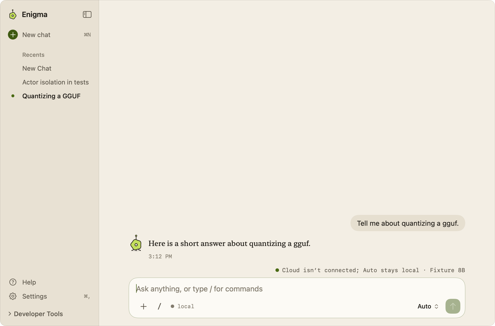
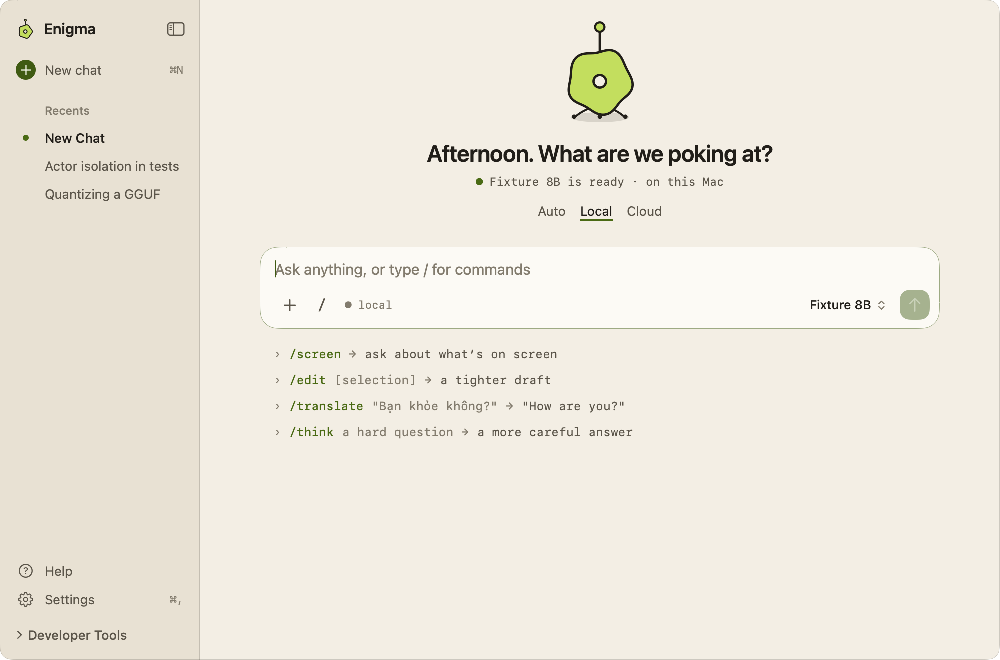
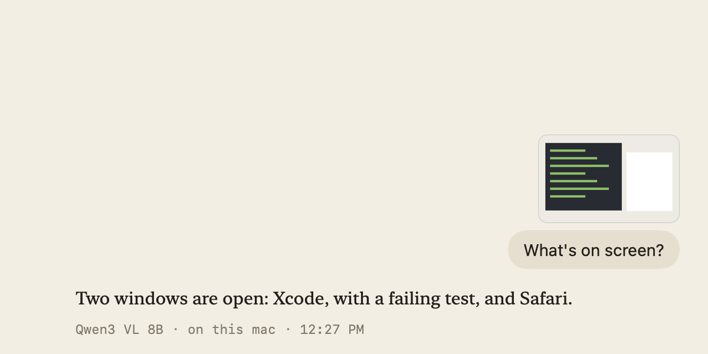

# Chat

Enigma's main window is a chat with a local or cloud model. Type a question in
the composer and press **Return**; the reply streams in beside the Enigma
character, and the conversation is saved to the sidebar's **Recents**.

## Using chat

### The main window

- **Sidebar.** The Enigma mark, **New chat** (**⌘N**), **Recents**, and at the
  bottom **Help**, **Settings** (**⌘,**) and **Developer Tools**. The open chat
  has a small dot. The sidebar starts hidden unless **Show sidebar** is on in
  **Settings → General → New chats**. Hide or show it with the sidebar button or
  by tapping **Control** twice. While it's hidden, a slim bar at the top keeps
  show-sidebar, **New chat**, **Help** and **Settings** in reach.
- **Empty page.** A new chat shows the character, a greeting, the route's status
  line (for example "Fixture 8B is ready · on this Mac"), the **Auto / Local /
  Cloud** routing control, the composer, and a few slash commands as example
  lines. Clicking an example puts that command in the composer.
- **Conversation.** After the first send the composer moves to the bottom and the
  conversation fills the space above it. Your messages are right-aligned bubbles
  in the system font. Replies are set in a serif, with a monospace meta line
  underneath: the model, where it ran (**on this mac** or the cloud provider),
  **brave search** if web sources were used, and the time (date and time for
  replies from an earlier day). The character sits beside the latest reply;
  earlier replies show the outline mark instead.
- **Over the composer.** The route's status line, plus any notices and cards:
  a trimmed-context notice, attached selection, screenshot, files, a Messages
  send approval, or errors.

### The composer

The composer holds the message field ("Ask anything, or type / for commands"),
**Attach files** (**+**, also **⇧⌥F**), a **/** button that starts a command, a
**● local** or **○ cloud** indicator for where the next request runs, the
**Mode and model** menu (**⌘K**), and **Send**.

- **Return** sends; **⇧Return** inserts a new line. Send is available only when
  the draft isn't empty and the selected mode has a usable model.
- While a reply runs, **Send** becomes **Stop** (also **⌘.**) and the composer is
  disabled until the request ends.
- Slash commands such as **/search**, **/think**, **/screen** and **/snapshot**
  apply to one message. See [Slash-Commands.md](Slash-Commands.md).
- Choosing a mode or model while a request runs applies to the next request; the
  menu's mode section reads **Next request**.

Other shortcuts in the window: **⌃Tab** opens the next recent chat, and **Esc**
closes an open menu or, with none open, hides the window.

### Streaming, scrolling and thinking

- Your message appears as soon as you send. The draft stays recoverable until the
  request is accepted: if preparation fails, for example because the message is
  too large for the model, the error appears in the status line and your draft is
  still in the composer.
- Before the first words arrive, the reply row shows the request's status line
  (see below) and the character thinks. Once text arrives it streams into the
  reply and the character answers. Model reasoning is never shown, only the
  answer.
- **Stop** keeps whatever text has already arrived.
- Replies render Markdown: headings, lists, emphasis, inline and fenced code,
  links, block quotes and tables. Code and tables scroll sideways when they're
  wide. Reply and message text can be selected and copied.
- The chat opens at its end and follows new text while you're at the bottom.
  Scroll up and it stops following, so you can read earlier messages while a
  reply streams; scroll back to the bottom and it follows again.

**/think** asks for a more careful answer for that one message. It adds checking
guidance to the request and gives the model more room: local models reserve
2,048 output tokens instead of 512, and models that support it get a thinking
budget or a higher reasoning effort.

### Activity and sources

Each reply has a monospace status line that opens into its activity. While a
request runs it shows the current step, such as **Analyzing query…**,
**Searching…**, **Reading sources (3)…**, **Thinking…** or **Generating
response…**. When it ends it reads **Activity**, **Stopped** or **Request
failed**, with the source count if web search was used.

Click it to see the steps and, for searched replies, the **web sources**: each
row shows the page title, the site, whether its excerpt was **Included in
context**, and the address, and opens the page in your browser. The list scrolls
when it's long. Only excerpts that fit in the model's context are listed; a
listed source means its excerpt was sent, not that the full page was read.

### Attachments in the chat

- **Files and folders** attached with **+** appear by name above the message they
  were sent with. Sending moves them into that message and clears the composer's
  attachment; the next message has no file access unless you attach again. See
  [File-Mode.md](File-Mode.md).
- **Screenshots** from **/screen** or **/snapshot** appear as a small preview above
  the message. See [Screen-Skill.md](Screen-Skill.md).
- **Selected text** from another app appears as a card over the composer and goes
  with the first message. See [Selection-Context.md](Selection-Context.md).

### Chat history

- **Recents** lists your chats, newest activity first. A chat is titled with the
  first 48 characters of its first message ("New Chat" until then).
- Enigma keeps the **10 most recently active chats**. Older chats are dropped
  for good, and an empty new chat counts toward the ten.
- You can't switch chats while a request is running.
- **Temporary chats.** A chat started from selected text in the compact panel is
  temporary: it's marked **temporary · not saved** and nothing of it is written
  to disk. Opening it in the window saves it to history, unless **Keep selection
  chats private** is on in **Settings → Selection**. A private chat stays
  temporary, stays out of Recents, and is gone when you start another chat.

## Privacy

Chats are stored on this Mac in `~/Library/Application Support/AI Spotlight/chats.json`.
Each chat saves its title, timestamps, and messages: text, the web sources a
reply used, and the names (not contents) of files and folders sent with a
message. A chat also remembers files attached but not yet sent, so they're still
attached when you come back to it.

These are never saved: screenshot pixels, selected text from other apps, request
activity, the **/think** flag, and the model and route shown in the meta line.
After a relaunch, older replies show only what was saved, for example a meta line
with just the time.

Where a message is sent depends on the mode: **Local** stays on this Mac, **Cloud**
sends the conversation context to the chosen provider, and **Auto** decides per
request. See [Local-Model-Selection.md](Local-Model-Selection.md) and
[Cloud-Model-Selection.md](Cloud-Model-Selection.md).

## How it works

### Request lifecycle

`LocalChatViewModel` (`Enigma/LocalInference/LocalChatViewModel.swift`) owns the
sessions, the selected chat, and the running request for every route. Despite its
name it also drives cloud, Auto, Screen, File Mode and Messages requests.

- `AppShellView` (`Enigma/App/AppShellView.swift`) turns a Send into a
  `ComposerSubmission` (`Enigma/App/ComposerSubmission.swift`): plain chat,
  files, Messages, screen capture, or a conflict message.
- `beginGeneration` creates an `ActiveRequest` and a fresh `AssistantActivity`.
  Every later event checks that its request still owns the generation, so late
  tokens or errors from a stopped or replaced request are ignored.
- For local and searched requests, the user message is shown at once as
  `pendingUserMessage`. It's written to the session only after preparation
  succeeds; then `onAccepted` clears the draft. The composer hides the retained
  draft while the pending bubble is visible.
- Fragments append to the assistant message; `stopStreaming()` revokes ownership,
  cancels the task, and flushes history.

### Presentation

- `ConversationTranscript` (`Enigma/Chat/EnigmaConversationLogic.swift`) builds
  the rows, decides which reply holds the character's slot, and stands in a reply
  row for a request that's still preparing. `ReplyMetaLine` formats the meta line
  from the reply's session-only `ReplyOrigin`.
- `EnigmaMessageList` (`Enigma/Chat/EnigmaMessageList.swift`) lays out the rows
  and is reused by the compact panel. Its `ConversationScrollObserver` watches the
  native scroll view: it follows only while within 2 pt of the bottom, stops on
  live scrolling, wheel or key navigation, coalesces scroll corrections for 30 ms,
  and treats layout changes (such as the waiting row being replaced) as layout,
  not navigation. The list gets a new identity per chat, so each opens at its end.
- `ChatMarkdownView` (`Enigma/Chat/ChatMarkdownView.swift`) renders Foundation's
  Markdown parse as native blocks. `ChatResponseNormalizer`
  (`Enigma/Chat/ChatMarkdown.swift`) repairs clearly escaped formatting and odd
  whitespace for display only, leaving code, paths and URLs alone; stored text is
  unchanged. `ChatResponseStyle` (`Enigma/Chat/ChatContext.swift`) asks every
  provider for concise, standard Markdown.
- `EnigmaMainColumn` and `EnigmaMainPageHeader` (`Enigma/App/EnigmaMainPage.swift`)
  switch between the empty page and the docked conversation. `EnigmaComposer`
  (`Enigma/App/EnigmaComposer.swift`), `EnigmaSidebar`
  (`Enigma/App/EnigmaSidebar.swift`) and `ChatHistoryList`
  (`Enigma/App/ChatHistoryList.swift`) draw the rest. `ShellPresentation`
  (`Enigma/App/ShellPresentation.swift`) holds sidebar visibility, the routing
  mode and which activities are expanded. The visual rules are in
  [design/UI-Style.md](design/UI-Style.md).

### Activity

`AssistantActivityEvent` (`Enigma/Chat/AssistantActivity.swift`) carries phase,
sources-discovered and sources-selected updates from search, local orchestration
and cloud adapters (`ChatEvent.activity`). `AssistantActivity` reduces them into
the snapshot that `AssistantActivityView` (`Enigma/Chat/AssistantActivityView.swift`)
draws, independent of provider. Only safe http(s) links are listed, each URL once.
Once sources are selected, only those appear. Activity is session-only; a saved
reply's `searchSources` are shown through the same view without a step timeline.

### History

`ChatSession` and `ChatMessage` are in `Enigma/Chat/ChatDomain.swift`.
`ChatMessage` encodes only `id`, `role`, `content`, `searchSources`, `createdAt`
and `attachments`; everything else is session-only. `ChatSessionStore`
(`Enigma/Chat/ChatSessionStore.swift`) loads and atomically writes `chats.json`,
sorted by last activity and capped at `maximumRetainedSessions` (10).

`ChatSessionWriter` keeps saves off the main thread: one write at a time on a
utility queue, and one replaceable pending snapshot so an older save can never
overwrite a newer one. Streamed fragments are coalesced into a save every 500 ms.
New chats, accepted messages and attachment changes save right away; Stop,
completion, failure and the app becoming inactive flush pending changes. A
temporary chat is filtered out of every snapshot.

### Context budgets

The saved chat is always the full transcript. Each request sends a trimmed copy,
built by `ChatContextPreparer` (`Enigma/Chat/ChatContext.swift`):

- The current message is always included. If it can't fit on its own, the request
  is rejected before anything is saved and the draft is kept.
- Earlier history is added as **complete user/assistant pairs**, newest first,
  until the next pair would not fit. Unanswered messages and empty replies are
  skipped; a partial reply that was stopped still counts.
- When anything is left out, a notice over the composer says how many earlier
  messages were omitted and that saved history is unchanged.
- Attached selection or file context is expanded into the request copy only
  (`ConversationContextPrompt` in `Enigma/Chat/ConversationContext.swift`).

A `ContextBudget` gives the input allowance as the smaller of an input cap and
`context window − output reserve − protocol reserve`.

**Local** (`Enigma/LocalInference/`):

- The context window comes from the model's vision configuration, then its
  catalog recommendation, then a 4,096-token fallback.
- The output reserve is 512 tokens, or 2,048 with **/think**.
- Text-only models run in the embedded engine (`LlamaCPPModelEngine.swift` and
  `Packages/LlamaBridge`). Tokens are counted exactly with the model's chat
  template, the context is capped at the model's training context, and one spare
  token is reserved. A model without a usable chat template is refused. Each
  completion clears the KV cache and replays only the prepared conversation.
- Vision-capable models run in a local llama-server (`LlamaServerVisionEngine.swift`,
  `LocalMultimodalClient.swift`) with a 256-token protocol reserve and 4,096 extra
  tokens for an image. Tokens are counted with the server's `apply-template` and
  `tokenize` endpoints, using the same system message and thinking settings as
  generation. If those endpoints aren't available, it falls back to a byte
  estimate (UTF-8 bytes plus 32 per message) until the runtime reloads. Context
  shifting and prompt caching are off.

**Cloud** (`ModelContextPolicy.cloud` and `CloudContext`): input is counted as one
token per UTF-8 byte of the serialized messages, which deliberately overestimates.
No tokenizer or network call is used. Every cloud client checks the budget again
before sending.

| Provider | Context window | Output reserve | Protocol reserve | Input cap |
|---|---:|---:|---:|---:|
| OpenAI, Anthropic, Gemini | Reviewed model's published limit; 8,192 otherwise | 4,096 (lower if the model's maximum is lower), sent as the max-output parameter | 512 | 32,768 |
| ChatGPT via Codex | 1,050,000 for the reviewed GPT-5.6 models; 32,768 otherwise | 128,000; 16,384 otherwise | 8,192 | 32,768 |
| Claude via Claude Code | 200,000 for its listed aliases; 65,536 otherwise | 32,000; 8,192 otherwise | 16,384 | 32,768 |

Per-model limits and how models are reviewed are in
[Cloud-Model-Selection.md](Cloud-Model-Selection.md). These are application
policy; they don't certify a provider's real limits or your account's access.

Web search evidence is fitted into the same budget: it takes up to half of what's
left after the current question, and recent history is added only after the
evidence fits. See [Web-Search.md](Web-Search.md).

## Limitations

- History is best effort. There are no backups or retries, a failed save shows no
  warning, and a crash or forced quit can lose the last moments of a reply. If
  `chats.json` can't be read, the app starts with an empty history.
- Only the 10 most recently active chats are kept. Chats can't be renamed,
  deleted individually, or searched.
- The composer is disabled while a reply runs; you can't type the next message
  until it finishes or you press **Stop**.
- Cloud history trimming uses a conservative byte count, so it can keep less
  history than the provider would actually accept. Unreviewed or manually entered
  models get small default windows.
- Every request's input is capped at 32,768 tokens for cloud models, however large
  the model's window.
- Screenshots and request activity aren't saved, so they're gone after a relaunch.

## Tests

- `EnigmaTests/ChatContextTests.swift`: budgets, complete-turn trimming, cloud
  byte counting, the native and server tokenizer paths, and (`ChatMarkdownTests`)
  Markdown normalization and parsing.
- `EnigmaTests/ChatPersistenceTests.swift`: retention, archive loading, excluded
  fields, and `ChatSessionWriter` coalescing and write ordering.
- `EnigmaTests/RequestLifecycleTests.swift`: request ownership, Stop,
  replacement, draft preservation, partial output, and saves during streaming.
- `EnigmaTests/EnigmaConversationTests.swift`: transcript rows, the character's
  slot, meta lines, list layout and scrolling, sent images and activity.
- `EnigmaTests/ScreenViewTests.swift`: the scroll observer while streaming and
  while reading, and typing after Stop with a blocked save.
- `EnigmaTests/AppShellStateTests.swift`: `ShellPresentation`,
  `ComposerSubmission` and `ChatHistoryList`.
- `EnigmaTests/EnigmaMainWindowTests.swift`: the main page, composer and sidebar.
- `EnigmaTests/WebSearchTests.swift`: activity events, source selection and
  evidence packing.
- `EnigmaTests/LocalInferenceTests.swift`: streaming partial Markdown, failures
  and Stop on the local route.
- `EnigmaTests/EnigmaCompactPanelTests.swift`: temporary and private selection
  chats.
