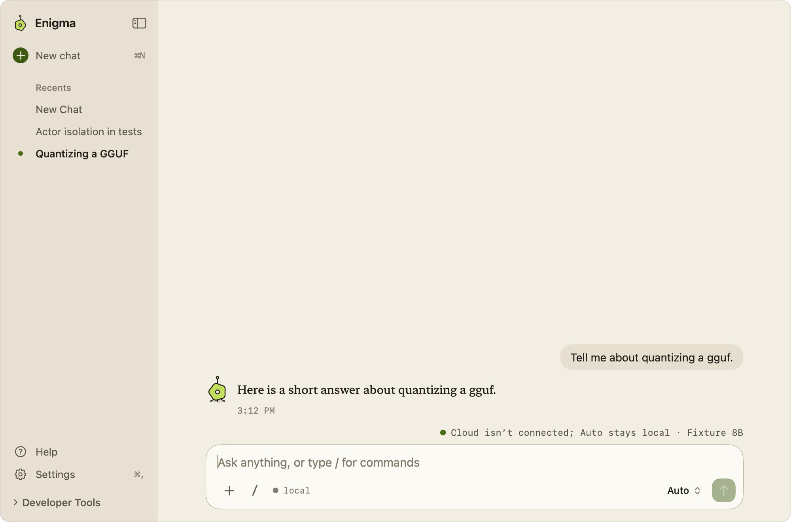
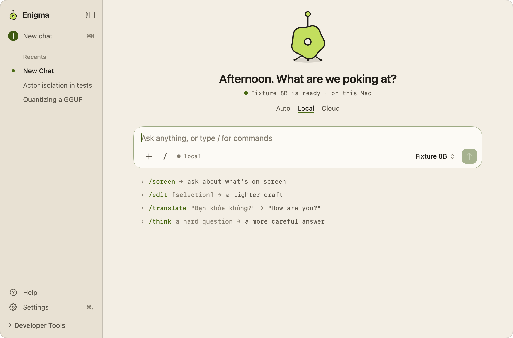
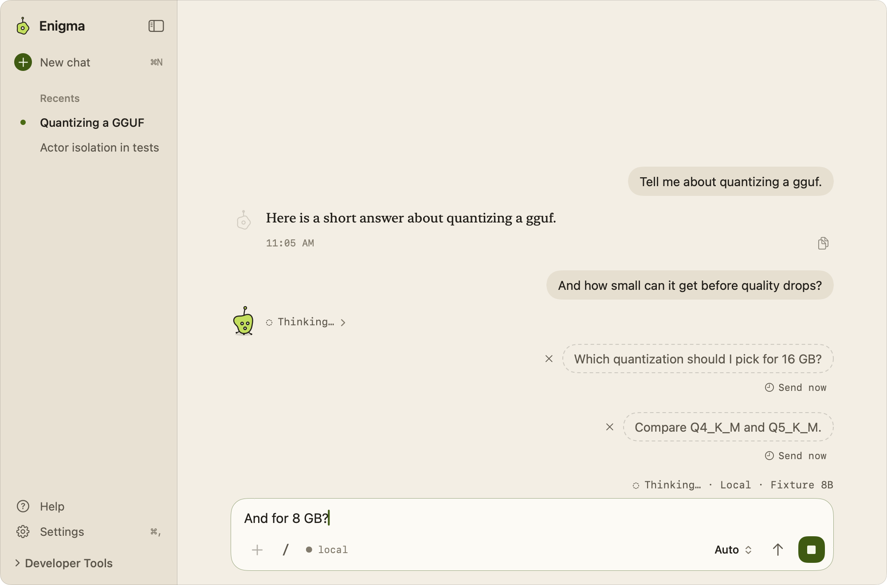
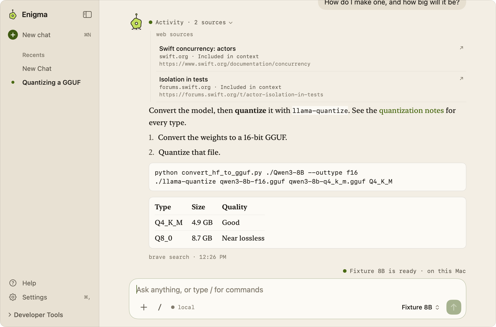
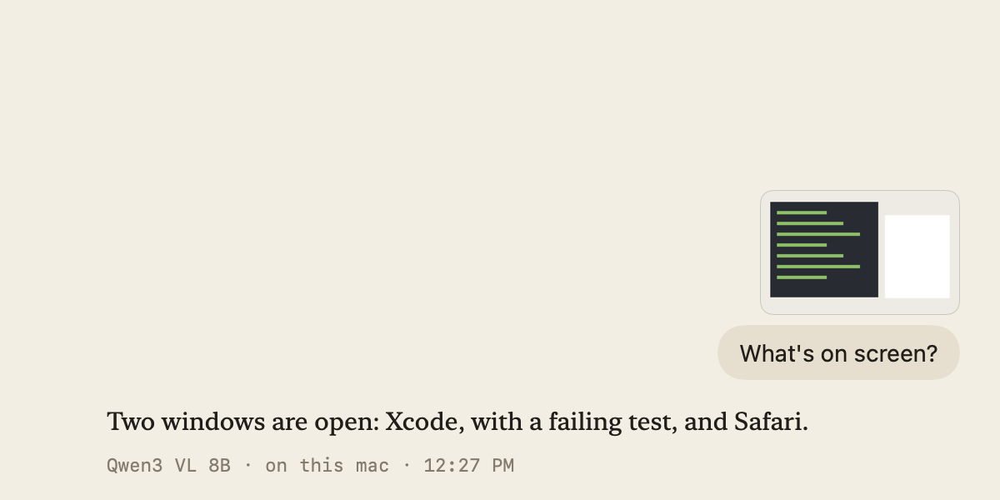
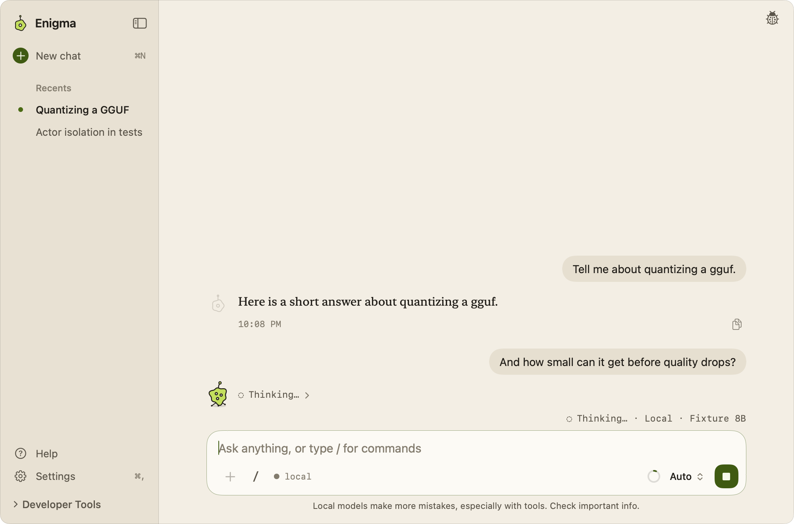

# Chat

Enigma's main window is a chat with a local or cloud model. Type a question in
the composer and press **Return**; the reply streams in beside the Enigma
character, and the conversation is saved to the sidebar's **Recents**.

## Using chat

### The main window

- **Sidebar.** The Enigma mark, **New chat** (**⌘N**), **Recents**, and at the
  bottom **Help** and **Settings** (**⌘,**); Debug builds also show **Developer
  Tools**. The open chat
  has a small dot. The sidebar starts hidden unless **Show sidebar** is on in
  **Settings → General → New chats**. Hide or show it with the sidebar button or
  with **⌃⌘S**. While it's hidden, a slim bar at the top keeps
  show-sidebar, **New chat**, **Help** and **Settings** in reach.
- **What's new?** After an update, an outlined **What's new?** button sits at
  the right end of that bar, which then shows with the sidebar up too, until
  it's opened. It shows the release notes since the last version you saw; see
  [Updates](Updates.md).
- **Empty page.** A new chat shows the character, a greeting, the route's status
  line (for example "Fixture 8B is ready · on this Mac"), the **Auto / Local /
  Cloud** routing control, the composer, and a few slash commands as example
  lines. Clicking an example puts that command in the composer.
- **Conversation.** After the first send the composer moves to the bottom and the
  conversation fills the space above it. Your messages are right-aligned bubbles
  in the system font. Replies are set in a serif, with a monospace meta line
  underneath: the model, where it ran (**on this mac** or the cloud provider),
  **web search** if web sources were used (**brave search** when a saved Brave
  key answered, until Enigma restarts), and the time (date and time for
  replies from an earlier day). The character sits beside the latest reply;
  earlier replies show the outline mark instead. A finished reply that used
  places from Apple Maps shows a map card under it, with numbered pins that open
  the places in Apple Maps and **Open in Maps**; the card is for this session
  only and isn't saved. A weather answer starts with a weather card, one per
  place, as soon as the forecast arrives, with the description streaming in
  under it; while it shows on the latest reply the character wears something
  for the weather, with a puff of smoke and a hop as it changes. Weather cards
  aren't saved either. See [Web Search](Web-Search.md#places-and-weather).
- **Over the composer.** The route's status line, plus any notices and cards:
  a trimmed-context notice, attached selection, screenshot, files, a Messages
  send approval, or errors.

### The composer

The composer holds the message field ("Ask anything, or type / for commands"),
**Attach files** (**+**, also **⇧⌘A**), a **/** button that starts a command, a
**● local** or **○ cloud** indicator for where the next request runs, chips for
any commands recognized from your wording, the **Mode and model** menu
(**⌘K**), and **Send**.

Once a chat has started, a small line under the docked composer says how far to
trust a reply. It follows the **● local** / **○ cloud** indicator: "Local models
make more mistakes, especially with tools. Check important info." on this Mac,
and "AI can make mistakes. Check important info." in the cloud (or when no
route can run). The empty page and the compact panel don't show it.

- **Return** sends; **⇧Return** inserts a new line. Send is available only when
  the draft isn't empty and the selected mode has a usable model.
- While a reply runs, **Send** becomes **Stop** (also **⌘.**). The field keeps
  focus, even after you click Send, and you can keep typing, including slash
  commands and the **/** button; **Attach files** and screen capture stay off
  until the reply ends.
- **Queued messages.** Once the field has text during a reply, a second **Send**
  appears beside Stop; it and **Return** queue the message instead of sending
  it. Up to 5 messages can wait; at 5, Send and Return do nothing until one
  sends or is cancelled. Queued messages show under the reply with a dashed
  outline, an **x** that cancels them, and **Send now** with a clock under
  each. They send one at a time, in order, each when the previous reply ends,
  and become ordinary messages once sent. **Send now** stops the running reply
  and sends that message at once, ahead of the others.

    

  - A queued message can't be edited: cancel it and type it again.
  - Only text is queued. Slash commands resolve when the message sends, on the
    mode and model selected then, but a draft with **/screen** or
    **/snapshot**, or with a screenshot or files attached, stays in the field,
    so a capture is never taken at a moment you don't see. A queued message
    never takes a screenshot or files attached later for the field's draft. A
    draft of commands alone, with nothing to ask, isn't queued. A queued
    **/messages** for a cloud model that hasn't been approved for Messages
    holds the queue: approve Messages by sending a **/messages** request from
    the field, then choose **Send now** on it.
  - With **Recognize commands from your wording** on, a queued message's
    commands are recognized again when it sends, so a follow-up to a queued
    **/messages** request can use Messages without having shown its chip.
    Chips you dismissed before queueing stay off.
  - If a reply fails or is stopped, the queue holds: nothing more sends until
    you choose **Send now** on one of the messages, which sends it and
    resumes the rest. A queued message that fails before it reaches the chat
    (for example while being prepared) goes back to the front of the held
    queue. Sending from the field while the queue is held sends that message
    directly and leaves the queue held.
  - The queue lives in memory only and is never saved. **⌘N**, the selection
    shortcut and opening another chat erase it; a held queue keeps the chat
    open when you return after 5 minutes, like a draft.
  - The compact panel has no queue: its question moves to the window as soon
    as its request starts.
- Slash commands such as **/search**, **/think**, **/screen** and **/snapshot**
  apply to one message. See [Slash-Commands.md](Slash-Commands.md).
- Choosing a mode or model while a request runs applies to the next request; the
  menu's mode section reads **Next request**. A local model picked then loads
  once the reply ends. A chat too long for the new model is compacted on it
  (see [Compaction](#compaction)) instead of losing its oldest turns, except in
  File Mode.

Other shortcuts in the window: **⌃Tab** opens the next recent chat, and **Esc**
closes an open menu or, with none open, hides the window.

### Streaming, scrolling and thinking

- Your message appears as soon as you send. The draft stays recoverable until the
  request is accepted: if preparation fails, for example because the message is
  too large for the model, the error appears in the status line and your draft is
  still in the composer. The field shows blank meanwhile; anything you type
  there starts a new draft, with its own recognized commands, and stays once
  the message is accepted. If that
  send then fails, what you typed stays and the sent text is gone; typing
  exactly the sent text again shows blank, as the sent draft does.
- Queued messages sit under the running reply, after the chat, and a new one
  keeps a reader at the bottom following. When one sends, the chat brings it
  to the bottom as for any sent message. A chat whose only question was
  stopped stays open while it has queued messages, so they stay in view.
- Before the first words arrive, the reply row shows the request's status line
  (see below) and the character thinks. Once text arrives it streams into the
  reply and the character answers. Model reasoning is never shown, only the
  answer.
- **Stop** keeps whatever text has already arrived.
- Replies render Markdown: headings, lists, emphasis, inline and fenced code,
  links, block quotes and tables. Code and tables scroll sideways when they're
  wide. Reply and message text can be selected and copied.
- **Copy buttons.** Each code block has a header with its language on the left
  and a **Copy code** icon on the right that turns into a check mark for a
  moment. In a terminal block (`bash`, `sh`, `zsh`, `shell` or `console`) where
  some lines start with a `$ ` or `% ` prompt, Copy keeps only those commands,
  without the prompt, and the lines their trailing `\` continues; the rest is
  output and is left out. Only prompt lines and their `\` continuations are
  kept, so a here-document's body (`$ cat <<EOF`, then its lines) is dropped
  with the output. Without a prompt line, Copy writes the block as shown, and
  `# ` is never a prompt because it is also a comment.
  A finished reply has a **Copy reply** icon at the right of its meta line. It
  rests dimmed and brightens when you point at the reply; it stays clickable
  and visible to VoiceOver and Tab (like any button, Tab reaches it with
  Keyboard navigation on). It writes the reply as plain text, without
  Markdown marks, and as rich text that pastes cleanly into Mail or Pages.
  Plain text keeps list markers, writes block quotes as plain paragraphs and
  writes tables as tab-separated rows, empty cells included. Rich text has
  fonts, paragraph breaks, list markers, links and monospace code (Menlo) but
  no colours, so Ink's light text never pastes invisibly onto a white page.
  Copy reply copies the reply's own text only: after `/edit`, the revised
  text in the revision card under it isn't included, and a reply with only
  whitespace has no Copy reply icon.
- **Syntax colours.** Code in Swift, Python, JavaScript or TypeScript, shell,
  JSON, HTML or XML, CSS and SQL has its keywords, strings, numbers, comments,
  types and variables in different colours (the `code…` tokens in
  `docs/design/UI-Style.md`); other languages and unlabelled blocks stay
  plain. A terminal block (`bash`, `sh`, `zsh`, `shell` or `console`) has a
  terminal glyph in its header and colours commands, flags, paths and
  variables; in a session with `$ ` or `% ` prompt lines, the output lines
  are dimmed to `textSecondary`. Copy is unchanged.
- The chat opens at its end and follows new text while you're at the bottom.
  Sending a message always brings it and its reply to the bottom of the view,
  even if you had scrolled up, and the chat follows the reply again; a reply
  taller than the window scrolls the message off the top as the chat follows
  the end. Scroll up and it stops following, so you can read earlier messages
  while a reply streams; scroll back to the bottom and it follows again.

**/think** asks for a more careful answer for that one message. It adds checking
guidance to the request and gives the model more room: local models reserve
2,048 output tokens instead of 512, and models that support it get a thinking
budget or a higher reasoning effort.

### Regenerating a reply

Every reply has a **Regenerate reply** icon (↻) right under its text, styled
like **Copy reply**: dimmed at rest, brighter on hover, reachable with Tab and
VoiceOver. It gets a new answer to the same question. On an earlier reply, it
also drops every message after that reply once the new one starts:

- Only for a plain chat turn in Local, Cloud or Auto, with or without `/search`
  or `/think`. It isn't shown for Files, `/messages`, Screen or selection
  (`/edit`, `/translate`, or a message that carried a selection) turns. After
  a relaunch it shows for turns with no attachments and no `/edit` or
  `/translate`; `/think` isn't saved, so it can't be repeated then.
- It's off while a reply runs, while messages are queued, and when the
  current route can't send. It isn't shown once the chat's summary covers
  that turn (see [Compaction](#compaction)), or during the welcome tour.
- It replays the same text and `/think` choice on the current route; Auto
  routes again. It searches again only if the old reply searched, and never
  adds a search the old reply didn't have.
- The old reply, and anything after it, stays in the chat and on disk until the
  new reply's first token; meanwhile it's hidden. A failure, or Stop, before that token puts it
  back and shows the error as usual. Once the new reply starts, the old one is
  gone; earlier versions aren't kept.
- There's no shortcut, and nothing in the compact panel. A temporary chat still
  writes nothing. Actions a dropped reply took (File Mode edits, sent iMessages)
  aren't undone.

### Editing a message

Hover a message you sent and click the pencil (**Edit message**) under it to
change its text in place. Editing is how you go back in a chat: there's no
separate Rewind. **Send**, or Return, replaces that message and everything
after it with the edited message and a new reply to it. **Cancel**, or Escape,
leaves the chat exactly as it was.

- It runs on Regenerate's path, with the same rules: only plain chat turns,
  not while a reply runs or messages are queued, not for turns the chat's
  summary covers, and not during the tour. The `/think` choice is kept; slash
  commands typed in the edit are dropped, so an edit is always a plain chat
  turn.
- Nothing is removed until the new reply's first token; a failure, or Stop,
  before then leaves the chat as it was. Earlier versions aren't kept.

### Activity and sources

Each reply has a monospace status line that opens into its activity. While a
request runs it shows the current step, such as **Analyzing query…**,
**Searching…**, **Reading sources (3)…**, **Thinking…** or **Generating
response…**. When it ends it reads **Activity**, **Stopped** or **Request
failed**, with the source count if web search was used.

On a model that chooses its own tools, the status line also shows each tool as
it runs (**Searching…** for a web search, a Messages step for a read), and the
reply's sources gather every search it made. See
[Slash commands](Slash-Commands.md#models-that-choose-their-own-tools).

On ChatGPT and Claude Code the search may be the provider's own. In a chat
that holds message text, it runs only after you allow it on a card for that
provider. If the model reads a chat partway through such a reply before you
have, the reply restarts: its text and sources so far are cleared, the card
asks, and the same question runs again with the provider's search (allowed) or
without search (declined), so the chat's text never reaches a search you
didn't allow. This happens at most once per reply, and Stop during it ends the
turn. See
[Web search](Web-Search.md#cloud-models-own-search).

Click it to see the steps and, for searched replies, the **web sources**: each
row shows the page title, the site, whether its excerpt was **Included in
context**, and the address, and opens the page in your browser. The list scrolls
when it's long. Only excerpts that fit in the model's context are listed; a
listed source means its excerpt was sent, not that the full page was read.

### Permission cards

On a model that chooses its own tools, a reply can pause on a card in the chat
before a tool reads private data: **Allow reading your chat with ‹name›?**,
**Search all your messages for “‹query›”?**, or, once message text is in the
chat, **Search the web for “‹query›”?** (Enigma's search), **Find ‹what› near
you?** or **Check the weather for ‹place›?**, or **Let ‹provider› search the web
in this chat?** (ChatGPT's or Claude Code's own search). The detail line says
where the data goes (**It stays on this Mac.**, **It will be sent to ‹company›.**,
**It will be sent to search sites.**, or Brave, Apple Maps or Open-Meteo), and the
buttons are **Don't allow** (Escape), **For this conversation** and **Always**.
One card is open at a time; the reply carries on once you answer, and Stop or
a new chat answers Don't allow. Other chats can't be opened while it waits. A chat holding message text
can also ask **Send text from your messages to ‹company›?** before a cloud
model gets it. See [Messages](Messages.md#permission-cards).

### Attachments in the chat

- **Files and folders** attached with **+** appear by name above the message they
  were sent with. Sending moves them into that message and clears the composer's
  attachment; the next message has no file access unless you attach again. See
  [File-Mode.md](File-Mode.md).
- **Screenshots** from **/screen** or **/snapshot** appear as a small preview above
  the message. See [Screen-Skill.md](Screen-Skill.md).
- **Selected text** from another app goes with the first message and appears as
  its own bubble above it; until it's sent, the window shows it as a card over
  the composer. See [Selection-Context.md](Selection-Context.md).

### Chat history

- **Recents** lists your chats, newest activity first. A chat is titled with the
  first 48 characters of its first message ("New Chat" until then).
- **Short titles.** Once a chat's first reply finishes (a failed or stopped
  first try doesn't count), the chat's own model
  writes a short title for it (about 2–6 words, such as "Weekend trip to
  Lisbon"), which replaces the 48-character one. It uses the same model and
  provider as the chat, and sends only the question that reply answered and
  the start of the reply. It runs after the reply, so it never delays your next message;
  sending one first cancels it. A chat is titled once. If the call fails, is
  cancelled, or the model's answer isn't 1–8 words and at most 48 characters,
  the first-message title stays. Temporary chats aren't titled, unless one
  moves to the window as an ordinary chat.
- Enigma keeps the **10 most recently active chats**. Older chats are dropped
  for good. A chat with no messages is never saved or counted.
- **New chats.** Launch and **New chat** both open the empty chat page with no
  chat selected in Recents. A chat with no messages, as when you've only
  attached files, exists in memory only: it isn't written, listed in Recents
  or counted toward the ten, and leaving it (a new chat, another chat,
  cycling, or the selection shortcut) removes it. Its first message saves it,
  at the top of Recents. The one exception to the listing: a selection chat
  that just moved to the window shows in Recents while its first question is
  on its way, though it's written only once that question lands.
- **Coming back.** Summoning Enigma after more than **5 minutes** away opens a
  new chat; within 5 minutes it comes back to the chat you left. Away means
  hidden (Escape, the show/hide shortcut, or the menu bar's **Privacy Hide**)
  and not used: a request that ended while the window was hidden, finished or
  failed, counts as use, and the 5 minutes run from then. A window left open
  behind other apps is not away, and keeps its chat however long it stays
  there. You always come back to the same
  chat when there's nothing to leave (no chat, or one with no messages), when
  something is unsent (text, a screenshot or files in the composer, queued
  messages, a selection revision not yet applied or dismissed, or a File Mode
  edit waiting on **Use Codex**), or while the chat is busy: a reply, file
  work, or a model install, delete or performance check holds it. A model
  download alone doesn't.
- You can't switch chats while a request is running; **New chat** stops it
  first. Opening another chat erases any held queued messages.
- **Temporary chats.** A chat started from selected text in the compact panel is
  temporary: it's marked **temporary · not saved** and nothing of it is written
  to disk. Sending its first question, or ⌘O, moves it to the main window and
  lists it at the top of Recents, written once its first question lands, unless
  **Keep selection chats private** is on in **Settings → Selection**. A private chat stays temporary, stays out of
  Recents, and is gone when you start another chat.

## Privacy

Chats are stored on this Mac in `~/Library/Application Support/AI Spotlight/chats.json`.
Each chat saves its title, timestamps, and messages: text, the web sources a
reply used, and the names (not contents) of files and folders sent with a
message. A chat also remembers files attached but not yet sent, so they're still
attached when you come back to it.

These are never saved: screenshot pixels, selected text from other apps, request
activity, the **/think** flag, and the model and route shown in the meta line.
After a relaunch, older replies show only what was saved, for example a meta line
with just the time.

Where a message is sent depends on the mode: **Local** stays on this Mac, **Cloud**
sends the conversation context to the chosen provider, and **Auto** decides per
request. See [Local-Model-Selection.md](Local-Model-Selection.md) and
[Cloud-Model-Selection.md](Cloud-Model-Selection.md).

A chat also saves whether it holds text from your messages (a mark, never the
text), so a web search in it still asks first after a relaunch. Permission
grants for this conversation are never saved; **Always** grants are kept in
settings. See [Messages](Messages.md#permission-cards).

## How it works

### Request lifecycle

`LocalChatViewModel` (`Enigma/LocalInference/LocalChatViewModel.swift`) owns the
sessions, the selected chat, and the running request for every route. Despite its
name it also drives cloud, Auto, Screen, File Mode and Messages requests.

- `AppShellView` (`Enigma/App/AppShellView.swift`) turns a Send into a
  `ComposerSubmission` (`Enigma/App/ComposerSubmission.swift`): plain chat,
  files, Messages, screen capture, or a conflict message.
- `beginGeneration` creates an `ActiveRequest` and a fresh `AssistantActivity`.
  Every later event checks that its request still owns the generation, so late
  tokens or errors from a stopped or replaced request are ignored.
- For local and searched requests, the user message is shown at once as
  `pendingUserMessage`. It's written to the session only after preparation
  succeeds; then `onAccepted` clears the draft. The composer shows the field
  blank while that send's pending bubble is visible and the draft is still the
  one sent (`sentDraft`, keyed by the pending message's id); a keystroke
  replaces it, and `draftAfterAcceptance` keeps it. Send and Return read that
  visible draft, so a second Return never queues the message already sent.
- `LocalChatViewModel.messageQueue` holds the open chat's queued messages, a
  `MessageQueue` (`Enigma/Chat/MessageQueue.swift`): order, the cap of 5, and
  whether it's held. AppShellView installs `queuedMessageSender`, which plans
  a queued message like a typed draft with no screenshot or files on the
  current route. The view model remembers the message in flight and whether
  its `onAccepted` ran. It drains the next message on a fresh turn whenever
  something that held the chat ends (`finishGeneration`, a model operation,
  a selection replacement); AppShellView also drains when `isBusy` ends, for
  the rest, such as the file picker. A failed
  `finishGeneration`, `stopStreaming()`, or a send that starts no request holds
  the queue, returning an unaccepted message to its head. `newChat`,
  `startTemporaryChat`, and switching chats clear it. Nothing in it reaches
  `sessions` or the session writer.
- Fragments append to the assistant message; `stopStreaming()` revokes ownership,
  cancels the task, and flushes history.
- Regenerate (F3) is `resend(fromUserMessage:text:send:removed:)`, which F9's
  edit will reuse (`text` is nil for a regenerate). It records a
  `PendingResend` (the chat as it was, the ids of that message and everything
  after it, and whether that question's own reply searched), so `messages`, and with it
  `presentationMessages` and the request history, leave them out. Then
  AppShellView's `submitChat` runs the normal route. The first non-empty
  fragment (`commitResend`) removes them, with their `selectionRevisions` and
  any summary that covered one of them, and
  reports their ids so `shell.expandedActivities` drops them;
  `finishGeneration` or `stopStreaming()` before that (`restoreResend`) removes
  the new messages instead. A route that starts no request clears the mark. A
  native turn whose old reply didn't search gets `plan.withoutSearch()`. Each
  user message carries a session-only `turnKind`; the rule for which replies
  can be regenerated is `ConversationTranscript.Reply.canRegenerate(from:)`.

### Native tool turns

A route whose model has the native tools flag (`NativeTools.isCapable`) goes to
`submitNative` instead of `submit`, `submitCloud` or `submitMessages`: from
`AppShellView` for Local and Cloud, from `submitAuto` once Auto has picked a
flagged route, and from the queue. Requests with files or a screenshot keep
their own paths.

- `nativeToolPlan(for:)` makes a `NativeToolPlan` (`Enigma/Chat/AssistantToolbox.swift`)
  from the typed commands, the attached selection and the settings (automatic
  search). `submitNative` remakes it for the
  route: the search part is `.search(.provider)` when
  `NativeWebSearch.isAllowed` says so (ChatGPT or Claude Code, the pair not
  marked unavailable), and `.search(.enigma)` otherwise, with `find_places` and
  `get_weather` beside either. When
  the chat holds message text, or `/messages` was typed, a `.provider` search
  first asks `ToolPermission.providerSearchAfterMessages`; declined, the plan
  is remade with `withoutSearch()`, and allowed, the toolbox's gate delivers
  reads without a restart. `nativeToolbox` builds the
  plan's parts in a fixed order, `WebSearchTool` or `ProviderSearchPart` (the
  provider-search instruction, with `ChatRequest.providerSearch` set), the
  gated `MessagesTools` and `SelectionTools`, and merges them into an
  `AssistantToolbox`, whose instructions add the untrusted-data line.
- A provider-search turn may run twice, each at most once: when the provider
  throws `CloudProviderError.webSearchUnavailable` before the first text or
  tool call (the pair is marked unavailable in memory and the plan remade), and
  when `SavingMessagesGate` throws `ProviderSearchRestart` because a Messages
  tool is about to return message text into a provider search the user
  hasn't allowed for this chat (the result is held back, the reply is
  cleared with `restartNativeReply`, and the provider-search card asked:
  allowed keeps provider search for the second run, declined remakes the plan
  without search). Before the first run, a nearby question asks the per-provider
  location card. Provider `.sourcesSelected` events merge onto the reply,
  capped at 8.
- Local turns trim the history with `LocalToolAgent.prepare` and run
  `LocalToolAgent.runStreaming` on the same `llama-server` plain turns use,
  without unloading it after the turn. Cloud turns run the provider's streaming
  tool loop (`ToolCallingChatProvider.stream(_:toolbox:)`); Codex uses its File
  Mode client. A required tool (typed `/search`, `/edit` or `/translate`) is also
  asked for in words at the end of the last message, for the routes that can't
  force one.
- Every tool loop Enigma drives (local, OpenAI, Anthropic and Gemini) measures
  each step before sending it against the request's budget (`ToolStepBudget`,
  F35), with `ContextEstimate`: local steps message by message as
  `LocalToolAgent.prepare` counts, API steps from their wire items. A tool
  turn's history leaves room for one full-size result and the next step
  (2,560 tokens local, 8,704 cloud, at most half the budget) by dropping older turns first. After a tool result, when fewer than
  512 tokens would be left (room for the smallest search result and the next
  step), the turn's earlier `web_search` results shrink: each source keeps its
  title, site and URL, and its excerpt becomes `(excerpt removed to save space)`.
  The newest results stay whole, as the model hasn't read them; other tools'
  results are kept. If that still isn't enough, the step goes without tools:
  local steps omit them, API steps keep them defined (so earlier calls stay
  valid) with a "none" tool choice, and the system prompt gains `You can't call
  any more tools in this turn. Answer now from the results you already have, and
  say if something you needed is missing.` The step limit still applies. The
  same budget sizes each `web_search` result (see Web Search). Codex's and
  Claude Code's own loops, and a provider's own search, are outside it.
- As on plain turns, the question shows as pending and the draft clears only
  once the request is under way: a cloud turn once it's prepared, a local turn
  at the model's first text or tool call. A failure before that keeps the draft.
- Permission cards come from `toolPermissions`, a `ToolPermissionCoordinator`
  that `AppShellView` renders as a `ToolPermissionCard` after the send approval
  card. `NativeTools.logger` (category `NativeTools`) logs each flagged turn's
  route, the tools offered and each tool called, never text, queries,
  arguments or results.
- When the request ends, `applyNativeProposals` turns a proposed edit into the
  reply's revision block and appends translations to it.
- While you type in Local or Auto with a flagged local model, `AppShellView`
  calls `warmNativeTurn` on each draft change. It builds the next turn's
  toolbox and history around an empty prompt and calls
  `LlamaServerVisionEngine.warmTools`: at most every 10 seconds, or at once
  when the typed commands change, since `/think`, `/messages` and `/search`
  change the system prompt or the tools. It waits while a command is half
  typed, and a draft changed during a warm-up is looked at again when it ends.
  Only the draft's commands are read, never its text.
- `warmTools` loads a stopped server and reads the system prompt, tools and
  earlier messages into the prompt cache with a one-token request. A loaded
  server whose cache starts with the same system prompt and tools only
  restarts its idle timer, so it stays loaded while you type; one used since
  for something else reads them again. A request that starts during a warm-up
  waits for it rather than restarting the server, and stopping that request
  stops the warm-up. A model whose warm-up failed isn't loaded in the
  background again until the next send. There's no warm-up with files, a
  screenshot, a typed `/screen` or `/snapshot`, during a reply, in Cloud, or
  with the switch off.

### Presentation

- `ConversationTranscript` (`Enigma/Chat/EnigmaConversationLogic.swift`) builds
  the rows, decides which reply holds the character's slot, and stands in a reply
  row for a request that's still preparing. `ReplyMetaLine` formats the meta line
  from the reply's session-only `ReplyOrigin`.
- `EnigmaMessageList` (`Enigma/Chat/EnigmaMessageList.swift`) lays out the rows
  and is reused by the compact panel. It uses a plain `VStack` so the chat's
  height is exact: a lazy stack estimates rows it hasn't drawn, which can leave
  empty space below the messages for following to scroll into. Its
  `ConversationScrollObserver` watches the native scroll view: it follows only
  while within 2 pt of the bottom, or once the list's send revision (the id of
  the latest message you sent) changes to a message it hasn't shown, stops on
  live scrolling, wheel or key navigation, coalesces scroll corrections for
  30 ms, and treats layout changes (such as the waiting row being replaced) as
  layout, not navigation. The list
  gets a new identity per chat, so each opens at its end.
- `ChatMarkdownView` (`Enigma/Chat/ChatMarkdownView.swift`) renders Foundation's
  Markdown parse as native blocks. `ChatResponseNormalizer`
  (`Enigma/Chat/ChatMarkdown.swift`) repairs clearly escaped formatting and odd
  whitespace for display only, leaving code, paths and URLs alone; stored text is
  unchanged. `ChatResponseStyle` (`Enigma/Chat/ChatContext.swift`) asks every
  provider for concise, standard Markdown. While a reply streams,
  `ChatMarkdownStream` keeps the reply parsed up to the last point where a new
  top-level block must start (an empty line outside code, before an unindented
  line that can't continue a list) and parses only the rest on each update, so
  a long reply doesn't get slower to stream. Its blocks are the same as parsing
  the whole reply; link reference definitions and HTML blocks that span empty
  lines fall back to parsing everything.
- `CodeHighlighter` (`Enigma/Chat/CodeHighlighter.swift`) is a small built-in
  tokenizer: it reads a code block one line at a time, carrying an open block
  comment or multi-line string to the next line. `CodeHighlightCache`, kept by
  each code block view, highlights a streamed block's finished lines once and
  only its unfinished last line again on each update; it starts over when the
  code no longer extends what it read, or the language, palette or prompt
  session changes.
- `ChatCopy` (`Enigma/Chat/ChatCopy.swift`) decides what the copy buttons
  write: `copyableCode(_:language:)` for the terminal rule, and
  `plainText(_:)` and `richText(_:)` for a reply, both built from the parsed
  `ChatMarkdownBlock`s so they match what is shown. `ChatCopyButton` is the
  icon button; it writes to the `enigmaPasteboard` environment value (the
  general pasteboard unless a test sets another). A reply's button rests
  dimmed and brightens on hover, rather than being hidden, because a view at
  zero opacity can't be clicked and leaves the accessibility tree.
- `EnigmaMainColumn` and `EnigmaMainPageHeader` (`Enigma/App/EnigmaMainPage.swift`)
  switch between the empty page and the docked conversation. `EnigmaComposer`
  (`Enigma/App/EnigmaComposer.swift`), `EnigmaSidebar`
  (`Enigma/App/EnigmaSidebar.swift`) and `ChatHistoryList`
  (`Enigma/App/ChatHistoryList.swift`) draw the rest. `ShellPresentation`
  (`Enigma/App/ShellPresentation.swift`) holds sidebar visibility, the routing
  mode and which activities are expanded. The visual rules are in
  [design/UI-Style.md](design/UI-Style.md).

### Activity

`AssistantActivityEvent` (`Enigma/Chat/AssistantActivity.swift`) carries phase,
sources-discovered and sources-selected updates from search, local orchestration
and cloud adapters (`ChatEvent.activity`). `AssistantActivity` reduces them into
the snapshot that `AssistantActivityView` (`Enigma/Chat/AssistantActivityView.swift`)
draws, independent of provider. Only safe http(s) links are listed, each URL once.
Once sources are selected, only those appear. Activity is session-only; a saved
reply's `searchSources` are shown through the same view without a step timeline.

### History

`ChatSession` and `ChatMessage` are in `Enigma/Chat/ChatDomain.swift`.
`ChatMessage` encodes only `id`, `role`, `content`, `searchSources`, `createdAt`
and `attachments`; everything else is session-only. `ChatSessionStore`
(`Enigma/Chat/ChatSessionStore.swift`) loads and atomically writes `chats.json`,
sorted by last activity and capped at `maximumRetainedSessions` (10).

`ChatSessionWriter` keeps saves off the main thread: one write at a time on a
utility queue, and one replaceable pending snapshot so an older save can never
overwrite a newer one. Streamed fragments are coalesced into a save every 500 ms.
A chat's first message, later accepted messages, and attachment changes on a
chat with messages save right away; Stop, completion, failure and the app
becoming inactive flush pending changes. A temporary chat is filtered out of
every snapshot. While a reply is regenerated, the chat is saved as it was
until the new reply's first token (`PendingResend.saved`).

Short titles (F38): `finishGeneration` calls `titleInBackground` after a
successful reply, when it's the chat's first finished reply (earlier replies
whose activity ended `.cancelled` or `.failed` don't count, with or without
text) and its title is still `ChatSession.title(for:)` of the first question. The call reuses F35's
`compactionSteps` for the reply's route, with a one-message request built by
`titleRequest(question:reply:)` (the first 1,000 characters of the question,
300 of the reply). On the embedded engine it has a 24-token cap and
temperature 0. A model on the local server (vision, or native tools) gets it
as a streamed step with no tools (`streamTools`), whose stop keeps the server
loaded. When it ends, it clears `lastWarmUp` and, unless a request is running,
warms the chat's next-turn prefix again (`warmNativeTurn`), as the title took
the server's one prompt cache. A cloud route sends it through the provider's `textStream` with
the provider's own output limit and temperature. On every route the text is
read only until it's past 200 characters. No title starts while a message is
queued, or, on a local model, while a local background summary runs: both
would use the local server. The question sent is the one the first reply
with text answered. `ChatSession.generatedTitle(from:)`
cleans the output (a `<think>` block, quotes, a "Title:" label and trailing
punctuation removed; 1–8 words, at most 48 characters, or nothing), and
`applyGeneratedTitle` replaces only the first-question title. `beginGeneration`
cancels a title still running, and a local send's `waitBeforeEngine` waits for
it to let go of the engine; a model switch cancels it too, and idle unload
waits for it. A temporary chat's first exchange is remembered, in memory, and
titled only if `openTemporaryChatInWindow` makes it an ordinary chat. The
title call follows the chat's Messages-text rule (`messageTextMayGo`) and is
skipped during the tour. In the test host it's off unless a test passes
`writesTitles: true`.

`LocalChatViewModel` starts with no selected chat; `ensureSelectedSession()`
creates one, at the top, when sending or a file attachment needs it, without
writing it. `isUnsaved` covers every chat with no messages as well as the
temporary chat, so such a chat stays out of the saved file and of retention, and
`historySessions` leaves it out of Recents, apart from the selection's chat
that just moved to the window. Empty chats in the file from older versions are
dropped at load. `newChat()` stops any reply, discards a temporary chat, and
returns to no selected chat. Leaving a chat with no messages, through
`newChat()`, `selectSession`, `cycleRecentChat` or `startTemporaryChat`, removes
it (`leaveEmptyChat`). `lastRequestActivityAt` records in memory when a request
last started, streamed or ended, failed or not, without moving its chat.

The return rule is `ChatReturnPolicy` in
`Enigma/App/SpotlightPanelController.swift`, given plain values: when the panel
was hidden, the time, and a `ChatReturnState` (the later of the open chat's
last activity and `lastRequestActivityAt`, whether anything is unsent, and
`isBusy`), which the
controller reads through an injected closure from the shared chat and the
window's own `ScreenComposerCoordinator`. `SpotlightPanelController.hide()`
records when the panel was hidden (keeping the first time if it's hidden
again); every way the panel is shown clears it. `show()` asks the policy before
ordering the panel front. A new chat goes out as `.newChatRequested`, the same
path as **⌘N**, so the main window resets and a compact selection panel returns
to its normal frame; the content is laid out before the panel is ordered front.
Screen capture and a
running text replacement order the panel out without `hide()`, so they don't
count as away; an automatic paste that leaves the window hidden ends with
`hide()`, as Escape does. A selection summon starts its own temporary chat as
before, and the rule applies again once that panel is hidden.

### Context budgets

The saved chat is always the full transcript. Each request sends a trimmed copy,
built by `ChatContextPreparer` (`Enigma/Chat/ChatContext.swift`):

- The current message is always included. If it can't fit on its own, the request
  is rejected before anything is saved and the draft is kept.
- Earlier history is added as **complete user/assistant pairs**, newest first,
  until the next pair would not fit. Unanswered messages and empty replies are
  skipped; a partial reply that was stopped still counts.
- When anything is left out, a notice over the composer says how many earlier
  messages were omitted and that saved history is unchanged.
- Attached selection or file context is expanded into the request copy only
  (`ConversationContextPrompt` in `Enigma/Chat/ConversationContext.swift`).

A `ContextBudget` gives the input allowance as the smaller of an input cap and
`context window − output reserve − protocol reserve`, less Enigma's own system
prompt and tool definitions for the request (`promptTokens`), which count as
used. `PreparedConversation.usage` (`ContextUsage`) is the share of the budget a
prepared request fills: messages plus prompt, out of the allowance plus prompt.

**Local** (`Enigma/LocalInference/`):

- The context window is the one chosen for this Mac (F35): the largest of
  8K, 16K or 32K that the model's trained maximum and this Mac's memory allow,
  or the size picked under **Settings → On this Mac → › Advanced → Context
  size** (see [Local-Model-Selection.md](Local-Model-Selection.md#context-size)).
  Imported models use their vision configuration, then a 4,096-token
  fallback.
- The output reserve is 512 tokens, or 2,048 with **/think**.
- Text-only models run in the embedded engine (`LlamaCPPModelEngine.swift` and
  `Packages/LlamaBridge`). Tokens are counted exactly with the model's chat
  template, the context is capped at the model's training context, and one spare
  token is reserved. A model without a usable chat template is refused. Each
  completion clears the KV cache and replays only the prepared conversation.
- Vision-capable models run in a local llama-server (`LlamaServerVisionEngine.swift`,
  `LocalMultimodalClient.swift`) with a 256-token protocol reserve and 4,096 extra
  tokens for an image. Tokens are counted with the server's `apply-template` and
  `tokenize` endpoints, using the same system message and thinking settings as
  generation. If those endpoints aren't available, it falls back to a byte
  estimate (UTF-8 bytes plus 32 per message) until the runtime reloads. Context
  shifting is off, and so is prompt caching, except on a flagged model's tool
  turns, which reuse the cached system prompt and tool definitions (see
  [Local models](Local-Model-Selection.md#runtimes)).

**Cloud** (`ModelContextPolicy.cloud`, `ContextEstimate` and `CloudContext`): input
is estimated as `ceil(bytes / 3)` of the messages as the client serializes them
(role wrappers and JSON escaping included), plus 4,096 tokens for an image. The
system prompt and tool definitions the route's client sends are estimated the
same way and count as used (`CloudContext.promptTokens`). No tokenizer or network
call is used. Every cloud client checks the budget again before sending.

The estimate stays above OpenAI's tokenizer for English, code and JSON (checked
against `o200k_base` and `cl100k_base`). Digit-heavy text, and non-Latin text on
older tokenizers, can run over it; the input cap and reserves leave room for that
on the large windows, but a long message of mostly digits on a small-window model
can still be rejected by the provider.

Input is capped at **65,536 tokens** even on models with 1M-token windows: a
longer prompt is slower to answer, and Enigma's priority is latency.

The protocol reserve covers text a CLI adds that Enigma never sees. It was
measured on 2026-11-03 by sending a one-word message with Enigma's settings, with
and without tools, and taking the input-token count the CLI reported less
Enigma's estimate of what it sent: about 2,860 tokens for Codex 0.164.0 and 840
for Claude Code 2.1.312. Each reserve is that figure rounded up to the next
1,024, plus 25%.

| Provider | Context window | Output reserve | Protocol reserve | Input cap |
|---|---:|---:|---:|---:|
| OpenAI, Anthropic, Gemini | Reviewed model's published limit, at least 262,144; 262,144 otherwise | 4,096 (lower if the model's maximum is lower), sent as the max-output parameter | 512 | 65,536 |
| ChatGPT via Codex | 1,050,000 for the reviewed GPT-5.6 models; 262,144 otherwise | 128,000; 16,384 otherwise | 3,840 | 65,536 |
| Claude via Claude Code | 262,144 | 32,000; 8,192 otherwise | 1,280 | 65,536 |

Every cloud model is assumed to have a window of at least 262,144 tokens
(owner, 2026-11-03; `ModelContextPolicy.cloudMinimumContextWindow`): a smaller
published limit, or none, is raised to it. With the 65,536 input cap, a
request's room is then the cap less the prompt for every cloud model.

Per-model limits and how models are reviewed are in
[Cloud-Model-Selection.md](Cloud-Model-Selection.md). These are application
policy; they don't certify a provider's real limits or your account's access.

Web search evidence is fitted into the same budget: it takes up to half of what's
left after the current question, and recent history is added only after the
evidence fits. See [Web-Search.md](Web-Search.md).

#### Compaction

When a chat doesn't fit, `ChatCompactor` (`Enigma/Chat/ChatCompaction.swift`)
compacts the request copy the way Codex and Claude Code do (owner, 2026-11-03:
as small as stays useful, so a long local chat keeps working). Every send path
(local, local with tools, cloud, cloud with tools, Screen and search grounding)
runs it through one preparation in `LocalChatViewModel`, with the route's own
count, so compaction and the request always agree.

1. **Summarize everything.** Every turn, the newest too, is summarized by the
   route's own model, with no tools, into handoff notes of at most 300 words:
   what the user wants and has decided, their preferences, key facts, what's
   open and where the latest exchange left off. Each summary request is one user
   message with the instruction and the turns as JSON (a 1,024-token answer
   allowance in the embedded local engine; other runtimes and cloud clients keep
   their usual allowance). The status reads "Summarizing earlier messages…". When
   the turns are too many for one summary request, they go in at most two
   chunks of the newest turns, run oldest first, the second folding in the
   first; older turns past them, or past a turn too big for a summary request
   on its own, are left out, as Codex trims what it summarizes (when the newest
   turn is that big, nothing is summarized). If a chunk fails, the summary covers
   only the turns before it.
   A summary that is empty, over 900 tokens by the route's count (beyond what a
   one-character message counts, so a system prompt or an image isn't charged to
   it), or fails is not used.
2. **Keep what the notes can't.** As Codex does, the user's latest messages are
   kept word for word, newest first, up to 400 tokens by the cloud estimate
   (about 150 words), the first that doesn't fit cut to the room left; replies
   aren't kept. As Claude Code rereads recent files, the context attached to the
   latest summarized message that had any (a selection, say) is sent again in
   full when it takes at most a quarter of the input budget.
3. **Drop.** Whatever still doesn't fit is dropped oldest first, as before, with
   the omitted-messages notice. The summary turn goes last: when grounding or a
   tool loop prepares a compacted request again, later turns go before it.

In requests the summarized turns become one user message: "The earlier
conversation was compacted to save space. Your handoff notes on it:", the notes,
the user's latest messages as JSON and any attached context, followed by an
assistant `Understood.`, so turns still alternate on every provider. After
compaction a chat uses roughly a tenth to a fifth of its budget (more with
attached context), plus the new message.

The summary (`ChatSummary`: its notes, the user's latest messages, the last
message it covers and when; its attached context stays in memory, like a
message's own) is
kept with the chat, as the optional `summary` in `chats.json`, and in memory only
for a temporary chat. It goes with every later request, on any route, until the
chat needs compacting again; the new summary then folds the old one in. Its
copy of attached context stays even after the selection is removed, like the
message it came from. A saved
summary is never shown or edited.

In Auto, a long chat stays on this Mac and is compacted there, but Auto keeps
the latest exchange whole: the chat as it is, or, compacted, the summary (or the
longest it may become), the newest turn and the current message, must fit
locally. When they don't,
Auto answers in the cloud and says so above the reply: "Answered in the cloud:
the latest messages are too long for this Mac." Local mode always stays local.

The chat shows a quiet "Earlier messages summarized" line after the last message
the summary covers. Summarized turns don't count as omitted: the notice appears
only when the last-resort drop also left turns out. `/compact` summarizes on
request (see [Slash-Commands.md](Slash-Commands.md)). `LocalChatViewModel.contextUsage`
holds the selected chat's `ContextUsage` after each preparation, for the context
ring.

**The context ring.** A small ring in the main window's composer, before the
mode and model menu, fills clockwise from the top with the exact
share of the input budget the chat's last prepared request used: green below
70%, `contextHigh` yellow from 70%, `contextFull` red from 90%, the rest grey.
Hovering shows "<N>% of context left", adding "Earlier messages will be
summarized." from 90%; clicking it opens a popover with "<U> of <L> tokens
used" above the same line. VoiceOver reads "Context" with both lines. It
updates after each send and compaction (animated over 0.25 s, at once with
Reduce Motion), and is hidden on the empty page and in the tour.

**In the background.** After a reply finishes normally (not on Stop or an
error), a chat at 90% or more of its input budget is summarized right away, on
the route that answered, so the next send needn't wait. One compaction runs per
chat at a time. Its summary is kept only if the chat still exists and still
starts with the messages it summarized; otherwise it's discarded silently. A
send made while it runs waits for it with "Summarizing earlier messages…", for
up to 30 seconds; Stop cancels both. If it fails or times out (it's cancelled
then), that request drops turns as before instead of summarizing again. The log
records its start, finish, failure and timeout with durations and token counts
only.

## Limitations

- History is best effort. There are no backups or retries, a failed save shows no
  warning, and a crash or forced quit can lose the last moments of a reply. If
  `chats.json` can't be read, the app starts with an empty history.
- Only the 10 most recently active chats are kept. Chats can't be renamed,
  deleted individually, or searched.
- Queued messages can't be edited, can't carry attachments or captures, and
  aren't available in the compact panel. A held queue stays held after a
  message sent directly from the field succeeds; choose **Send now** to resume
  it.
- A queued message that can't start when its turn comes, for example because
  the selected mode has no usable model, holds the queue with no message of
  its own; the route status line says what's missing.
- Cloud history trimming uses an estimate (three bytes a token), not the
  provider's tokenizer. Unreviewed or manually entered models get small default
  windows.
- Every request's input is capped at 65,536 tokens for cloud models, however large
  the model's window.
- Screenshots and request activity aren't saved, so they're gone after a relaunch.
- The chat lays out every message on each update while a reply streams, so a
  very long chat costs more per update (about 2 ms at 20 messages, 13 ms at 100
  and 70 ms at 400). Enigma's chats are meant to be short.

## Tests

- `EnigmaTests/ChatContextTests.swift`: budgets, complete-turn trimming, cloud
  byte counting, the native and server tokenizer paths, and (`ChatMarkdownTests`)
  Markdown normalization and parsing, including streamed parsing matching a
  whole-reply parse at every prefix.
- `EnigmaTests/ChatCopyTests.swift`: the terminal prompt rule and its edge
  cases, a reply's plain and rich text (lists, code inside list items, empty
  table cells), RTF fonts, the pasteboard write, the hosted Copy code button
  with its check mark, and the hosted Copy reply button (clickable while dimmed,
  absent while the reply streams or has no text).
- `EnigmaTests/CodeHighlighterTests.swift`: language hints, each language's
  tokens, terminal sessions, redirects, here-documents and strings across
  lines, the palette colours, and the streaming cache matching a fresh
  highlight and reading only new lines.
- `EnigmaTests/ChatPersistenceTests.swift`: retention, archive loading, excluded
  fields, and `ChatSessionWriter` coalescing and write ordering;
  (`ChatTitleTests`) the first-question placeholder, a model title replacing
  only it and only once, the clean-up of model output, the title after the
  first reply (saved, never retitled), the fallback on failure or unusable
  output, a new send cancelling it, and temporary chats.
- `EnigmaTests/RequestLifecycleTests.swift`: request ownership, Stop,
  replacement, draft preservation, partial output, and saves during streaming;
  the message queue draining in order, holding on failure and Stop, returning
  an unaccepted message to its head, Send now, clearing on a new or other chat,
  never being saved, and counting as unsent work.
- `EnigmaTests/MessageQueueTests.swift`: the queue's order, cap, hold, resume,
  Send now, cancel and clear, and which drafts can be queued.
- `EnigmaTests/EnigmaConversationTests.swift`: transcript rows, the character's
  slot, meta lines, list layout and scrolling (including the second and third
  message staying in view, with Reduce Motion on and off), sent images and
  activity.
- `EnigmaTests/ScreenViewTests.swift`: the scroll observer while streaming and
  while reading, typing after Stop with a blocked save, and the composer draft
  and screenshot in `ChatReturnState`.
- `EnigmaTests/AppShellStateTests.swift`: `ShellPresentation` (including focus
  staying in the field during a reply),
  `ComposerSubmission`, `ChatHistoryList`, and (`ChatReturnTests`) the
  5-minute return rule and the panel controller that applies it.
- `EnigmaTests/EnigmaMainWindowTests.swift`: the main page, composer and sidebar,
  including typing during a reply, text typed just after Send, queueing with
  Return and the Send beside Stop, `/screen` staying in the field, and the
  queued rows' Send now and x.
- `EnigmaTests/WebSearchTests.swift`: activity events, source selection and
  evidence packing.
- `EnigmaTests/LocalInferenceTests.swift`: streaming partial Markdown, failures
  and Stop on the local route, launch and New chat opening no chat, empty chats
  never saved or listed, and request activity counting as use.
- `EnigmaTests/FileModeUITests.swift`: files on a chat with no messages held in
  memory and removed when you leave it.
- `EnigmaTests/EnigmaCompactPanelTests.swift`: temporary and private selection
  chats, and the 5-minute return through the hosted window.
- `EnigmaTests/SelectionContextTests.swift`: selection revisions, including
  which count as unsent work in `ChatReturnState`.
- `EnigmaTests/NativeToolRequestTests.swift`: flagged turns on the local and
  cloud tool loops, the server kept warm, the draft kept until a turn is under
  way, trimming, cards answered and Stop while one is open, and Auto sending
  flagged routes to `submitNative`; `EnigmaTests/ToolPermissionTests.swift` and
  `EnigmaConversationTests` cover the card itself and its buttons in the window.
