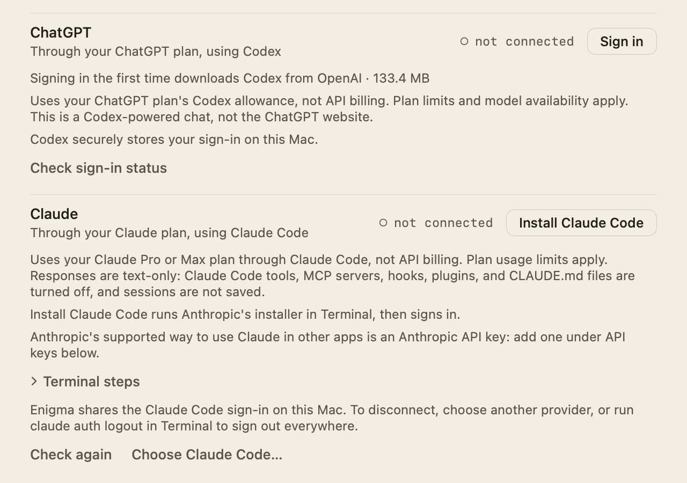

# Claude via Claude Code

Enigma can chat through your Claude Pro or Max plan by running the Claude Code
CLI on this Mac. Usage counts against the plan's Claude Code limits, not API
billing. The Anthropic API-key route is a separately billed alternative; neither
route falls back to the other.

## Setup

1. Open **Settings → Cloud and search → Subscriptions → Claude**, or the
   **Connect what you use** step of welcome setup.
2. If Claude Code isn't found, the row's main button is **Install Claude
   Code**. Enigma never bundles or downloads Claude Code itself: the button
   opens Terminal with a script that runs Anthropic's official installer,
   `curl -fsSL https://claude.ai/install.sh | bash` (from
   [Anthropic's setup guide](https://code.claude.com/docs/en/setup)), and, if
   it succeeds, the new `claude auth login --claudeai` in the same window, so
   one click covers install and sign-in. The row reads **installing** with
   **Cancel**; Enigma checks every two seconds for up to 15 minutes and, once
   signed in, selects Claude and loads its models. The **Terminal steps**
   disclosure (hidden while Enigma waits) shows the command with **Copy** and
   three steps for doing it yourself: open Terminal, paste the command and
   press Return, then come back and choose **Check again**, then **Sign in**. If Claude Code is installed somewhere
   Enigma doesn't look, **Choose Claude Code…** picks the `claude` file; Enigma
   saves that path and uses it while it is still an executable file.

   Anthropic's officially supported way to use Claude in third-party apps is an
   Anthropic API key (**API keys** on the same Settings page); the Claude row
   in Settings says so. Welcome setup leaves that note out for room.

   **Check sign-in status** (**Check again** while Claude Code is missing)
   shows **Checking…** while it runs and then always reports the result under
   the row: signed in as an account, not signed in (choose **Sign in**), Claude
   Code not found on this Mac with the folders Enigma looked in (choose
   **Install Claude Code** or **Choose Claude Code…**), or the error with a
   hint to retry.
3. If Claude Code is already signed in with a Claude subscription, the row reads
   **connected** with your email and plan. Otherwise choose **Sign in**: Enigma
   opens Terminal, which runs `claude auth login --claudeai`, and you finish in
   the browser. Enigma checks the sign-in every two seconds for up to five
   minutes; **Cancel** stops waiting. Once signed in, Claude becomes the
   preferred cloud provider and its models load.
4. If another provider is selected, choose **Use Claude**. The row then reads
   **connected · selected for cloud**.
5. Choose **Cloud** in the mode and model menu (**⌘K**). Auto can also send
   requests to the preferred cloud provider; see
   [Cloud-Model-Selection.md](Cloud-Model-Selection.md).

### Which Claude Code Enigma uses

Enigma looks for `claude` in this order and uses the first executable it finds:
`AI_SPOTLIGHT_CLAUDE_PATH` (an absolute path for developers, for example in
the Xcode scheme's Run environment); `~/.local/bin` (where the official
installer puts it), `~/.claude/local`, `/opt/homebrew/bin`, `/usr/local/bin`;
the folders Node version managers, npm and Bun install into
(`~/.nvm/versions/node/*/bin` newest first, `~/.volta/bin`, fnm's
`node-versions/*/installation/bin`, `~/.asdf/shims`, `~/.npm-global/bin`,
`~/.bun/bin`); where your shell finds it (`$SHELL -ilc 'command -v claude'`,
asked in the background with a 5-second limit, as for
[Codex](ChatGPT-Setup.md#which-codex-enigma-uses)); the
file chosen with **Choose Claude Code…**; and the app's `PATH`. Enigma doesn't
look in `~/Applications`, because Claude Code has no app-bundle layout there.

### Model and effort

The model list holds Claude Code's aliases: **Sonnet (latest)** (the default),
**Opus (latest)**, **Fable (latest)**, and **Haiku (latest)**. Each resolves to
the newest model of that family your plan offers. You can type a full model
name in **Manual model ID** under **Advanced cloud settings**; it is shown as
unverified.

The four aliases take screenshots, under the same permission as the API
providers (see [Screen-Skill.md](Screen-Skill.md)). Enigma also refreshes the
list (after checking `claude auth status`) about two minutes after launch and
then once a day while it runs, if Claude Code is your chosen provider, you chose
a Claude Code model, or Enigma has its list cached; see
[Cloud-Model-Selection.md](Cloud-Model-Selection.md#daily-refresh).

**Effort** (Model Default, Low, Medium, High, Extra High, or Max) is passed to
Claude Code as `--effort`; Model Default leaves the choice to Claude Code.
`/think` raises effort to at least High for that message.

### Disconnecting

Enigma shares the Claude Code sign-in on this Mac. To stop using Claude in
Enigma, choose another provider. Running `claude auth logout` in Terminal signs
out of both Enigma and the CLI.

## Privacy and data handling

- Enigma never reads or copies Claude Code's credentials; Claude Code keeps them
  and Enigma only runs the CLI. The only thing Enigma saves for Claude Code is
  the path chosen with **Choose Claude Code…**.
- The account check runs `claude auth status` and accepts only a `claude.ai`
  subscription sign-in. If Claude Code is signed in with Anthropic Console
  billing, Enigma shows an error and sends nothing.
- The CLI runs with a minimal environment (`HOME`, `USER`, `LOGNAME`, a fixed
  `PATH` with the `claude` executable's own folder first, so a Node-based
  install finds its `node`, `TMPDIR`, and `LANG`). It inherits no `ANTHROPIC_API_KEY`, auth
  token, base URL, or Bedrock or Vertex settings.
- Each response is a separate `claude -p` process in an empty working folder
  under `~/Library/Application Support/AI Spotlight/Claude Code`. It runs with
  `--safe-mode` (no CLAUDE.md files, skills, plugins, hooks, or custom agents),
  `--tools ""`, `--strict-mcp-config` with no MCP servers,
  `--disable-slash-commands`, and `--no-session-persistence`. Enigma's system
  prompt replaces Claude Code's own.
- Enigma sends the conversation on standard input as a bounded JSON transcript,
  up to 32,768 input tokens, and reads streamed text deltas. **Stop**
  terminates the process. Anthropic's data policies apply.
- With a screenshot, the process also gets `--input-format stream-json`, and
  standard input is one stream-json user message (`{"type":"user",…}`) whose
  content is an Anthropic base64 `image` block followed by the transcript as a
  text block; standard input then closes. Enigma never writes the screenshot to
  disk. Text-only requests send plain text as before.

With `/messages`, the process instead gets an in-process MCP server that Enigma
answers over Claude Code's stream-json control protocol, so no helper process
or network listener is involved. Built-in tools stay off and only Enigma's
Messages tools are allowed. See [Messages.md](Messages.md).

## How it works

| File | Responsibility |
| --- | --- |
| `Enigma/Cloud/ClaudeCodeSubscriptionClient.swift` | `ClaudeCodeRuntime` (executable lookup order, environment, chat and tool-mode arguments, the install command, and the Terminal install and sign-in scripts), `ClaudeCodeProcess`, `ClaudeCodeStreamParser`, and `ClaudeCodeSubscriptionClient` (account status, the model aliases, streaming). Also `ClaudeCodeEffort`. |
| `Enigma/Cloud/CommandLineToolLocator.swift` | The lookup folders shared with Codex, the "looked in" text, `PATH` with the tool's folder, and the cached login-shell question. |
| `Enigma/Cloud/CloudToolCalling.swift` | `ClaudeCodeToolMode`, which serves Enigma's MCP server for tool requests such as `/messages`. |
| `Enigma/Cloud/CloudConnectionControls.swift` | `ClaudeCodeConnectionControls`, the row shared by Settings and welcome setup. |
| `Enigma/Cloud/CloudSettingsModel.swift` | Account state, the install and sign-in polling, the chosen Claude Code path, the preferred provider and model, and effort. |
| `Enigma/Chat/ChatContext.swift` | The Claude Code context budget, which leaves room for the CLI's own prompt text. |

## Limitations

- Claude Code must be installed (by Anthropic's installer, not by Enigma) and
  signed in with a Claude subscription. Anthropic's Agent SDK documentation says
  that, unless previously approved, third-party developers may not offer
  claude.ai login or rate limits in their products; the API-key route is the
  supported one.
- Plan usage limits apply.
- Claude Code doesn't say which inputs a model takes; Enigma treats all four
  aliases as taking images because each resolves to the plan's newest model of
  its tier. Cloud File Mode uses ChatGPT via Codex, not Claude; see
  [File-Mode.md](File-Mode.md).
- Install and sign-in happen in Terminal and the browser and need your
  participation.

## Tests

`EnigmaTests/ClaudeCodeSubscriptionTests.swift` replaces the CLI with shell
scripts. It covers the process environment and flags, `/think` raising effort,
stream parsing across chunk boundaries, error results and invalid output,
account states, a missing CLI, the conversation sent on standard input
(plain text, or the exact stream-json message and arguments with a screenshot),
results without deltas, signed-out and unexpected exits, a large screenshot
when the CLI exits early or Stop is pressed (no SIGPIPE), Stop terminating the
process, settings and the default model, the Terminal sign-in flow, the install script
and the install-then-sign-in wait, cancelling it, choosing a Claude Code file,
and the context budget. `EnigmaTests/CloudToolInstallTests.swift` covers the
lookup order, the "looked in" text, the login-shell question and `PATH` with
the tool's own folder. `EnigmaTests/MessagesToolCallingTests.swift` covers the tool
mode's arguments and MCP handling. None of these tests need Claude Code, a
login, or paid requests.
