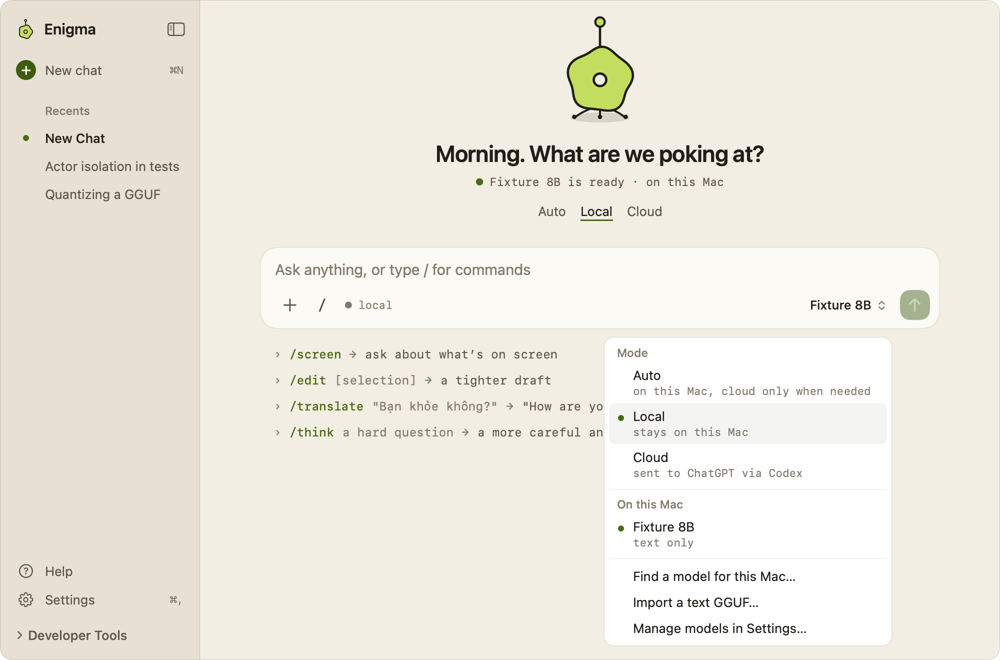
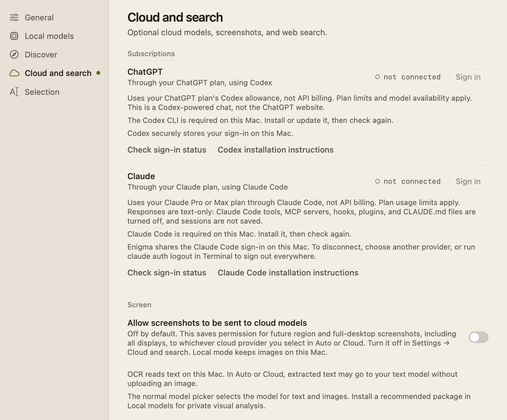

# Cloud models

Enigma can send a request to a cloud model when you choose Cloud, or when Auto
decides a request needs more than the local model. It supports five providers:
ChatGPT via Codex, Claude via Claude Code, and the OpenAI, Anthropic and Gemini
APIs with your own key. This page covers connecting them, choosing a model, and
how Auto picks between this Mac and the cloud.

## Modes

Every chat runs in one of three modes, chosen on the main page or in the
composer's mode and model menu (⌘K also opens it):

- **Auto**, *on this Mac, cloud only when needed*. The default.
- **Local**, *stays on this Mac*. Uses the selected local model only.
- **Cloud**, *sent to* the preferred provider. Uses the preferred cloud model.

The menu also lists the models for the current mode: installed local models
under **On this Mac**, and the preferred provider's models under its name, each
marked **text + images** or **text only**. A new choice made while a reply is
running applies to the next request. The composer shows where the next request
runs: **● local** or **○ cloud**. **General → Start mode** sets the mode new
chats start in (see [Welcome-and-Settings.md](Welcome-and-Settings.md)).

### How Auto decides

Auto picks a route from the request itself, without asking another model:

1. If no cloud provider is ready, Auto uses the local model and doesn't examine
   the prompt. With no local model either, it says **Choose a local model or
   connect Cloud before using Auto.**
2. If the prompt asks for a web lookup ("search the web", "latest news",
   "current price" and similar) and web search isn't on for the request, Auto
   stops with **Use /search in your message to look this up on the web.** See
   [Web-Search.md](Web-Search.md).
   This rule is skipped when the local model chooses its own tools, since the
   model can search for itself.
3. If the conversation won't fit the local model's context, Auto uses the cloud,
   provided the latest message fits the cloud budget.
4. Coding requests (for example "write a function", "debug", "stack trace", or a
   language name such as Swift or Python) go to the cloud.
5. Demanding reasoning goes to the cloud: words such as "analyze", "prove" or
   "troubleshoot", or a combination of comparison, depth and constraint words.
   Length alone never sends a request to the cloud.
6. Everything else stays on this Mac. With no local model installed, it goes to
   the cloud.

Screenshots follow the same decision, with extra rules for sending images; see
[Screen-Skill.md](Screen-Skill.md).

A chat that holds text from your messages stays on this Mac in Auto, as a typed
`/messages` does. See [Messages](Messages.md#message-text-in-a-chat).

### Native tools

Every cloud model in the catalogue calls tools natively, so in Cloud, or when
Auto picks the cloud, the model gets Enigma's tools on every message (web
search, Messages, the selection tools) and decides when to use them. On
ChatGPT via Codex and Claude Code the web search is the provider's own (in a
chat with message text, after a card); Gemini and the OpenAI and Anthropic API
keys use Enigma's `web_search`, which runs on this Mac (see
[Web search](Web-Search.md#cloud-models-own-search)); see
[Slash commands](Slash-Commands.md#models-that-choose-their-own-tools). The
flag goes by family: every `claude-*` model on the Anthropic API except the
retired Claude 2 and Instant, Gemini 2.5 and 3 text models and their `-latest`
aliases, and on the OpenAI API, Codex and Claude Code the reviewed and listed
models (`CloudModelCapabilities.supportsNativeTools`). Other model IDs, such as
Gemma on the Gemini API or an unreviewed OpenAI ID, keep the chips and rules.

The tool loops stream on every provider: OpenAI Responses, Anthropic Messages
and Gemini `streamGenerateContent` show text as it arrives and assemble each
tool call from the stream, running it only once the stream is complete. Codex
and Claude Code stream through their own clients. Calls run one at a time, at
most 12 model turns a request.

The tool-use eval (see [Local models](Local-Model-Selection.md#native-tools))
measured two cloud routes on 2026-10-28: ChatGPT via Codex with `gpt-5.6-luna`
got 58 of 60 right (0.97), and Claude Code with `sonnet` 58 of 60 (0.97). Their
first answer text with tools came 0.90× and 1.03× as soon as today's plain turn
(the gate is 1.15×). Neither followed an instruction planted in a search result;
each asked which city's marathon was meant instead of searching.

With their providers' own search (F30), the same eval measured both at 58 of 60
again on 2026-10-29. On 20 web questions ChatGPT searched on all 20 and showed
2 or more sources on 19, with a median of 7.6 s to the first answer text;
Claude Code searched on 19, showed 2 or more sources on 19, and took 16.2 s.
See the [report](history/2026-10-29-native-search-evaluation.md).

## Providers

| Provider | How it connects | Model list | Default model |
|---|---|---|---|
| **ChatGPT via Codex** | Your ChatGPT plan through the Codex CLI. See [ChatGPT-Setup.md](ChatGPT-Setup.md). | Codex's own model list, in Codex's order | The model Codex marks as its default, else the first listed, else `gpt-5.6-luna` |
| **Claude via Claude Code** | Your Claude plan through Claude Code. See [Claude-Code-Setup.md](Claude-Code-Setup.md). | Sonnet, Opus, Fable and Haiku (latest), which Claude Code resolves to the newest model your plan offers | `sonnet` |
| **OpenAI** | Your OpenAI API key | The account's models, filtered to the reviewed list below, in fallback order | First reviewed model in the account's list |
| **Anthropic** | Your Anthropic API key | The account's models, in Anthropic's order | First model listed |
| **Gemini** | Your Gemini API key | The account's models that support `generateContent`, in Google's order | First model listed |

ChatGPT via Codex is the preferred provider until you choose another. Signing in
to ChatGPT or Claude makes that provider preferred and refreshes its models.

While Enigma runs, it refreshes the ChatGPT and Claude model lists about two
minutes after launch and then once a day, in the background; see
[Daily refresh](#daily-refresh).

## Choosing a cloud model

**Settings → Cloud and search** has **Subscriptions** (ChatGPT and Claude
sign-in), the Screen and web search sections, **Advanced cloud settings**, and
**API keys**.

**Advanced cloud settings** holds:

- **Preferred provider**: the provider Cloud mode and Auto use.
- **Preferred model**: the provider's listed models. A model ID you typed that
  isn't listed appears as **Manual · *id***. Before a list loads, the row
  explains how to refresh or enter an ID.
- **Manual model ID**: type any model ID. The status line below it says whether
  it is compatible (see below).
- **Thinking capacity** (ChatGPT only, default **High**) or **Effort** (Claude
  only, default **Model Default**). `/think` raises these for one request; see
  [Slash-Commands.md](Slash-Commands.md).
- **Model list**: **Refresh Models** fetches the provider's list again.

Under **API keys**, each of **OpenAI API**, **Anthropic API** and **Gemini API**
has a secure field, **Save to Keychain** (or Return), **Remove** and **Test
connection**. A stored key reads **API key stored in Keychain**. A successful
test reads **API reachable · Compatible chat models: *N*** with the note
**Model-list check only. Sending and billing were not tested.** OpenAI API usage
is billed separately; a ChatGPT plan doesn't include it.

Your choice is saved per provider. Enigma fills in a default only when the
preference is empty; a saved or typed choice survives refreshes, provider
switches, connection tests and a later list that omits it. For ChatGPT the
default isn't saved: until you choose a model, Enigma uses Codex's current
default, so it follows Codex when the list changes. Earlier versions saved
`gpt-5.6-luna` (or, before that, the first listed model `gpt-5.6-sol`) when
nobody had chosen; that saved value is cleared once, so it follows Codex too.

### Compatibility

The status under **Manual model ID** is one of:

- **Compatible with text chat. Account access and billing are checked when you
  send.** A reviewed model ID, or (for every provider except the OpenAI API) one
  the provider listed. Codex lists only the models your plan can use through
  Codex, so every model in its list is compatible, with conservative limits
  unless it is reviewed (see [Context budgets](#context-budgets)).
- **Unverified model. You can try this ID, but text-chat support and account
  access are not confirmed.** Sending is allowed; the provider may reject it,
  and Enigma uses a conservative context budget.
- **This model cannot be used for text chat in Enigma. Choose a compatible
  model.** OpenAI image, embedding, video, speech, transcription, realtime and
  moderation families. Sending is blocked before anything leaves the Mac.
- **Choose a compatible model or enter a model ID.** Nothing selected.

A list with no compatible models is still a successful check. Settings then
says **No verified text-chat models were found. Refresh after checking model
access, or enter a model ID manually. Saved selections are kept.** Wrong keys,
rate limits, offline errors and unreadable lists are reported as errors.

Cloud mode is ready when the preferred provider is signed in or has a key and
the preferred model is compatible or unverified.

### Images

Cloud models receive screenshots only when you allow it (see
[Screen-Skill.md](Screen-Skill.md)) and only if the model takes images. For the
API providers that means the reviewed image list:

- OpenAI: `gpt-5.4-mini`, `gpt-5-mini`, `gpt-4.1-mini`, `gpt-4.1`,
  `gpt-4o-mini`, `gpt-4o` and their listed snapshots.
- Anthropic: `claude-sonnet-4-6`, `claude-opus-4-6`, `claude-haiku-4-5`,
  `claude-sonnet-4-5`, `claude-sonnet-4-20250514`, `claude-opus-4-20250514`,
  `claude-3-7-sonnet-20250219`, `claude-3-5-haiku-20241022` and listed
  snapshots.
- Gemini: `gemini-2.5-flash`, `gemini-2.5-pro`, `gemini-2.5-flash-lite`.

For the subscription routes:

- **ChatGPT via Codex**: the models whose entry in Codex's `model/list` has
  `"image"` in `inputModalities` (the app server treats a missing field as text
  and image). A list cached by an earlier Enigma, which didn't record this,
  counts as text-only until the next refresh. The screenshot goes in the
  `turn/start` input as an `image` item with a `data:` URL, before the text;
  Enigma never writes it to disk.
- **Claude via Claude Code**: all four aliases, since each resolves to the
  plan's newest model of its tier and those take images. A request with a
  screenshot runs `claude -p --input-format stream-json` and writes one user
  message to standard input: an Anthropic base64 `image` block, then the text.
  Text-only requests still send plain text.

A model's name never grants image support.

## Privacy

- Nothing goes to a cloud provider in Local mode. In Auto, only requests routed
  to the cloud are sent.
- API keys are stored in the macOS Keychain. Checking whether a key exists
  doesn't read the key, so it never triggers a Keychain prompt.
- A model-list check or **Test connection** sends no prompt.
- OpenAI requests set `store: false`.
- ChatGPT requests run in temporary Codex threads with a read-only sandbox, no
  approvals and an instruction not to use tools. Claude requests run in a fresh
  Claude Code process with tools, MCP servers, hooks, plugins and CLAUDE.md
  turned off and no saved session. Neither inherits API keys from Enigma. With
  native tools, each gets only Enigma's tools: Codex as dynamic tools in an
  empty workspace that declines every native approval, Claude Code as one
  in-process MCP server with its built-in tools disabled.
- With native tools, the model chooses when to search, read Messages or propose
  an edit, but message text reaches it only after you answer a card for that
  chat and company. See [Messages](Messages.md#permission-cards).
- Screenshots go to ChatGPT via Codex and Claude via Claude Code under the same
  permission as to the API providers, and only to models that take images.
- The cached model lists (`cloud-models.json` in Application Support) hold model
  IDs, names, and for Codex each model's input types and default flag.
- The daily refresh only checks sign-in and lists models; it never sends a
  prompt or reads Enigma's Keychain items, and does nothing for a route whose
  command-line tool isn't on this Mac.

## How it works

| Area | Types | Files |
|---|---|---|
| Providers, models, errors | `CloudProviderID`, `CloudModel`, `CloudProviderError` | `Enigma/Cloud/CloudDomain.swift` |
| Compatibility and limits | `CloudModelCapabilities`, `CloudModelCompatibility` | `Enigma/Cloud/CloudModelCapabilities.swift` |
| Image support | `CloudModelCapabilities.visionModelIDs`, `CloudModel.supportsVision` | `Enigma/Screen/ScreenRoutingPolicy.swift` |
| Model lists and cache | `CloudModelCatalog`, `CodexListedModels` | `Enigma/Cloud/CloudModelCatalog.swift`, `Enigma/Cloud/CloudDomain.swift` |
| Daily refresh | `DailySchedule`, `SubscriptionModelRefresh`, `CodexRuntime.maintainDaily` | `Enigma/Cloud/SubscriptionModelRefresh.swift`, `Enigma/Cloud/CodexRuntimeInstaller.swift`, `Enigma/App/ApplicationDelegate.swift` |
| Preferences and connection state | `CloudSettingsModel`, `CloudPreferencesStore` | `Enigma/Cloud/CloudSettingsModel.swift` |
| Settings UI | `CloudSettingsPage`, `AdvancedCloudSettings`, `APIKeyRow`, `CloudSettingsForm` | `Enigma/Cloud/CloudSettingsPage.swift`, `Enigma/Cloud/CloudSettingsForm.swift`, `Enigma/Cloud/CloudConnectionControls.swift` |
| API clients | `OpenAIResponsesClient`, `AnthropicMessagesClient`, `GeminiContentClient`, `CloudProviderRegistry` | `Enigma/Cloud/CloudProviderClients.swift`, `Enigma/Cloud/GeminiContentClient.swift` |
| Subscription clients | `CodexSubscriptionClient`, `ClaudeCodeSubscriptionClient` | `Enigma/Cloud/CodexSubscriptionClient.swift`, `Enigma/Cloud/CodexAppServer.swift`, `Enigma/Cloud/ClaudeCodeSubscriptionClient.swift` |
| Keychain | `KeychainCredentialStore` | `Enigma/Cloud/KeychainCredentialStore.swift` |
| Routing and budgets | `AutoRouter`, `ModelContextPolicy`, `CloudContext` | `Enigma/Chat/AutoRouter.swift`, `Enigma/Chat/ChatContext.swift` |
| Native tools | `NativeTools`, `CloudModelCapabilities.supportsNativeTools`, `CloudToolLoop`, the stream assemblers | `Enigma/Chat/NativeTools.swift`, `Enigma/Cloud/CloudToolCalling.swift`, `Enigma/Cloud/CloudToolStreaming.swift` |
| Mode menu | `ModeAndModelMenu`, `ComposerRouteIndicator` | `Enigma/App/EnigmaMainWindowLogic.swift` |

The API clients stream over server-sent events: OpenAI uses
`POST /v1/responses`, Anthropic `POST /v1/messages`, and Gemini
`streamGenerateContent`. Model lists come from `/v1/models` (OpenAI and
Anthropic), `v1beta/models` (Gemini), Codex's `model/list` (hidden models
excluded) and Claude Code's sign-in status (the four aliases are fixed).

`CloudModelCatalog` caches each provider's raw list for 24 hours. Every read
reapplies the current compatibility rules and drops empty, duplicate and
wrong-provider entries, so a rules change takes effect without a refresh.
`CloudContext.prepare` rejects an unsupported model before any request is built.
A fetch saves its list only if nothing changed that provider's cache since it
began, so a refresh finishing after sign-out, or after a newer refresh, can't
bring back an old list. Whenever the catalog reads or writes the cache, it hands the ChatGPT list (even
a stale one) to `CodexListedModels`, which checks that know only a model ID
(screen routing, the request guard, context budgets) use; signing out clears it.
At launch Enigma reads the cache once so this (and Codex's default) is known
before any refresh.

### Daily refresh

`DailySchedule` runs `SubscriptionModelRefresh` about two minutes after launch
and then 24 hours after each run finishes, or one hour after a run whose
refresh failed (for example offline at login). It checks the wall clock every
ten minutes, so a run that fell due while the Mac slept happens once soon after
wake, not once per missed day. A route that isn't signed in has nothing to
refresh, which doesn't count as a failure. Each run:

1. If a Codex is found and there is a local sign that you may use ChatGPT
   (ChatGPT is your chosen provider, you chose a ChatGPT model, or a ChatGPT
   list is cached), asks Codex whether ChatGPT is signed in (`account/read`).
   Without such a sign Codex isn't started, so no app server stays running.
   `CodexRuntime.maintainDaily` then upgrades Enigma's Codex like the launch
   upgrade, or, for someone signed in whose Codex is an older, OpenAI-signed
   system install, installs Enigma's pinned Codex (see
   [ChatGPT-Setup.md](ChatGPT-Setup.md)).
   A running Codex app server restarts on its next request once nothing is in
   flight and the lookup finds a different Codex than the one it started from
   (after any install), so a streaming reply is never cut off. If signed in, the
   run then force-refreshes the ChatGPT list (`model/list`), unless an old Codex
   is still running a reply; then it skips the list and the run is retried in an
   hour.
2. If Claude Code is found and there is a local sign that you use it (Claude
   Code is your chosen provider, you chose a Claude Code model, or its list is
   cached): force-refreshes its list, which first checks `claude auth status`.
   Status output that isn't the expected JSON (an unexpected CLI) counts as
   nothing to refresh, not as a failure to retry hourly.

Nothing is shown. A failed refresh keeps the cached list and the one on screen.
The refresh updates the menu's list when that provider is preferred.

### Context budgets

`ModelContextPolicy.cloud` gives every request a context window, a reply
reserve, a protocol reserve and a 32,768-token input cap, using
`CloudModelCapabilities` metadata where it exists. Older messages are trimmed to
fit; see [Chat.md](Chat.md).

| Route | Reviewed model | Unknown model |
|---|---|---|
| OpenAI, Anthropic, Gemini APIs | Published context; reply up to 4,096 tokens; 512 reserved | 8,192-token context; 4,096 reply; 512 reserved |
| ChatGPT via Codex | Published context and maximum output; 8,192 reserved. A Codex-listed model without a reviewed entry: 128,000 context; 32,000 output; 8,192 reserved | 32,768 context; 16,384 reply; 8,192 reserved |
| Claude via Claude Code | 200,000 context; 32,000 output; 16,384 reserved | 65,536 context; 8,192 reply; 16,384 reserved |

Anthropic models on the image list use a 200,000-token context; Gemini models on
the image list use 1,048,576. Other listed models from those providers use the
unknown-model budget.

### Sources, review date and fallback ordering

The OpenAI API needs an allowlist because its general
[Models API](https://developers.openai.com/api/reference/resources/models)
lists every model on the account, not just ones that accept Enigma's streaming
text request. Only these exact IDs are compatible. The order is the fallback
order for an empty preference: the lightweight Luna first, then smaller
general-purpose models, then larger ones. Within a row the alias comes before
its snapshots. This is a product choice, not a price comparison or a promise of
account access.

| Order | OpenAI API IDs | Context | Maximum output | Also on Codex | Source |
|---:|---|---:|---:|---|---|
| 1 | `gpt-5.6-luna` | 1,050,000 | 128,000 | Yes | [Luna](https://developers.openai.com/api/docs/models/gpt-5.6-luna) |
| 2 | `gpt-5.4-mini`, `gpt-5.4-mini-2026-03-17` | 400,000 | 128,000 | No | [GPT-5.4 Mini](https://developers.openai.com/api/docs/models/gpt-5.4-mini) |
| 3 | `gpt-5-mini` | 400,000 | 128,000 | No | [GPT-5 Mini](https://developers.openai.com/api/docs/models/gpt-5-mini) |
| 4 | `gpt-4.1-mini`, `gpt-4.1-mini-2025-04-14` | 1,047,576 | 32,768 | No | [GPT-4.1 Mini](https://developers.openai.com/api/docs/models/gpt-4.1-mini) |
| 5 | `gpt-4o-mini`, `gpt-4o-mini-2024-07-18` | 128,000 | 16,384 | No | [GPT-4o Mini](https://developers.openai.com/api/docs/models/gpt-4o-mini) |
| 6 | `gpt-5.6-terra` | 1,050,000 | 128,000 | Yes | [Terra](https://developers.openai.com/api/docs/models/gpt-5.6-terra) |
| 7 | `gpt-5.6-sol`, `gpt-5.6` | 1,050,000 | 128,000 | `gpt-5.6-sol` only | [Sol](https://developers.openai.com/api/docs/models/gpt-5.6-sol) |
| 8 | `gpt-4.1`, `gpt-4.1-2025-04-14` | 1,047,576 | 32,768 | No | [GPT-4.1](https://developers.openai.com/api/docs/models/gpt-4.1) |
| 9 | `gpt-4o`, `gpt-4o-2024-11-20`, `gpt-4o-2024-08-06` | 128,000 | 16,384 | No | [GPT-4o](https://developers.openai.com/api/docs/models/gpt-4o) |

Sources reviewed on 2026-09-04. The unsupported families are identified from
the [OpenAI model catalog](https://developers.openai.com/api/docs/models/all) by
exact name or a hyphenated prefix; that check only ever rules models out. Other
aliases, older snapshots, new models and fine-tuned IDs stay usable as
unverified manual entries.

Anthropic, Gemini, Codex and Claude Code keep their providers' own order
(Anthropic's [Models API](https://platform.claude.com/docs/en/api/models/list)
lists newer models first). The "Also on Codex" column marks the IDs with limits
for ChatGPT via Codex; the API alias `gpt-5.6` is not a Codex model ID.

To support another model automatically, check its exact ID, text modality,
endpoint, streaming support, request options and limits in the provider's
documentation, then update `CloudModelCapabilities`, this page and
`CloudModelSelectionTests`.

## Limitations

- Compatibility says nothing about quotas, billing, plan access, answer quality
  or future availability; those are only known when you send.
- The OpenAI allowlist is a reviewed subset and needs manual updates as OpenAI
  releases models.
- Unknown models get a small context budget even if the provider supports more.
  Codex-listed models without a reviewed entry get conservative limits.
- Auto's routing uses keyword rules, so it can misjudge a prompt. Choose Local or
  Cloud to override it.
- Claude Code's aliases are assumed to take images; Claude Code doesn't report
  input types.
- The OpenAI, Anthropic and Gemini API tool streams are tested against
  fixtures written from the providers' documentation and, for Anthropic, streams
  recorded through Claude Code, not against live API streams: there were no API
  keys to record or evaluate them with. The tool-use eval ran through Codex and
  Claude Code, which serve the same model families.

## Tests

The tests use controlled network and process seams and need no API key, sign-in
or paid request:

- `CloudModelSelectionTests`: the OpenAI allowlist and fallback order, mixed and
  empty lists, cache filtering, saved and manual choices, compatibility feedback,
  and shared budgets.
- `CloudModeTests` and `CloudStreamingTransportTests`: request shapes, errors,
  the 24-hour cache, streaming, cancellation and partial output.
- `AutoRouterTests`: Auto's routing rules, including no `/search` stop when the
  local model chooses its own tools.
- `CloudToolLoopTests` and the `…ToolStreamAssemblerTests` in
  `CloudToolStreamingTests.swift`: each provider's streamed tool calls (text
  only, one call, several, text between calls, a stream cut mid-call) and its
  forced tool choice.
- `CodexSubscriptionTests` and `ClaudeCodeSubscriptionTests`: the subscription
  routes, sign-in, default models, `inputModalities` parsing and old caches, and
  the exact Codex `turn/start` input and Claude Code standard input with and
  without a screenshot.
- `ScreenRoutingTests`: screenshots reach image-capable subscription models and
  still need permission.
- `SubscriptionModelRefreshTests`: the daily schedule (first run, 24 hours,
  once after wake, an hour after a failure), skipped routes and the local
  ChatGPT and Claude Code gates, kept caches and lists, the quiet Codex install
  over an older, OpenAI-signed system Codex, the app server switching to a new
  Codex only when idle, and surviving a Codex that exits mid-write.
- `EnigmaSettingsTests`: the Cloud and search page.

Run one suite with
`scripts/verify-xcode.sh test -only-testing:EnigmaTests/CloudModelSelectionTests`.
See [Testing.md](Testing.md).
