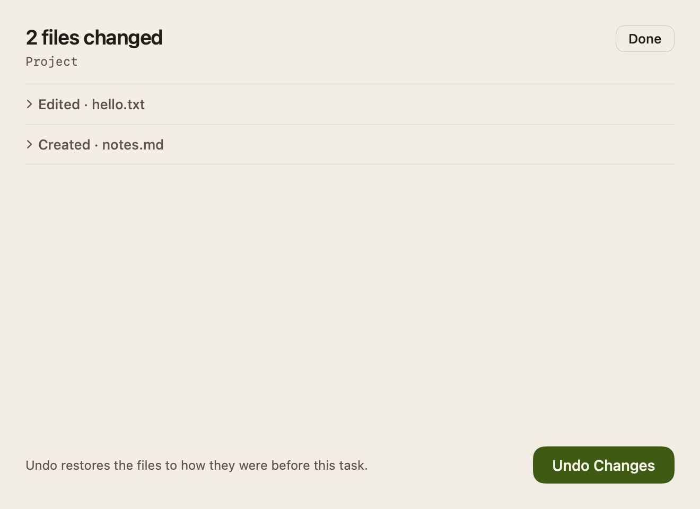
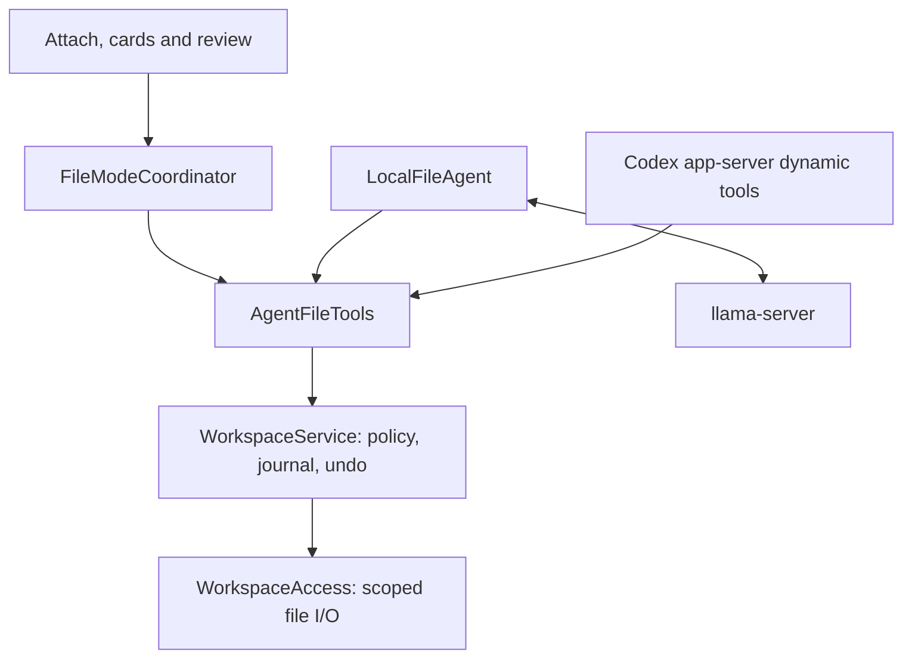

# File Mode

File Mode lets the model read, search and edit files and folders you attach. A
local model does the work on this Mac; Codex, through your ChatGPT sign-in, can
do it in the cloud with your permission. Every change is recorded first, so you
can review it and undo it.

## Attach files or a folder

Click **+** (**Attach files**) in the composer, or press **⇧⌘A**. Choose one or
more files or folders in the picker and click **Attach**. Choosing again adds
more, up to 16; a file inside a folder you've already attached is covered by that
folder and doesn't count toward the 16. Choosing more than that shows "You can
attach up to 16 files or folders." and keeps the current attachments.

A card above the composer lists each attachment with its access, **read & edit**
or **read only**, and an **×** to remove it. Removing the last one returns to
ordinary chat. Then type what you want and send, for example "Fix the typos in
notes.md" or "Summarize what this project does".


- Sending takes the attachments with the message. The sent message lists them by
  name, and the next draft starts without them; attach again to continue with the
  same files.
- Attachments you haven't sent yet stay with their chat, and a new chat starts
  without any. On a chat with no messages yet, attachments are held in memory
  only: that chat isn't saved or listed in Recents, and leaving it (a new chat,
  another chat, or cycling) removes it with its attachments. Its first message
  saves it with them. Returning to a chat doesn't open its files until you send.
- File Mode can't be combined with **/screen**, **/snapshot**, **/search** or
  **/messages**. Attaching files removes **/search** from the draft and any
  attached screenshot. **/think** works as usual, and **/translate** makes the
  request read-only. See [Slash commands](Slash-Commands.md).
- File Mode never searches the web.

## Local, Auto and Cloud

| Mode | Who does the work | Access |
| --- | --- | --- |
| **Local** or **Auto** | Your selected local model, on this Mac. Auto always keeps File Mode local. | **read & edit**, with protected files handled as below |
| **Cloud** with ChatGPT | Codex, using your ChatGPT plan | **read & edit** |
| **Cloud** with another provider | Nothing until you choose **Use Codex** | **read only** |

Without a local model, Local and Auto ask you to choose one or to use Codex.
Local File Mode also needs the small `llama-server` runtime: install it from
**Settings → On this Mac → Files → Local file tools → Install · 11 MB**.
If a compatible runtime is already on this Mac, for example from an installed
vision model, Enigma uses it instead. The download contains only the runtime and
sends none of your files.

Cloud File Mode needs a ChatGPT sign-in through Codex; the first sign-in
downloads Codex when this Mac has none. See [ChatGPT setup](ChatGPT-Setup.md).
Other cloud providers can still be used for ordinary chat.

## Safe and protected edits

In Local and Auto, Enigma classifies every change before writing it.

| Kind | Examples | What happens |
| --- | --- | --- |
| **Safe** | Plain `.md`, `.markdown`, `.txt` and `.text` files; files named note(s), plan(s), checklist(s), todo or readme; files Enigma created and that haven't changed since | The local model edits them directly. |
| **Protected** | Source code, project and configuration files, JSON, XML, scripts, RTF, unknown formats, hidden files, agent instruction files such as `AGENTS.md`, and names containing secret, credential or password | Enigma checks whether Codex is available, then asks. |

When a protected edit comes up and Codex is available, the local task stops
without changing that file and the card shows **Protected edit: …** with **Use
Codex**. Choosing it opens **Use Codex for these files?**; confirming switches to
Cloud with ChatGPT and an available Codex model, restores the attachments, and
puts your original request back in the composer if it's empty. Nothing is sent
until you press **Send**. **Cancel** sends nothing.

When Codex isn't available (offline, not installed, not signed in, or no
compatible model), the local model may make the edit anyway, and the card shows a
**Local fallback** notice with the reason. Local edits to protected files can be
less reliable, so review the result.

A file is judged by both its old and new contents and its full path, so renaming
a note to a source file or writing JSON into a `.txt` file still counts as
protected. Cloud requests through Codex skip this check: you already chose to use
Codex.

## Review and undo

Deleting a file always asks first: **Delete this file?** with **Delete** and
**Keep File**.

After a task changes files, a line above the composer shows **N files changed**
with **Review** and **Undo**, and an **Earlier changes** menu for older tasks in
the same chat. **Review** lists each file as Created, Edited or Deleted (a move
shows as both), with before and after previews, and **Undo Changes**.



Undo restores edited and deleted files, removes created ones, and puts moved files
back, including permissions, ACLs and extended attributes such as Finder tags. If
a file was changed outside Enigma since the task, Undo stops with a conflict
instead of overwriting your newer work. Changes stay available after restarting
or deleting the chat: **Settings → On this Mac → Files → Saved file changes →
Review**.

**Stop** ends the task's file access at once and cancels a pending delete
confirmation. Edits made before Stop remain and can be undone.

## Privacy and permissions

- **Only what you attach.** A file attachment covers that file only, not its
  folder. Paths outside the attachments, absolute paths, `..`, symbolic links
  inside an attachment, hard-linked files and special files are refused. Writes
  inside `.git`, `.codex` and `.agents` are refused. To use a link's target,
  attach the target itself.
- **No extra permissions.** File Mode doesn't need Full Disk Access. The picker
  grants access to what you choose, and that grant is saved with the chat as a
  security-scoped bookmark.
- **Local stays local.** Local and Auto run the model on this Mac, bound to
  `127.0.0.1` with a random access key and offline. The model is unloaded after the task.
- **Cloud only when you choose it.** File contents go to Codex only in Cloud mode
  with ChatGPT, or after you approve **Use Codex** and send. Enigma never switches
  provider on its own.
- **File contents are data.** File names, contents and tool results can't grant
  access, choose a provider or run commands. There is no shell, test runner or
  network tool.
- **Recovery copies.** Before the first change to a file, Enigma saves its old and
  new contents in `~/Library/Application Support/AI Spotlight/File Changes`, in
  files readable only by you. They can contain sensitive text, are kept until you
  delete them yourself (even after Undo), and are separate from chat history.

These checks stop the model from reaching outside your attachments. They don't
protect against other software running as you, and they don't lock files against
other editors; a detected outside change causes a conflict instead of an
overwrite.

## How it works

Both the local model and Codex use the same file tools, which go through one
service that enforces access and records changes.



- `Enigma/Files/FileModeCoordinator.swift`: `FileModeCoordinator` runs the picker
  (`FinderWorkspacePicker`), holds the attachments, starts and finishes a task,
  asks to delete, records protected-write notices, and runs Undo.
- `Enigma/Files/FileCards.swift` and `FileModeControls.swift`: the attachment card,
  the changed-files line, the review sheet, and the Codex and delete alerts.
- `Enigma/Files/AgentFileTools.swift`: the ten tools (`list_files`, `read_file`,
  `search_files`, `get_file_metadata`, `apply_patch`, `write_file`,
  `append_file`, `create_file`, `move_file`, `delete_file`) and their
  instructions. Read-only access offers only the first four, and the service
  rejects writes regardless. `LocalFileAgent` is the local tool loop.
- `Enigma/Files/WorkspaceService.swift`: `WorkspaceService` applies changes as a
  transaction. It saves the journal before writing, writes atomically, rolls back
  if a later step fails, detects outside changes, and undoes saved change sets.
- `Enigma/Files/WorkspaceAccess.swift`: `WorkspaceAccess` does all file I/O
  relative to verified directory descriptors with `O_NOFOLLOW`, checking real
  paths so links and case aliases can't escape. `WorkspaceAttachment` and
  `WorkspaceSelection` hold the bookmarks; `FileAccessLevel` is **Read Only** or
  **Read & Edit**.
- `Enigma/Files/WorkspaceWritePolicy.swift`: `WorkspaceWriteClassifier` decides
  safe or protected; `WorkspaceWritePolicy` checks Codex availability once per
  task and raises the notices.
- `Enigma/Files/WorkspaceDocument.swift`: reading and editing UTF-8 and text-only
  RTF. RTF tools work on the visible text and keep the formatting of unchanged
  text; Undo restores the original bytes.
- `Enigma/Files/CodexFileMode.swift`: Codex File Mode settings. It uses its own
  app-server connection with built-in file and shell environments turned off
  (`environments: []`), so every file operation arrives as a dynamic tool call to
  `AgentFileTools`. Requests to run commands or apply native file changes are
  declined, and extra permissions are never granted. `CodexFileModeSupport`
  checks the installed CLI's schema first and refuses File Mode if it lacks that
  contract.
- `Enigma/Files/LocalFileInference.swift`, `LocalFileRuntimeSetup.swift` and
  `LocalFileToolsViews.swift`: finding, installing and starting `llama-server`,
  and the Settings rows. `Enigma/LocalInference/LlamaServerVisionEngine.swift`
  sends the tool requests.
- `Enigma/LocalInference/LocalChatViewModel.swift`: `submitFiles` picks the route
  and access, and starts the task.

The local loop asks for one tool call at a time at temperature zero and runs only
the first call in a response, so an edit can't run before the model has seen what
it read. It counts the prompt's tokens before each step and keeps room for a
1,024-token response (2,048 with **/think**). A patch must use text the model
actually read. A run stops after 16 steps, a third failed tool call, or the same
call and result three times with no successful edit between them, and the model
can't claim success while an edit has failed. After each change, the tool reads
the file back to confirm it reached disk.

## Limitations

- Files up to 2 MiB. UTF-8 text and text-only RTF can be edited; PDF text (up to
  200 pages) can be read and searched but not edited. Office and other binary
  formats aren't supported; attach a text export instead.
- RTF with images, embedded objects, fields or tables can't be edited.
- `read_file` returns up to 2,000 characters per call. Listings return up to 500
  entries; search stops at 100 matches, 2,000 entries, 500 per folder or 4 MiB of
  text.
- New files need an existing parent folder. Moves and deletes work on single
  files, not folders. One task can journal up to 64 MiB.
- Small local models can make wrong or incomplete edits, ask for clarification,
  or stop early. The checks confirm what was written, not that it was right, so
  review the changes.
- Recovery copies are never pruned automatically.

## Tests

- `EnigmaTests/WorkspaceTests.swift` and `WorkspaceDocumentTests.swift`: access
  boundaries, links, transactions, rollback, Undo after restart, metadata,
  conflicts and RTF.
- `EnigmaTests/WorkspaceWritePolicyTests.swift`: safe and protected
  classification, Codex permission, local fallback and created-file provenance.
- `EnigmaTests/FileAgentTests.swift`: the local tool loop, recovery limits, read
  back, deletion confirmation, and Codex tool handling.
- `EnigmaTests/FileModeUITests.swift`: the picker and **⇧⌘A**, attachments per
  chat, Auto staying local, `/translate` staying read-only, the Codex handoff, and
  the rendered cards.

Optional checks with real runtimes (skipped unless set):

```sh
# A real local model editing disposable files, then Undo
TEST_RUNNER_AI_SPOTLIGHT_FILE_TEST_MODEL_PATH=/path/to/model.gguf \
  scripts/verify-xcode.sh test -only-testing:EnigmaTests/FileModeRuntimeTests

# The installed Codex CLI passes the File Mode schema check
TEST_RUNNER_AI_SPOTLIGHT_CODEX_TEST_PATH=/path/to/codex \
  scripts/verify-xcode.sh test -only-testing:EnigmaTests/CodexSubscriptionTests/testInstalledCodexFileModePreparation

# A real signed-in Codex edit of a synthetic RTF file, then Undo
TEST_RUNNER_AI_SPOTLIGHT_CODEX_FILE_SMOKE=1 \
  scripts/verify-xcode.sh test -only-testing:EnigmaTests/FileModeRuntimeTests/testRealCodexEditsRichTextAndUndoes
```

Two scripts cover what XCTest doesn't:

- `scripts/verify-file-mode-codex.py` starts the installed Codex app-server
  against a local fixture provider, with no account or real files, and checks
  that file operations arrive only as Enigma's dynamic tools. Add `--code-mode` to
  also check the isolated tool runner. Set `AI_SPOTLIGHT_CODEX_PATH` to choose the
  executable.
- `scripts/evaluate-file-mode.py` measures the installed local model on synthetic
  file tasks, for example `--output new-run.jsonl --runs 20`, or `--matrix` for
  broader tasks. It never overwrites earlier results.

The earlier reliability study is in
[File Mode reliability](history/File-Mode-Reliability.md), with its attempts in
[file-mode-attempts.csv](history/evaluations/file-mode-attempts.csv). See also
[Testing](Testing.md).
