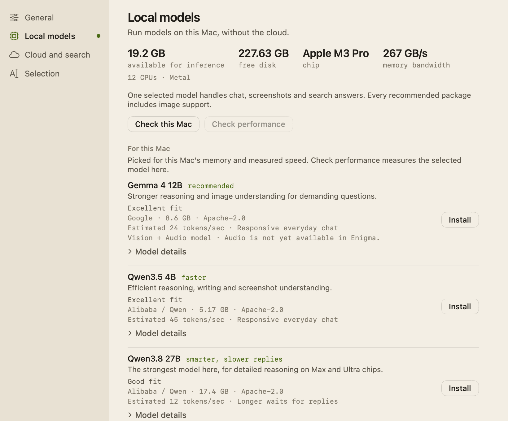

# Local models

Enigma can answer on your Mac with a local text-and-image model, so chats and
screenshots never leave it. It ships a reviewed catalogue of seven model
families (20 pinned packages), picks the smartest one this Mac runs fast, and
installs, checks and manages it for you.

## Choosing a model

Every picker shows the same three choices for this Mac, in this order:

- **recommended**: the smartest family that fits this Mac's memory and is fast
  (an estimated 20 tokens per second or more, and a first token within 2 seconds
  on a 256-token prompt). When nothing is fast, the smartest family that still
  reaches 8 tokens per second is tagged **best available, expect longer waits**.
- **faster**: the smartest other family that is at least 1.5 times as fast as
  Recommended. It's offered only while Recommended is under 40 tokens per
  second; above that Recommended already feels instant.
- **smarter, slower replies**: the smartest family above Recommended that fits
  but misses the speed bar, while still reaching 8 tokens per second.

Empty roles are left out. When nothing fits, Enigma says **No suitable model
found**. The choices appear in:

- **Welcome setup.** The **Pick a local model** step lists the roles, with
  **Skip local models** to use the cloud only. A model you picked earlier stays
  in the list even if a performance check changes the roles. See
  [Welcome-and-Settings.md](Welcome-and-Settings.md).
- **The composer's mode and model menu** (also opened with ⌘K). In Auto and
  Local it lists installed models under **On this Mac**, marked **text +
  images** or **text only**, plus **Find a model for this Mac…** (a sheet with
  the same three roles), **Import a text GGUF…** and **Manage models in
  Settings…**.
- **Settings → Local models**, described below.

One selected model handles local chat, screenshots and search answers. Every
catalogue package includes image support.

### Settings → Local models

The page is the one place to choose and manage local models. From the top:

1. **This Mac**: memory **available for inference**, **free disk**, **chip**
   and **memory bandwidth** (measured, or **Not measured**), and a line with
   its CPU count, Metal support and Metal's working set.
   - **Check this Mac** checks the Mac again, measures its memory bandwidth
     again, and re-reads the catalogue.
   - **Check performance** measures the selected model (see below).
2. **For this Mac**: up to three rows tagged **recommended**, **faster** and
   **smarter, slower replies**. Each shows its fit, publisher, download size
   and estimated or measured speed, with **Install**, **Update**, **Use** or
   **Selected**. **Model details** adds the quantization, context size,
   estimated memory and a **Model card and license** link.
3. **On this Mac**: every installed model, from the catalogue or not, with
   **Use** (or **Selected**) and **Delete**. Catalogue packages show their
   quantization and publisher; packages that have left the catalogue and
   imported GGUFs are marked legacy/imported. An installed package that needs
   an update stays usable here while For this Mac offers **Update**.
4. **All models** (collapsed): one row per catalogue family with its fit on
   this Mac. A package over the memory budget keeps its memory warning and can
   still be installed.
5. **Files** holds **Local file tools** and **Saved file changes** for File Mode
   (see [File-Mode.md](File-Mode.md)), then **Advanced: Import text GGUF…**.
   The footer shows the catalogue version (currently 6).

**Delete** asks first and removes the model and its support files. Deleting the
selected model selects another installed one, if any.

### Installing and updating

One download contains three parts: the model weights, the matching image
projector, and the pinned llama.cpp runtime (about 12 MB). Progress counts all
three together, then reads **verifying and installing package…** while sizes and
checksums are checked. **Cancel** works throughout. A failed or cancelled
install leaves your previous model and selection untouched.

A dropped connection doesn't restart the package. Each part resumes from the
bytes already on disk, so a brief Wi-Fi drop late in an 8 GB download costs
seconds, not the whole transfer. While a package downloads and installs, Enigma
keeps the Mac from idle-sleeping; the display can still sleep.

A newly installed package becomes the selected model. Updating a package that
is already installed keeps your current selection.

### Checking performance

After an install, Enigma runs a short performance check (**checking performance
on this Mac…**, cancellable) and shows first-token time, generation and prompt
speed, and peak app memory. **Check performance** repeats it at any time. If
the model ran well below its estimate, Enigma suggests a faster package. A
failed check never undoes an install.

Packages installed above the memory budget skip the automatic check; Enigma
says **Installed. Memory use may be high; choose Check Performance when you are
ready to test it.**

### Memory warnings

You can install any runnable catalogue package even when it exceeds the memory
budget. Its row then shows **Memory warning: this model may run slowly, use swap
or fail to load on this Mac. You can still install it.** Disk space, runtime
support and Metal buffer limits are still enforced; a memory warning never hides
a disk-space failure. Packages over budget are never recommended.

## The catalogue

Seven families, reviewed 2026-10-19. Every package runs with an 8,192-token
context and is Apache-2.0 licensed. Quality scores are the Artificial Analysis
Intelligence Index (v4.3.2, October 2026), checked against MMMU-Pro for vision;
within one model line a larger model never scores below a smaller one.

| Family | Parameters (active) | Quantizations | Quality | Mainly for |
|---|---|---|---|---|
| Qwen3.5 2B | 2.27B | Q4_K_M, Q8_0 | 8 | 8 GB Macs |
| Qwen3.5 4B | 4.66B | Q4_K_M, Q5_K_M, Q8_0 | 13 | the Faster pick |
| Qwen3.5 9B | 9.65B | Q4_K_M, Q5_K_M, Q8_0 | 13.5 | 16 GB Macs |
| Gemma 4 12B | 12B | Q4_K_M, Q5_K_M, Q8_0 | 14 | 24 GB Macs |
| Gemma 4 26B-A4B | 25.2B (3.8B), mixture of experts | Q4_K_M, Q5_K_M, Q8_0 | 17 | 32–48 GB Macs |
| Qwen3.6 35B-A3B | 36B (3B), mixture of experts | Q4_K_M, Q5_K_M, Q8_0 | 18 | 48–64 GB Macs |
| Qwen3.8 27B | 27.8B | Q4_K_M, Q5_K_M, Q8_0 | 28 | Max and Ultra chips |

Gemma 4 12B is a vision and audio model; Enigma sends it text and images only,
and its row says **Vision + Audio model · Audio is not yet available in
Enigma.** Qwen3.8 27B's Q4_K_M and Q5_K_M packages are Unsloth Dynamic files
(`UD-Q4_K_M`, `UD-Q5_K_M`), the only Q4 and Q5 files in that repository.

**Left the catalogue** in this release: SmolVLM2 2.2B (superseded by Qwen3.5
2B), Gemma 4 E4B (larger than Qwen3.5 4B and lower on both quality measures),
Ministral 3 8B and 14B (outscored by Qwen3.5 9B and Gemma 4 12B) and MiniCPM-o
4.5 (it could not be installed). Installed copies keep working under **On this
Mac**.

**Deferred** to a later refresh: 100B-class models for 128 GB Macs (the
strongest has an open Metal out-of-memory bug and a non-Apache licence),
MiniCPM-V 4.7, Muse Glimmer 30B and Gemma 4 31B.

[Updating-the-Model-Catalogue.md](Updating-the-Model-Catalogue.md) is the
checklist for a refresh.

### Pinned repositories and model cards

Each repository link is also the family's model card and license page. Weights
and projector always come from the same repository and revision.

| Family | Repository and model card | Revision | Projector |
|---|---|---|---|
| Qwen3.5 2B | [unsloth/Qwen3.5-2B-GGUF](https://huggingface.co/unsloth/Qwen3.5-2B-GGUF) | `f6d5376be1edb4d416d56da11e5397a961aca8ae` | `mmproj-F16.gguf` |
| Qwen3.5 4B | [unsloth/Qwen3.5-4B-GGUF](https://huggingface.co/unsloth/Qwen3.5-4B-GGUF) | `e87f176479d0855a907a41277aca2f8ee7a09523` | `mmproj-F16.gguf` |
| Qwen3.5 9B | [unsloth/Qwen3.5-9B-GGUF](https://huggingface.co/unsloth/Qwen3.5-9B-GGUF) | `3885219b6810b007914f3a7950a8d1b469d598a5` | `mmproj-F16.gguf` |
| Gemma 4 12B | [unsloth/gemma-4-12b-it-GGUF](https://huggingface.co/unsloth/gemma-4-12b-it-GGUF) | `fc034cfff751157913579611efad8462ac1be606` | `mmproj-F16.gguf` |
| Gemma 4 26B-A4B | [bartowski/google_gemma-4-26B-A4B-it-GGUF](https://huggingface.co/bartowski/google_gemma-4-26B-A4B-it-GGUF) | `10f3b41bcf8d3047f4e136e7197ffc2dd1654c9d` | `mmproj-google_gemma-4-26B-A4B-it-f16.gguf` |
| Qwen3.6 35B-A3B | [bartowski/Qwen_Qwen3.6-35B-A3B-GGUF](https://huggingface.co/bartowski/Qwen_Qwen3.6-35B-A3B-GGUF) | `5c2410d71524f4f72b023ce8daf7a80528226d5f` | `mmproj-Qwen_Qwen3.6-35B-A3B-f16.gguf` |
| Qwen3.8 27B | [unsloth/Qwen3.8-27B-GGUF](https://huggingface.co/unsloth/Qwen3.8-27B-GGUF) | `4ca720788d1e01f1bff70c033e0d0028fd02e502` | `mmproj-F16.gguf` |

Package IDs follow `<family>-<quantization>` (for example `gemma-4-12b-q5_k_m`);
existing IDs are kept so installed packages and benchmarks carry over. Sizes,
SHA-256 and each GGUF's largest tensor are in `BundledLocalModels.swift`.

## How picks work

`LocalModelSelector.select` assesses every package, then:

1. **Gates.** A package must fit the memory budget, pass the disk, runtime and
   Metal-buffer checks, and be fast (or, as a fallback, usable at 8 tokens per
   second). Quality ranks only what passes; it can never outweigh a gate.
2. **One package per family.** A family's candidate is its largest fast package
   (the highest precision that stays fast), or, when none is fast, its smallest
   package that fits.
3. **Roles.** Recommended, Faster and Smarter are chosen from the candidates by
   quality score, as described under [Choosing a model](#choosing-a-model).

`LocalModelRecommendations.roles` holds the non-empty roles in order; Settings,
Welcome (`WelcomeSetup.choices`) and the ⌘K sheet all render it, so every picker
agrees. `allFamilies` holds one package per family for **All models**.

If a performance check shows a model well below its estimate, Enigma suggests a
smaller fast package (`fasterAlternative(to:)`).

### Memory estimate

`LocalHardwareProfile.inferenceMemoryBudget` is the smallest of 60% of physical
RAM; physical RAM minus a macOS reserve of 4 GiB or 25% of RAM, whichever is
larger; and 80% of Metal's recommended working set, when Metal is present.

Each package's estimated runtime memory (`LocalMultimodalProfile.memory`) is

> weights + projector + KV cache + runtime reserve

- **Weights and projector count once.** llama.cpp maps the file and Metal wraps
  the mapping without copying it. Mixture-of-experts weights count in full: the
  whole model has to be in memory even though only some experts run per token.
- **KV cache (F16).** Each profile records its cache layout from the GGUF
  header (`LocalCacheLayout`): full-attention layers, sliding-window layers,
  their KV heads and head dimensions, and the window. Full-attention layers hold
  all 8,192 tokens. Sliding-window layers hold their window plus the physical
  batch, rounded up to 256 tokens, as llama.cpp sizes them. Hybrid Qwen models
  (3.5, 3.6, 3.8) hold cache only in their attention layers, counting the
  multi-token-prediction layer; their small recurrent state is inside the
  reserve. Gemma's global layers are counted with separate K and V, which is
  conservative.
- **Runtime reserve** is 1.5 GiB for the compute buffer, one image and the
  server.
- **Gemma's image batch.** Since llama.cpp b11327, models whose image tokens
  attend to each other (Gemma 4 12B, 26B-A4B and 31B) cap an image at the
  physical batch. Enigma launches them with a 1,024-token batch so a full-screen
  screenshot (about 33 × 21 tokens) is not cut. Their sliding-window layers then
  hold window + 1,024 tokens, and the reserve grows by 0.5 GiB of logits for the
  larger batch (1 MiB per extra token for Gemma's 262,144-token vocabulary).

The estimates were set against peaks recorded on a 24 GB M5 Pro: Gemma 4 12B
QAT Q4_0 estimates 9.41 GiB against a measured 8.57 GiB, and Gemma 4 E4B QAT
Q4_0 7.51 GiB against 6.64 GiB, both within 25% above the peak. A package's
minimum Mac memory is its estimate.

`LocalModelSelector.assess` turns this into a fit, checked in order:

1. **Unsupported**: an architecture, chat template, quantization, context or
   runtime build the app hasn't reviewed; a Mac with Metal but without Apple
   unified memory; or a largest tensor above Metal's maximum buffer size.
2. **Insufficient disk space**: less free space than twice the download plus
   2 GiB, unless the package is already installed.
3. **Insufficient memory**: an estimate (or measured peak) above the budget.
   Compatible packages may still be installed with the memory warning.
4. **May be slow**: under 8 tokens per second or over 5 seconds to first token.
5. **Excellent fit** when the estimate is within 80% of the budget, otherwise
   **Good fit**.

### Speed estimate

- **Memory bandwidth.** `LocalBandwidthProbe` copies 256 MiB buffers back and
  forth on the GPU (a Metal blit, about 1 GiB of traffic per pass), runs five
  passes, drops the first, and keeps the best reading, clamped to 50–1,500 GB/s.
  It takes well under a quarter of a second and runs off the main thread, once
  per hardware fingerprint and Low Power Mode state; the result is saved in
  `hardware.json` and is not part of the fingerprint. **Check this Mac** runs it
  again. Without Metal, or if the test fails, `measuredBandwidth` is empty and a
  conservative prior from the performance-core count is used (`min(100, 18 + 5
  × cores)` GB/s with Metal), reduced by 35% in Low Power Mode. Chip names are
  never used.
- **Decode** = bandwidth × efficiency ÷ active weight bytes. Active weight bytes
  are the file size × active ÷ total parameters: the whole file for a dense
  model, the active experts for a mixture of experts, and the effective
  parameters for a Gemma E-model. The starting efficiency is 0.75 for dense
  models and 0.45 for mixture-of-experts models.
- **Prompt** = 1.3 × bandwidth × 7 ÷ active parameters (billions).
- **First token** = 256 ÷ prompt speed + 1 ÷ decode speed.
- **Calibration.** The latest applicable benchmark on this Mac of the same kind
  (dense or mixture of experts) replaces the starting efficiency, with no cap;
  a benchmark of the same architecture is preferred. It may only raise the
  prompt factor above 1.3, because the check's short prompt understates prompt
  speed.
  Calibration uses benchmarks recorded on this hardware, in the current power
  mode, within 90 days, on any runtime build, because efficiency belongs to the
  Mac. Benchmarks of packages that left the catalogue still count; imported
  GGUFs never do.
- **Exact measurements.** A benchmark of the exact package (same checksum and
  context) on the current runtime build overrides both estimates. The latest
  100 benchmarks are kept.

### Install transaction

`LocalModelCatalog.download` re-checks the assessment, requires free space of
twice the total download plus 2 GiB, and downloads the model, projector and
runtime archive into a staging folder. Each transfer stops as soon as it exceeds
its expected size, then checks the exact size and SHA-256. Free space is checked
again before installing.

Transfers (`ResumableArtifactTransfer`, `ResumableArtifactTransfer.swift`)
append a data task's bytes to the staging file. After a transient failure, it
asks the original `huggingface.co` URL again with `Range: bytes=<bytes on
disk>-`. It never reuses the redirected CDN URL, which is signed and expires
after about an hour. URLSession keeps the `Range` header across the
`huggingface.co` to CDN redirect; this was checked by hand against the live
CDN, not by the offline tests.

- The first request must answer 200. A resumed request must answer 206 with a
  `Content-Range` that starts at the bytes on disk, runs to the last byte and
  totals the expected size; anything else, including a range that stops short,
  fails. A server that answers 200 instead restarts the file from zero, and
  progress moves back to zero each time that happens.
- Transient failures are a lost connection, a timeout, no internet, a host
  that can't be found or reached, a DNS failure, a blocked data connection, and
  HTTP 408, 429, 500, 502, 503 and 504. Other errors, such as 401, 403, 404, a
  size or checksum mismatch or a non-HTTPS response, fail at once.
- The transfer gives up after five attempts in a row that bring no new bytes,
  and reports the last network error. Only an attempt that takes the file past
  the furthest point it has reached resets the count, so refilling a restarted
  file doesn't, and a server that always ignores `Range` and drops still runs
  out of retries. The waits between attempts without new bytes double from 1 s (1, 2,
  4, 8 s; capped at 30 s), and a retry after an attempt that brought bytes
  waits 1 s. Cancelling stops a retry wait at once.
- Progress goes through a stream that keeps only its newest update, and the
  transfer sends at most about ten updates a second plus the final byte count.
  The main actor never works through a backlog of stale updates, and
  verification waits on at most one.
- `LocalModelCatalog.downloadVision` and the File-mode runtime setup hold a `ProcessInfo` activity
  (`.userInitiated`, `.idleSystemSleepDisabled`) for the whole operation,
  ended on success, failure and cancellation. It stops App Nap and idle system
  sleep, not display sleep. `DownloadActivity` makes this injectable for tests.
- Cleanup of the staging folder and the unused runtime folder is explicit and
  never throws, so the error the person sees is the one that ended the
  download. The runtime archive is extracted only if every path
stays inside its folder, no link escapes it, and `llama-server --help` lists
`--mmproj` and `--offline`.

`LocalModelInstallationStore` copies files under fresh names (`model-<id>.gguf`,
`mmproj-<id>.gguf`) and commits by atomically writing its library metadata.
Cancellation is checked between steps; anything uncommitted is removed and the
previous model, selection and bytes stay intact. A same-ID update retires only
the replaced package's own files, never files shared with another record.
Deletion moves files aside first and restores them if the metadata write fails.
Models live in `~/Library/Application Support/AI Spotlight/Models`; the folder
name is kept so existing installs carry over.

### Runtimes

Catalogue packages run in `llama-server` from llama.cpp build b11734
(`LocalVisionRuntime`), launched on loopback with the model, projector,
`--ctx-size 8192`, `--parallel 1`, `--offline`, `--no-webui`, `--jinja`,
`--no-context-shift`, `--cache-ram 0`, `--reasoning-budget -1` and `--fit off`.
Gemma 4 12B and 26B-A4B add `--ubatch-size 1024 --image-max-tokens 1024`; every
other model gets `--image-max-tokens 4096`. One process serves text, OCR, image
and answer requests; every request carries its full prepared conversation, and
the server keeps no conversation state. Switching models, cancelling, a failed
request, quitting, and deleting all stop it.

Text-only models (imported GGUFs and older installs) run in the embedded
`Packages/LlamaBridge` package, which wraps the llama.cpp b5046 XCFramework.
They answer text and OCR text; visual questions explain how to install a
text-and-image package. An older SmolVLM image package that can't process images
with its runtime says so and keeps its files.

A local model unloads 60 seconds after its last reply finishes, fails or is
stopped (`LocalModelIdlePolicy`), even with the chat open. A new request cancels
the pending unload, and the next idle period starts when that work ends. File
Mode unloads as soon as its task is done. Installed files and chats are kept;
the first reply after an unload takes longer while the model loads.

The runtimes are pinned:

- `llama-server`: [llama.cpp release b11734](https://github.com/ggml-org/llama.cpp/releases/tag/b11734),
  `llama-b11734-bin-macos-arm64.tar.gz` or `-x64.tar.gz`, with size and SHA-256
  in `LocalVisionRuntime.bundled`.
- Embedded text engine: [llama.cpp release b5046](https://github.com/ggml-org/llama.cpp/releases/tag/b5046),
  `llama-b5046-xcframework.zip`, with its checksum in `Packages/LlamaBridge/Package.swift`.

### Signed catalogue updates

`LocalCatalogUpdater` can replace the bundled catalogue with a newer signed one,
but only when `LocalModelCatalogURL` (HTTPS) and a base64 Ed25519
`LocalModelCatalogPublicKey` are set in `Info.plist`. They are not set, so the
app uses the bundled catalogue, and new models ship with app releases. When
configured, it checks at most every 30 days (**Check this Mac** forces a check),
limits responses to 1 MB, verifies the signature, rejects older versions, and
falls back to the cached or bundled catalogue when offline. A signed catalogue
cannot add architectures, runtime builds, contexts or repositories the app
hasn't reviewed. Never bundle the private key.

### Key files

Key files are in `Enigma/LocalInference/`.

| Area | Types | Files |
|---|---|---|
| Catalogue | `LocalModelFamily`, `BundledLocalModels` | `BundledLocalModels.swift` |
| Profiles, cache layouts and memory | `LocalMultimodalProfile`, `LocalCacheLayout` | `LocalMultimodalProfile.swift` |
| Package metadata, download and verification | `LocalModelDescriptor`, `LocalModelManifest`, `LocalModelCatalog`, `VerifiedModelArtifact`, `ResumableArtifactTransfer`, `DownloadActivity` | `LocalModelManifest.swift`, `ResumableArtifactTransfer.swift` |
| Fit, speed and roles | `LocalModelSelector`, `LocalModelAssessment`, `LocalModelRecommendations`, `LocalModelRole`, `LocalModelCompatibility` | `LocalModelSelection.swift` |
| Hardware, budget and bandwidth | `LocalHardwareProfile`, `LocalBandwidthProbe` | `LocalHardwareProfile.swift`, `LocalBandwidthProbe.swift` |
| State, benchmarks, signed updates | `LocalModelAdvisor`, `LocalModelBenchmark`, `LocalCatalogUpdater` | `LocalModelAdvisor.swift`, `LocalModelBenchmark.swift`, `LocalCatalogUpdates.swift` |
| Model library on disk | `LocalModelInstallationStore` | `LocalModelInstallationStore.swift` |
| Runtimes | `LlamaServerVisionEngine`, `LocalVisionRuntime`, `LlamaCPPModelEngine` | `LlamaServerVisionEngine.swift`, `LlamaCPPModelEngine.swift` |
| Settings UI and the model sheet | `LocalModelManagerSection`, `LocalModelSettingsLogic`, `LocalModelOnboardingView` | `LocalModelManagerSection.swift`, `LocalModelSettingsLogic.swift`, `LocalModelViews.swift` |

Download orchestration and idle unloading live in `LocalChatViewModel.swift`.
`scripts/gguf-header.py` reads a GGUF header for the catalogue checklist.

## Privacy

- Local inference runs entirely on the Mac. The runtime listens only on
  `127.0.0.1`, requires a per-session key, and runs with `--offline`.
- Enigma contacts `huggingface.co` (model and projector) and GitHub's llama.cpp
  releases (runtime) only to install a catalogue package you chose. No chat
  content and no credentials are sent.
- The bandwidth test runs on the Mac's GPU and sends nothing. Hardware detection
  reads memory, chip, CPU counts, Metal limits, free disk and Low Power Mode,
  and collects no serial numbers or other stable identifiers. The report and
  performance results stay in Application Support on this Mac.

## Limitations

- Memory and speed figures are estimates, not measurements, until you run
  **Check performance**. A model inside the budget can still be slow when other
  apps use memory, and an over-budget install may swap or fail to load. Newer
  chips are underestimated for prompt speed until measured.
- A runtime update changes every catalogue package's revision, so installed
  packages offer **Update** once, which downloads the package again. The
  installed copy stays usable under **On this Mac** until then.
- Audio input and output aren't supported; audio-capable models answer text and
  images only.
- Macs with a Metal GPU that isn't Apple unified memory can't run catalogue
  packages.
- Remote catalogue updates are built but not configured.
- Downloads resume only within one attempt to install. Quitting Enigma, or
  running out of retries, discards the partial files, and the next attempt
  starts from zero.
- Imported GGUFs are text-only.

## Tests

The suites are offline and deterministic; none touches the GPU:

- `LocalModelEstimateTests`: cache layouts against the GGUF headers, sliding
  windows and the physical batch, the memory estimate against the recorded
  peaks, speed estimates from bandwidth and active weights, calibration and its
  applicability, exact measurements, and the speed gates.
- `LocalModelSelectionTests`: the roles on synthetic Macs, per-family
  quantization choice, the nothing-fast and nothing-fits cases, memory budget
  and Metal limits, safety gates, memory warnings, benchmark scoping, Welcome
  choices, and decoding of older installed records.
- `LocalModelCatalogueTests`: seven families and 20 runnable packages, unique
  IDs and checksums, consistent family metadata, existing package IDs and pins,
  quality ordering within a line, expected picks on synthetic Macs, and the
  24 GB M5 Pro fixture that recommends Gemma 4 12B.
- `LocalBandwidthProbeTests`: clamping, a missing Metal device, measuring once
  per fingerprint and power mode, a failed test, and older `hardware.json`
  files. `testMetalProbeOnThisMac` runs the real Metal test only when opted in
  (see [Testing.md](Testing.md)).
- `LocalModelInstallationStoreTests` and `LocalInferenceTests`: atomic install,
  replacement, deletion and selection, plus idle unloading.
- `LocalVisionTests`: package pairs, runtime launch arguments (including Gemma's
  image batch), loopback-only sessions, guided download, progress and
  cancellation, a persistent connection drop and the keep-awake activity through
  `downloadVision`, and legacy packages. The File-mode runtime setup's activity
  has no test, because that setup writes to the real Application Support folder.
- `ResumableArtifactTransferTests`: resuming with `Range`, servers that ignore
  it, `Content-Range` mismatches, the retry budget and backoff, statuses that
  aren't retried, cancellation during backoff, the size limit, progress pacing,
  and the response checks.
- `EnigmaWelcomeTests` and `EnigmaSettingsTests` cover the welcome step and the
  Settings pages, including **On this Mac**, **Check this Mac** and the removed
  Discover destination.

Run one suite with
`scripts/verify-xcode.sh test -only-testing:EnigmaTests/LocalModelSelectionTests`.
See [Testing.md](Testing.md).
