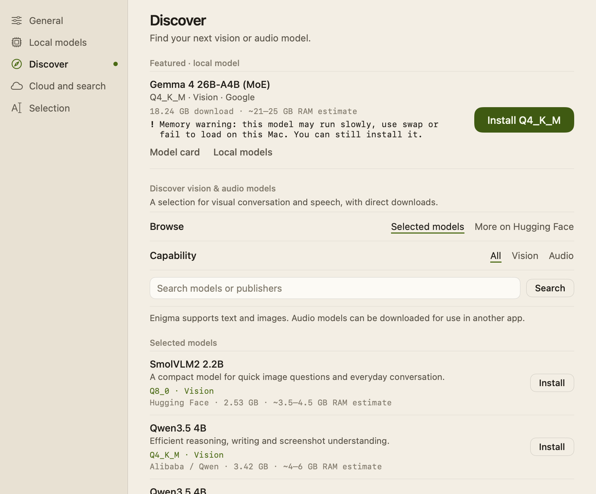
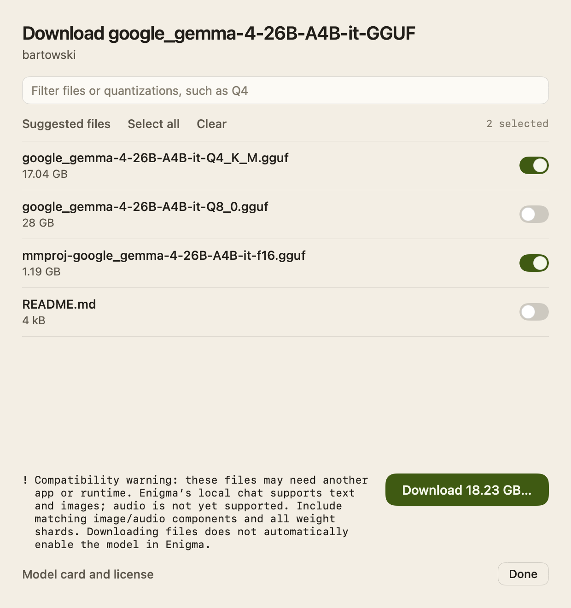

# Local models

Enigma can answer on your Mac with a local text-and-image model, so chats and
screenshots never leave it. It ships a reviewed catalogue of 13 pinned model
packages, recommends the ones that fit your Mac's memory, and installs, checks
and manages them for you. **Discover** in Settings adds a featured model and a
browser for public vision and audio models on Hugging Face.

## Choosing a model

There are three ways to pick a local model:

- **Welcome setup.** The **Pick a local model** step shows up to three good fits
  for this Mac, the first marked **recommended** (or **best available, expect
  longer waits** when nothing is fast enough). You can also choose **Skip local
  models** and use the cloud only. See [Welcome-and-Settings.md](Welcome-and-Settings.md).
- **The composer's mode and model menu** (also opened with ⌘K). In Auto and
  Local it lists installed models under **On this Mac**, marked **text +
  images** or **text only**, plus **Find a model for this Mac…** (a sheet with
  the lightweight, middleweight and heavyweight choices for this Mac),
  **Import a text GGUF…** and **Manage models in Settings…**.
- **Settings → Local models**, described below.

One selected model handles local chat, screenshots and search answers. Every
catalogue package includes image support.

### Settings → Local models

The page starts with this Mac's memory **available for inference**, **free
disk** and **chip**, then:

- **Refresh recommendations** re-detects the Mac and re-reads the catalogue.
  **Check performance** measures the selected model (see below).
- **Best choices for this Mac** lists five packages in three weight classes,
  **Lightweight**, **Middleweight** and **Heavyweight**, chosen for this Mac's
  memory tier. Each row shows its fit, publisher, download size, estimated or
  measured speed, the RAM planning estimate and quantization. **Model details**
  adds context size, estimated memory, minimum Mac memory and a **Model card and
  license** link.
- **Models for other memory sizes** holds the rest of the catalogue.
- **Imported models** lists installed models that are not in the catalogue, with
  **Use** and **Delete**.
- **Files** holds **Local file tools** and **Saved file changes** for File Mode
  (see [File-Mode.md](File-Mode.md)), then **Advanced: Import text GGUF…**.
- The footer shows the catalogue version (currently 5).

Each row's button is **Install**, **Update** (or **Update anyway** above the
memory budget), **Use**, **Selected**, or **Download files** for a package that
can't run in Enigma. Installed rows also have **Delete**, which asks first and
removes the model and its support files. Deleting the selected model selects
another installed one, if any.

### Installing and updating

One download contains three parts: the model weights, the matching image
projector, and the pinned llama.cpp runtime (about 11 MB). Progress counts all
three together, then reads **verifying and installing package…** while sizes and
checksums are checked. **Cancel** works throughout. A failed or cancelled
install leaves your previous model and selection untouched.

A newly installed package becomes the selected model. Updating a package that
is already installed keeps your current selection.

### Checking performance

After an install, Enigma runs a short performance check (**checking performance
on this Mac…**, cancellable) and shows first-token time, generation and prompt
speed, and peak app memory. **Check performance** repeats it at any time. If
the model ran well below its estimate, Enigma suggests a faster package. A
failed check never undoes an install.

Packages installed above the memory budget skip the automatic check; Enigma
says **Installed. Memory use may be high; choose Check Performance when you are
ready to test it.**

### Memory warnings

You can install any runnable catalogue package even when it exceeds the memory
budget. Its row then shows **Memory warning: this model may run slowly, use swap
or fail to load on this Mac. You can still install it.** Disk space, runtime
support and Metal buffer limits are still enforced; a memory warning never hides
a disk-space failure. Packages over budget are never recommended.

## The catalogue

Your Mac's physical memory picks the tier: under 24 GiB uses the 16–18 GB
group, 24 up to 32 GiB uses the 24 GB group, and 32 GiB or more uses the 32 GB
group. RAM figures are the publisher-style planning estimates shown in the app,
not measurements. Download sizes include the projector and runtime.

| Mac RAM | Weight class | Model | Quantization | Model modalities | Planning RAM | Download |
|---|---|---|---|---|---|---|
| 16–18 GB | Lightweight | SmolVLM2 2.2B | Q8_0 | Vision | ~3.5–4.5 GB | 2.5 GB |
| 16–18 GB | Middleweight | Qwen3.5 4B | Q4_K_M | Vision | ~4–6 GB | 3.4 GB |
| 16–18 GB | Middleweight | Gemma 4 E4B | Q4_K_M | Vision + Audio | ~7–9 GB | 6.0 GB |
| 16–18 GB | Heavyweight | Ministral 3 8B | Q4_K_M | Vision | ~7–10 GB | 6.1 GB |
| 16–18 GB | Heavyweight | MiniCPM-o 4.5 | Q4_K_M | Vision + Audio | ~8–11 GB | 6.1 GB |
| 24 GB | Lightweight | Qwen3.5 4B | Q5_K_M | Vision | ~4.5–6 GB | 3.8 GB |
| 24 GB | Middleweight | Qwen3.5 9B | Q5_K_M | Vision | ~8.5–11 GB | 7.5 GB |
| 24 GB | Middleweight | MiniCPM-o 4.5 | Q5_K_M | Vision + Audio | ~9–13 GB | 7.0 GB |
| 24 GB | Heavyweight | Gemma 4 12B | Q5_K_M | Vision + Audio | ~10–13 GB | 8.6 GB |
| 24 GB | Heavyweight | Ministral 3 14B | Q5_K_M | Vision | ~12–15 GB | 10.5 GB |
| 32 GB | Lightweight | Qwen3.5 4B | Q8_0 | Vision | ~6–8 GB | 5.2 GB |
| 32 GB | Middleweight | MiniCPM-o 4.5 | Q5_K_M | Vision + Audio | ~9–13 GB | 7.0 GB |
| 32 GB | Middleweight | Gemma 4 12B | Q5_K_M | Vision + Audio | ~10–13 GB | 8.6 GB |
| 32 GB | Heavyweight | Ministral 3 14B | Q8_0 | Vision | ~17–21 GB | 15.3 GB |
| 32 GB | Heavyweight | Gemma 4 26B-A4B | Q4_K_M | Vision | ~21–25 GB | 18.2 GB |

Repeated rows are the same package and download. Every package runs with an
8,192-token context.

Two caveats apply to the table:

- **MiniCPM-o 4.5 is listed but can't be installed.** Its publisher's package
  needs a dedicated runtime that Enigma's pinned llama.cpp build has not been
  validated with. Its row is marked **Unsupported** and offers **Download
  files** so you can use it in another app.
- **Audio is a model capability, not an Enigma feature.** Enigma sends text and
  images only. Audio-capable rows say **Vision + Audio model · Audio is not yet
  available in Enigma.**

**Recommended** is the highest-priority package in your tier that is expected to
be responsive: at least 8 tokens per second and a first token within 5 seconds,
measured if you've run a check, estimated otherwise.

## Discover

**Discover** (Settings) has three parts:

- **Featured · local model**: Gemma 4 26B-A4B (MoE), Q4_K_M, shown regardless of
  your memory tier or filters. Its button is **Install Q4_K_M**, **Update
  Q4_K_M**, **Use model** or **Selected**, and it uses the same verified
  installer as Local models. It is disabled until Enigma has checked this Mac.
  It accepts text and images, not audio. A mixture-of-experts model has about
  4B active parameters, but the whole model still has to fit in memory.
- **Selected models**: the other 12 catalogue packages with their fit, size,
  RAM estimate, warnings and an **Install**, **Update**, **Use** or **Download
  files** button. **Capability** (**All**, **Vision**, **Audio**) and the search
  field filter by name, publisher or quantization, locally.
- **More on Hugging Face**: public models for image-and-text chat, image
  captioning, visual and document questions, video understanding, audio-and-text
  chat, speech recognition, text to speech, audio generation, audio to audio and
  general multimodal tasks. **Capability** and **Task** narrow the list; search
  runs when you press Return or **Search**. Results are sorted by downloads among
  those loaded so far; **Load more models** continues each task's pages with no
  fixed cap. If some task lists fail, the rest stay visible and **Retry failed
  requests** fetches only the failed ones. Results come from publishers' task
  tags, so missing or wrong tags affect what appears. Every result carries a
  compatibility warning and a **Download files** button.

### Downloading files

**Download files** opens a sheet listing the repository's files at its current
revision, weights first. You can filter by name or quantization, toggle files,
or use **Suggested files**, **Select all** and **Clear**. For GGUF repositories
the suggestion is one Q4_K_M family (or the first weight family if there is no
Q4_K_M) with all its split shards, plus one image projector, preferring F16.
Other repositories default to every file. Suggestions don't guarantee that a
model will run anywhere.

**Download *size*…** asks for a folder (starting in Downloads) and saves the
files into a new subfolder there. Progress shows in the sheet and on the
Discover page, so you can close the sheet. **Cancel download** removes the
incomplete files; **Show in Finder** appears when it finishes. One download runs
at a time.

Downloaded files are not added to Enigma's model library and no runtime is
installed. Public repositories work without a Hugging Face account; gated or
private ones fail with a message that access approval or sign-in is required,
and Enigma has no Hugging Face sign-in.

## Privacy

- Local inference runs entirely on the Mac. The runtime listens only on
  `127.0.0.1`, requires a per-session key, and runs with `--offline`.
- Network use is limited to what you start: package installs fetch from
  `huggingface.co` (model and projector) and GitHub's llama.cpp releases
  (runtime); Discover fetches public model listings and file lists from
  `huggingface.co`. Typing a search sends nothing until you submit it. No chat
  content and no Hugging Face credentials are sent, and Discover's requests use
  ephemeral sessions without cookies or stored credentials.
- Hardware detection reads memory, chip, CPU counts, Metal limits, free disk and
  Low Power Mode. It collects no serial numbers or other stable identifiers. The
  report and performance results stay in Application Support on this Mac.

## How it works

Key files are in `Enigma/LocalInference/`.

| Area | Types | Files |
|---|---|---|
| Catalogue and tiers | `BundledLocalModels`, `LocalModelTiers`, `LocalModelWeight` | `BundledLocalModels.swift` |
| Package metadata, download and verification | `LocalModelDescriptor`, `LocalMultimodalProfile`, `LocalModelManifest`, `LocalModelCatalog`, `VerifiedModelArtifact` | `LocalModelManifest.swift` |
| Fit and recommendations | `LocalModelSelector`, `LocalModelAssessment`, `LocalModelRecommendations`, `LocalModelCompatibility` | `LocalModelSelection.swift` |
| Hardware and memory budget | `LocalHardwareProfile` | `LocalHardwareProfile.swift` |
| State, benchmarks, signed updates | `LocalModelAdvisor`, `LocalModelBenchmark`, `LocalCatalogUpdater` | `LocalModelAdvisor.swift`, `LocalModelBenchmark.swift`, `LocalCatalogUpdates.swift` |
| Model library on disk | `LocalModelInstallationStore` | `LocalModelInstallationStore.swift` |
| Runtimes | `LlamaServerVisionEngine`, `LocalVisionRuntime`, `LlamaCPPModelEngine` | `LlamaServerVisionEngine.swift`, `LlamaCPPModelEngine.swift` |
| Settings and Discover UI | `LocalModelManagerSection`, `LocalModelDiscoveryView`, `LocalModelSettingsLogic`, `LocalModelOnboardingView` | `LocalModelManagerSection.swift`, `LocalModelDiscoveryView.swift`, `LocalModelSettingsLogic.swift`, `LocalModelViews.swift` |
| Hugging Face browsing and downloads | `LocalModelDiscovery`, `HuggingFaceModelClient`, `HuggingFaceRepositoryClient`, `HuggingFaceFileDownloader` | `HuggingFaceModelDiscovery.swift`, `HuggingFaceModelDownloads.swift` |

Download orchestration and idle unloading live in `LocalChatViewModel.swift`.
The welcome step's choice logic is `WelcomeSetup.choices` in
`Enigma/App/WelcomeSetup.swift`.

### Memory policy

`LocalHardwareProfile.inferenceMemoryBudget` is the smallest of:

- 60% of physical RAM;
- physical RAM minus a macOS reserve of 4 GiB or 25% of RAM, whichever is larger;
- 80% of Metal's recommended working set, when Metal is present.

Each package's estimated runtime memory (`LocalMultimodalProfile.memory`) is
1.2 × (weights + projector) + a full-context F16 KV cache at 8,192 tokens +
2 GiB for the runtime, image processing and compute. All mixture-of-experts and
Gemma per-layer-embedding weights count in full, because the estimate uses the
actual file sizes rather than active parameters. The cache is reserved for every
layer, even sliding-window or shared ones. Qwen3.5 reserves cache for its eight
full-attention layers (4 KV heads × 256 head dimension), leaving its recurrent
state to the runtime reserve; SmolVLM2 uses a conservative 24 × 32 × 64 bound.
A package's minimum Mac memory is the larger of its estimate and its tier floor
(16, 24 or 32 GiB).

`LocalModelSelector.assess` turns this into a fit, checked in order:

1. **Unsupported**: MiniCPM-o 4.5; an architecture, chat template, quantization,
   context or runtime build the app hasn't reviewed; a Mac with Metal but without
   Apple unified memory; or a largest tensor (3 GiB for Gemma 4, 1 GiB otherwise)
   above Metal's maximum buffer size.
2. **Insufficient disk space**: less free space than twice the download plus
   2 GiB, unless the package is already installed.
3. **Insufficient memory**: RAM below the package's minimum, or an estimate (or
   measured peak) above the budget. Compatible packages may still be installed
   with the memory warning.
4. **May be slow**: under 8 tokens per second or over 5 seconds to first token.
5. **Excellent fit** when the estimate is within 80% of the budget, otherwise
   **Good fit**.

Speed is a measured result when a check exists for the exact package; otherwise
a conservative heuristic from performance-core count and Metal availability,
reduced by 35% in Low Power Mode and calibrated by the latest benchmark of the
same architecture (capped at twice the heuristic). Chip names are never used.
Benchmarks apply only to the same hardware, power mode and runtime build, for
90 days; the latest 100 are kept.

Recommendation order uses each package's editorial `qualityScore` in
`BundledLocalModels.swift`, but only after these safety gates; quality can never
outweigh a memory, disk or compatibility failure.

### Install transaction

`LocalModelCatalog.download` re-checks the assessment, requires free space of
twice the total download plus 2 GiB, and downloads the model, projector and
runtime archive into a staging folder. Each transfer stops as soon as it exceeds
its expected size, then checks the exact size and SHA-256. Free space is checked
again before installing. The runtime archive is extracted only if every path
stays inside its folder, no link escapes it, and `llama-server --help` lists
`--mmproj` and `--offline`.

`LocalModelInstallationStore` copies files under fresh names (`model-<id>.gguf`,
`mmproj-<id>.gguf`) and commits by atomically writing its library metadata.
Cancellation is checked between steps; anything uncommitted is removed and the
previous model, selection and bytes stay intact. A same-ID update retires only
the replaced package's own files, never files shared with another record.
Deletion moves files aside first and restores them if the metadata write fails.
Models live in `~/Library/Application Support/AI Spotlight/Models`; the folder
name is kept so existing installs carry over.

### Runtimes

Catalogue packages run in `llama-server` from llama.cpp build b10797
(`LocalVisionRuntime`), launched on loopback with the model, projector,
`--ctx-size 8192`, `--parallel 1`, `--offline`, `--cache-ram 0` and
`--image-max-tokens 4096`. One process serves text, OCR, image and answer
requests; every request carries its full prepared conversation, and the server
keeps no conversation state. Switching models, cancelling, a failed request,
quitting, and deleting all stop it.

Text-only models (imported GGUFs and older installs) run in the embedded
`Packages/LlamaBridge` package, which wraps the llama.cpp b5046 XCFramework.
They answer text and OCR text; visual questions explain how to install a
text-and-image package. An older SmolVLM image package that can't process images
with its runtime says so and keeps its files.

A local model unloads 60 seconds after its last reply finishes, fails or is
stopped (`LocalModelIdlePolicy`), even with the chat open. A new request cancels
the pending unload, and the next idle period starts when that work ends. File
Mode unloads as soon as its task is done. Installed files and chats are kept;
the first reply after an unload takes longer while the model loads.

### Signed catalogue updates

`LocalCatalogUpdater` can replace the bundled catalogue with a newer signed one,
but only when `LocalModelCatalogURL` (HTTPS) and a base64 Ed25519
`LocalModelCatalogPublicKey` are set in `Info.plist`. They are not set, so the
app uses the bundled catalogue. When configured, it checks at most every 30 days
(**Refresh recommendations** forces a check), limits responses to 1 MB, verifies
the signature, rejects older versions, and falls back to the cached or bundled
catalogue when offline. A signed catalogue cannot add architectures, runtime
builds, contexts or repositories the app hasn't reviewed. Never bundle the
private key.

### Evidence

Every catalogue entry pins an exact repository revision, file size and SHA-256
for both the weights and projector, and the weights and projector always come
from the same repository and revision. Memory profiles were reviewed against
publisher configurations and the pinned runtime, as noted in
`LocalModelManifest.swift`. The planning RAM ranges, recommendation priorities
and speed estimates are planning aids, not measurements of answer quality or
speed on any particular Mac; **Check performance** records real speed after
installation.

### Pinned repositories and model cards

Each repository link is also the package's model card and license page.

| Packages | Repository and model card | Revision | Projector |
|---|---|---|---|
| SmolVLM2 2.2B Q8_0 | [ggml-org/SmolVLM2-2.2B-Instruct-GGUF](https://huggingface.co/ggml-org/SmolVLM2-2.2B-Instruct-GGUF) | `1bc3c9f74ceafd4c8d4411cc9cf188bba3798f91` | `mmproj-SmolVLM2-2.2B-Instruct-Q8_0.gguf` |
| Qwen3.5 4B Q4_K_M, Q5_K_M, Q8_0 | [unsloth/Qwen3.5-4B-GGUF](https://huggingface.co/unsloth/Qwen3.5-4B-GGUF) | `e87f176479d0855a907a41277aca2f8ee7a09523` | `mmproj-F16.gguf` |
| Qwen3.5 9B Q5_K_M | [unsloth/Qwen3.5-9B-GGUF](https://huggingface.co/unsloth/Qwen3.5-9B-GGUF) | `3885219b6810b007914f3a7950a8d1b469d598a5` | `mmproj-F16.gguf` |
| Gemma 4 E4B Q4_K_M | [unsloth/gemma-4-E4B-it-GGUF](https://huggingface.co/unsloth/gemma-4-E4B-it-GGUF) | `bfc15c382204943c3a8fff0c750b94ae2364d7a3` | `mmproj-F16.gguf` |
| Gemma 4 12B Q5_K_M | [unsloth/gemma-4-12b-it-GGUF](https://huggingface.co/unsloth/gemma-4-12b-it-GGUF) | `fc034cfff751157913579611efad8462ac1be606` | `mmproj-F16.gguf` |
| Gemma 4 26B-A4B Q4_K_M | [bartowski/google_gemma-4-26B-A4B-it-GGUF](https://huggingface.co/bartowski/google_gemma-4-26B-A4B-it-GGUF) | `10f3b41bcf8d3047f4e136e7197ffc2dd1654c9d` | `mmproj-google_gemma-4-26B-A4B-it-f16.gguf` |
| Ministral 3 8B Q4_K_M | [mistralai/Ministral-3-8B-Instruct-2512-GGUF](https://huggingface.co/mistralai/Ministral-3-8B-Instruct-2512-GGUF) | `0102285ad796bd99af90f58de616092e5630e970` | `Ministral-3-8B-Instruct-2512-BF16-mmproj.gguf` |
| Ministral 3 14B Q5_K_M, Q8_0 | [mistralai/Ministral-3-14B-Instruct-2512-GGUF](https://huggingface.co/mistralai/Ministral-3-14B-Instruct-2512-GGUF) | `74fac473c43357d7fb2671713608183cc72496d0` | `Ministral-3-14B-Instruct-2512-BF16-mmproj.gguf` |
| MiniCPM-o 4.5 Q4_K_M, Q5_K_M | [openbmb/MiniCPM-o-4_5-gguf](https://huggingface.co/openbmb/MiniCPM-o-4_5-gguf) | `db25077c33951fe163b42986fba0132e279872a2` | `vision/MiniCPM-o-4_5-vision-F16.gguf` |

Gemma 4 26B-A4B uses Bartowski's exact Q4_K_M file, not a variant
quantization. The runtimes are pinned too:

- `llama-server`: [llama.cpp release b10797](https://github.com/ggml-org/llama.cpp/releases/tag/b10797),
  `llama-b10797-bin-macos-arm64.tar.gz` or `-x64.tar.gz`, with size and SHA-256
  in `LocalVisionRuntime.bundled`.
- Embedded text engine: [llama.cpp release b5046](https://github.com/ggml-org/llama.cpp/releases/tag/b5046),
  `llama-b5046-xcframework.zip`, with its checksum in `Packages/LlamaBridge/Package.swift`.

### Discover networking

`HuggingFaceModelClient` requests `https://huggingface.co/api/models` with up
to 20 models per task page, at most four requests at once, a 2 MB response
limit, and a 200-character search. It follows only pagination links that stay
on that endpoint and keep the same search and filters. A newer search discards
late responses from an older one. `HuggingFaceRepositoryClient` loads one
repository's file list (up to 8 MB and 10,000 files) and rejects invalid
revisions, path traversal and paths that collide on a case-insensitive disk.
Downloads use the resolved immutable revision. Large (LFS) files get size and
SHA-256 checks; ordinary Git files get size and Git blob SHA-1 checks. The
snapshot is renamed into place only when complete. Downloaded code is never
run.

## Limitations

- Audio input and output aren't supported; audio-capable models answer text and
  images only.
- MiniCPM-o 4.5 can't be installed; its files can be downloaded for another app.
- Macs with a Metal GPU that isn't Apple unified memory can't run catalogue
  packages.
- Memory and speed figures are estimates. A model inside the budget can still be
  slow when other apps use memory, and an over-budget install may swap or fail
  to load.
- Hugging Face downloads don't install anything into Enigma and don't support
  gated or private repositories.
- Remote catalogue updates are built but not configured.
- Imported GGUFs are text-only.

## Tests

The suites are offline and deterministic:

- `LocalModelSelectionTests`: tier contents and quantizations, pinned
  metadata, memory budget and Metal limits, safety gates, memory warnings,
  ranking, benchmark applicability, and decoding of older installed records.
- `LocalModelInstallationStoreTests` and `LocalInferenceTests`: atomic install,
  replacement, deletion and selection, plus idle unloading.
- `LocalVisionTests`: package pairs, runtime launch arguments, loopback-only
  sessions, guided download, progress and cancellation, and legacy packages.
- `LocalModelDiscoveryTests`: Hugging Face search, pagination, partial failure,
  late responses, the featured package, and Discover rendering in both themes.
- `HuggingFaceModelDownloadsTests`: repository validation, file suggestions,
  snapshot commit, cancellation, checksum and size failures, and the file
  sheet.
- `EnigmaWelcomeTests` and `EnigmaSettingsTests` cover the welcome step and the
  Settings pages.

Run one suite with
`scripts/verify-xcode.sh test -only-testing:EnigmaTests/LocalModelSelectionTests`.
See [Testing.md](Testing.md).
