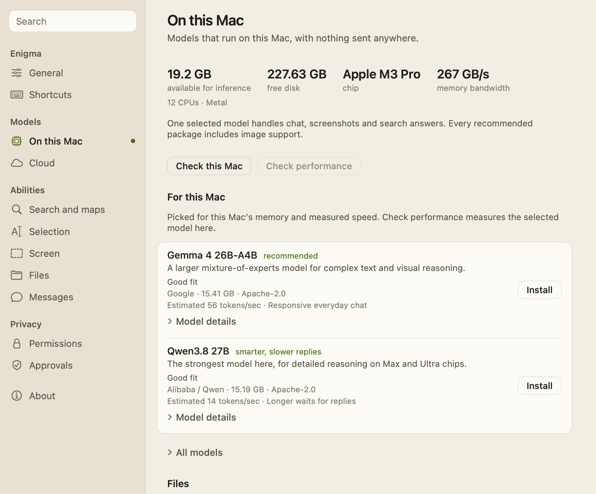

# Local models

Enigma can answer on your Mac with a local text-and-image model, so chats and
screenshots never leave it. It ships a reviewed catalogue of fourteen model
families (48 pinned packages), picks the best Bonsai 2 this Mac runs (or,
without one, the smartest model it runs fast), and installs, checks and manages it for you.

## Choosing a model

Every picker shows the same three choices for this Mac, in this order:

- **recommended**: the best Bonsai 2 that fits this Mac's memory and reaches 8
  tokens per second, even when it misses the speed bar: Bonsai 2 27B on every
  Mac with 18 GB or more, Bonsai 2 9B on 16 GB Macs, Bonsai 2 4B on 8 GB Macs
  (owner's choice, 2026-10-31). Without one, the smartest family that fits and
  is fast (an estimated 20 tokens per second or more, and a first token within
  2 seconds on a 256-token prompt). When nothing is fast, the smartest family
  that still reaches 8 tokens per second is tagged **best available, expect
  longer waits**.
- **faster**: another family that is fast and at least 1.5 times as fast as
  Recommended, a Bonsai 2 when one qualifies, else the smartest. It's offered
  only while Recommended is under 40 tokens per second; above that Recommended
  already feels instant.
- **smarter, slower replies**: the smartest family above Recommended that fits
  but misses the speed bar, while still reaching 8 tokens per second. Above a
  Bonsai 2 Recommended, any family that ranks higher counts instead, as long
  as it is slower than the Bonsai, so it never repeats Faster. When Recommended is a 3-bit package, a 4-bit
  size of its own family can be Smarter too (see
  [Ranked quality](#ranked-quality)).

Empty roles are left out, and a best-available Recommended is offered alone. A
Bonsai 2 Recommended is tagged **recommended** even when it misses the speed
bar; its row still says replies take longer.
When nothing fits, Enigma says **No suitable model found**. The choices
appear in:

- **Welcome setup.** The **Pick a local model** step lists the roles, with
  **Skip local models** to use the cloud only. A model you picked earlier stays
  in the list even if a performance check changes the roles. See
  [Welcome-and-Settings.md](Welcome-and-Settings.md).
- **The composer's mode and model menu** (also opened with ⌘K). In Auto and
  Local it lists installed models under **On this Mac**, marked **text +
  images** or **text only**, plus **Find a model for this Mac…** (a sheet with
  the same three roles), **Import a text GGUF…** and **Manage models in
  Settings…**.
- **Settings → On this Mac**, described below.

One selected model handles local chat, screenshots and search answers. Every
catalogue package includes image support.

### Settings → On this Mac

The page is the one place to choose and manage local models. From the top:

1. **This Mac**: memory **available for inference**, **free disk**, **chip**
   and **memory bandwidth** (measured, or **Not measured**), and a line with
   its CPU count, Metal support and Metal's working set.
   - **Check this Mac** checks the Mac again, measures its memory bandwidth
     again, and re-reads the catalogue.
   - **Check performance** measures the selected model (see below).
2. **For this Mac**: up to three rows tagged **recommended**, **faster** and
   **smarter, slower replies**. Each shows its fit, publisher, download size
   and estimated or measured speed, with **Install**, **Update**, **Use** or
   **Selected**. **Model details** adds the quantization, the context size it
   runs at on this Mac (see [Context size](#context-size)), estimated memory
   (at the package's 8,192-token size) and a **Model card and license** link.
3. **On this Mac**: every installed model, from the catalogue or not, with
   **Use** (or **Selected**) and **Delete**. Catalogue packages show their
   quantization and publisher; packages that have left the catalogue and
   imported GGUFs are marked legacy/imported. An installed package that needs
   an update stays usable here while For this Mac offers **Update**.
4. **All models** (collapsed): one row per catalogue family with its fit on
   this Mac. A package over the memory budget keeps its memory warning and can
   still be installed.
5. **Files** holds **Local file tools** and **Saved file changes** for File Mode
   (see [File-Mode.md](File-Mode.md)), then **Advanced: Import text GGUF…**.
   The footer shows the catalogue version (currently 9).
6. **› Advanced** (closed until opened) holds **Context size** (see below).

**Delete** asks first and removes the model and its support files. Deleting the
selected model selects another installed one, if any.

### Installing and updating

One download contains three parts: the model weights, the matching image
projector, and the pinned llama.cpp runtime (about 12 MB). Progress counts all
three together, then reads **verifying and installing package…** while sizes and
checksums are checked. **Cancel** works throughout. A failed or cancelled
install leaves your previous model and selection untouched.

A dropped connection doesn't restart the package. Each part resumes from the
bytes already on disk, so a brief Wi-Fi drop late in an 8 GB download costs
seconds, not the whole transfer. While a package downloads and installs, Enigma
keeps the Mac from idle-sleeping; the display can still sleep.

A newly installed package becomes the selected model. Updating a package that
is already installed keeps your current selection.

You can keep chatting while a package downloads, verifies and unpacks, in the
cloud or with the local model you already use; the status line shows the
download's progress between replies. Choosing, deleting, importing and checking
models wait until the install finishes or is cancelled; the model sheet can
still be closed. The last step, which installs the package and may switch to
it, waits for any reply in progress to finish (**waiting for the reply to
finish before installing…**), so a reply never changes model halfway. Chat then
pauses while Enigma unloads the current model, installs the package and runs
the performance check. Importing a GGUF, deleting a model and **Check
performance** also pause chat while they run. An install failure shows with
the model's status, apart from chat errors, until the next model action.

### Checking performance

After an install, Enigma runs a short performance check (**checking performance
on this Mac…**, cancellable) and shows first-token time, generation and prompt
speed, and peak app memory. **Check performance** repeats it at any time. If
the model ran well below its estimate, Enigma suggests a faster package. A
failed check never undoes an install. Welcome setup checks this Mac before
it recommends anything, so installs from setup skip this check.

Packages installed above the memory budget skip the automatic check; Enigma
says **Installed. Memory use may be high; choose Check Performance when you are
ready to test it.**

### Context size

Each local model runs at the largest of 8K, 16K or 32K tokens that its trained
maximum and this Mac's memory allow (`LocalContextWindowChoice`, F35): the
largest size whose memory estimate stays within 4/5 of the inference budget
(the "comfortable" line), so a larger window never makes a recommended model
uncomfortable. Catalogue models never go below 8K. The trained maximum is the
package's GGUF `context_length` (every catalogue family is trained on 131,072
tokens or more); a package with none counts as 8,192, and imported models keep
their own window.

It's a runtime choice, not a package change. It reaches llama-server's
`--ctx-size`, the embedded engine and every context budget, and is never
written into the installed package, so it never shows **Update**.

**Settings → On this Mac → › Advanced → Context size** overrides it: **Smaller
(4K)**, **Automatic**, **Larger (16K)** or **Max (32K)**. A preset the model's
trained maximum or this Mac's memory rules out is disabled, and so is Smaller
for vision packages (every catalogue package today): a screenshot's image
tokens don't fit in 4K. One over the comfortable line, and larger than
Automatic's, asks first: **This size may not fit in this Mac's memory alongside
other apps. Use it anyway?** with **Use It** and **Cancel**. A new size applies
at the next request, which starts the local runtime again; nothing is
downloaded. When the size the selected model runs at changes and it hasn't
been measured at the new size, **Check performance** runs for it, as after an
install. Benchmarks from before F35 were measured at 8,192, so on a Mac where
Automatic is now larger, the speed shown is an estimate until **Check
performance** runs again.

The preset is one setting for every model, but **Use It** is remembered per
model (`localContextWindowAccepted`). A model selected later that the saved
preset puts over its comfortable line runs at Automatic, and the row shows the
warning again with **Until you choose Use It, this model runs at Automatic.**;
**Cancel** there sets the preset back to Automatic. A saved preset a model
rules out runs at Automatic for that model, and the row says so: **This model
can't use Max (32K) on this Mac, so it runs at Automatic.** VoiceOver reads a
ruled-out preset as unavailable.

### Memory warnings

You can install any runnable catalogue package even when it exceeds the memory
budget. Its row then shows **Memory warning: this model may run slowly, use swap
or fail to load on this Mac. You can still install it.** Disk space, runtime
support and Metal buffer limits are still enforced; a memory warning never hides
a disk-space failure. Packages over budget are never recommended.

## The catalogue

Fourteen families, reviewed 2026-10-31. Every package is built for an 8,192-token
context, runs at the size chosen for this Mac (see [Context size](#context-size)),
and is Apache-2.0 licensed. Quality scores are the Artificial Analysis
Intelligence Index (v4.3.2, October 2026), checked against MMMU-Pro for vision;
within one model line a larger model never scores below a smaller one, except
that Gemma 4 31B keeps the index's 15 below the mixture-of-experts Gemma 4
26B-A4B's estimated 17. Qwen3.5 2B and Ministral 3 8B have no confirmed index
score; their 8 and 5 are assumptions that place them below Qwen3.5 4B and
Ministral 3 14B.

The three Bonsai 2 families are PrismML's ternary builds of Qwen3.5 4B, Qwen3.5
9B and Qwen3.8 27B, with the same architecture as their bases. Each ships one
package, `Q2_0`, the only ternary packing stock llama.cpp runs (PrismML's
`PQ2_0` and `PTQ1_0` need its fork). They have no index listing, so each score
is its base's score above times PrismML's measured vision retention against the
base in BF16, because images are what local models mostly answer (tool calling
is the least-kept category for the 4B and 9B). These are vendor figures:

| Family | Base score × vision retention | Overall retention | MMMU-Pro (base) | Source |
|---|---|---|---|---|
| Bonsai 2 4B | 13 × 0.913 = 11.9 | 94.6% | 64.86 (68.09) | PrismML whitepaper, October 2026, Tables 6–7 |
| Bonsai 2 9B | 13.5 × 0.925 = 12.5 | 95.1% | 68.73 (72.43) | the same |
| Bonsai 2 27B | 28 × 0.928 = 26.0 | 98.2% | 75.49 (81.73) | model card and PrismML 27B report, September 2026 |

| Family | Parameters (active) | Quantizations | Quality | Mainly for |
|---|---|---|---|---|
| Qwen3.5 2B | 2.27B | Q4_K_M, Q8_0 | 8 | All models |
| Qwen3.5 4B | 4.66B | Q4_K_M, Q5_K_M, Q8_0 | 13 | Smarter at Q8_0 on 16 GB Macs at about 140–170 GB/s |
| Gemma 4 E4B | 7.5B (4.5B effective) | Q4_K_M | 9 | All models |
| Ministral 3 8B | 8.5B | Q4_K_M | 5 | All models |
| Qwen3.5 9B | 9.65B | IQ3_XXS, Q3_K_M, IQ4_XS, Q4_K_M, Q5_K_M, Q8_0 | 13.5 | Smarter on 16 GB Macs: IQ4_XS up to about 135 GB/s, Q4_K_M from about 175 GB/s |
| Gemma 4 12B | 12B | IQ3_XXS, Q3_K_M, IQ4_XS, Q4_K_M, Q5_K_M, Q8_0 | 14 | All models |
| Ministral 3 14B | 13.5B | Q5_K_M, Q8_0 | 6 | All models |
| Gemma 4 26B-A4B | 25.2B (3.8B), mixture of experts | IQ3_XXS, Q3_K_M, IQ4_XS, Q4_K_M, Q5_K_M, Q8_0 | 17 | Smarter on M1-class 32 GB-plus Macs |
| Gemma 4 31B | 31B | IQ3_XXS, Q3_K_M, IQ4_XS, Q4_K_M, Q5_K_M, Q8_0 | 15 | All models |
| Qwen3.6 35B-A3B | 36B (3B), mixture of experts | IQ3_XXS, Q3_K_M, IQ4_XS, Q4_K_M, Q5_K_M, Q8_0 | 18 | All models |
| Qwen3.8 27B | 27.8B | IQ3_XXS, IQ3_S, IQ4_XS, Q4_K_M, Q5_K_M, Q8_0 | 28 | Smarter on 32 GB or more from about 200 GB/s: IQ4_XS up to about 500 GB/s, Q4_K_M or Q5_K_M on the fastest chips |
| Bonsai 2 4B | 4.66B, ternary | Q2_0 | 11.9 | Recommended on 8 GB Macs; Faster at about 100–150 GB/s |
| Bonsai 2 9B | 9.65B, ternary | Q2_0 | 12.5 | Recommended on 16 GB Macs; Faster on 24 GB-plus Macs at about 200–460 GB/s |
| Bonsai 2 27B | 27.8B, ternary | Q2_0 | 26.0 | Recommended on every Mac with 18 GB or more (about 9 tok/s on a 24 GB base chip, 26 on a 24 GB M5 Pro) |

"All models" families are there to choose by hand. Since Bonsai 2 fills
Recommended and usually Faster, the other families mostly get a role as Smarter,
where they rank above the Bonsai Recommended, fit and reach 8 tokens per second.
They can be Faster too when a Bonsai's own Check performance comes in slow, and
the old rules apply in full when no Bonsai qualifies. For example, a 32 GB Mac
at 200 GB/s gets Bonsai 2 27B (17.1 tok/s), Faster Bonsai 2 9B (51.0) and Smarter
Qwen3.8 27B IQ4_XS (26.88, 9.2 tok/s).

Gemma 4 E4B and 12B are vision and audio models; Enigma sends them text and
images only, and their rows say **Vision + Audio model · Text and images in
Enigma**. Several 3-bit, IQ4 and Q4/Q5 files are Unsloth Dynamic quantizations
(`UD-IQ3_XXS`, `UD-IQ3_S`, `UD-IQ4_XS`, `UD-Q4_K_M`, `UD-Q5_K_M`): all of Qwen3.8
27B's below Q8_0, and the IQ3_XXS of Qwen3.5 9B and Gemma 4 12B. The package's
quantization drops the `UD-` prefix.

**Back in the catalogue** in this release: Gemma 4 E4B and Ministral 3 8B and
14B, with the package IDs and pins they left with, so installed copies are
recognised as catalogue packages again. Copies installed by 0.10.1 ran on
llama.cpp b10797, so they show **Update** once: a download of the same files
that moves them to b11734. They stay usable until then. **Left the catalogue**: SmolVLM2 2.2B
(superseded by Qwen3.5 2B) and MiniCPM-o 4.5 (it could not be installed).
Installed copies keep working under **On this Mac**, but they get no update:
they, and Gemma 4 12B QAT from earlier versions, stay on the runtime they were
installed with. That older runtime (b10797) misreads screenshots on Gemma
models, so Gemma 4 12B QAT users should install the new Gemma 4 12B for
screenshot questions.

**Deferred** to a later refresh: 100B-class models for 128 GB Macs (the
strongest has an open Metal out-of-memory bug and a non-Apache licence),
MiniCPM-V 4.7, Muse Glimmer 30B and Qwen3.8-Flash-Next.

[Updating-the-Model-Catalogue.md](Updating-the-Model-Catalogue.md) is the
checklist for a refresh; `scripts/add-catalogue-model.py` prints a family's
entry from its repository.

### Native tools

Each family has a **native tools** flag (`LocalMultimodalProfile.nativeTools`,
shared by every quantization). A flagged model gets Enigma's tools on every
message and decides itself when to search, read Messages or propose an edit; an
unflagged one keeps the chips and rules. See
[Slash commands](Slash-Commands.md#models-that-choose-their-own-tools).

The tool-use eval (`NativeToolsEvalTests`, 60 invented prompts scored strictly
on the first tool a model chooses) and the first-token check
(`NativeToolsLatencyTests`) set these flags on 2026-10-28. A flagged model needs
0.90 of the eval right, and its first answer text with the tool descriptions
within 1.15× of the time without them, on the same warm server. Families the
eval didn't measure keep their starting flags: on from about 9B up, off below,
as the small models weren't downloaded for the eval. Bonsai 2 follows the same
rule (9B and 27B on, 4B off) by the owner's choice, although PrismML lists
malformed or looping tool calls on the 27B as a known issue.

| Family | Native tools | Eval right | First token, with tools / without |
|---|---|---|---|
| Qwen3.5 2B | Off | Not measured | — |
| Qwen3.5 4B | Off | Not measured | — |
| Gemma 4 E4B | Off | Not measured | — |
| Ministral 3 8B | Off | Not measured | — |
| Qwen3.5 9B | On | Not measured | — |
| Gemma 4 12B | On | 57 of 60 (0.95) | 0.68× |
| Ministral 3 14B | On | Not measured | — |
| Gemma 4 26B-A4B | On | Not measured | — |
| Gemma 4 31B | On | Not measured | — |
| Qwen3.6 35B-A3B | On | Not measured | — |
| Qwen3.8 27B | On | 57 of 60 (0.95) | 1.03× |
| Bonsai 2 4B | Off | Not measured | — |
| Bonsai 2 9B | On | Not measured | — |
| Bonsai 2 27B | On | Not measured | — |

Measured on Gemma 4 12B Q5_K_M and Qwen3.8 27B IQ3_XXS. With the tools, the
first answer text came sooner (0.16 s and 0.36 s against 0.51 s and 0.97 s
for today's plain turn), because flagged turns keep the prompt cache on.

Flagged models also get `find_places` and `get_weather` beside `web_search`
(F29). The eval's prompt set now holds 72 prompts, 12 of them for places and
weather, but it hasn't been rerun with the two new tools, so the scores above
are from the 60-prompt run.

The server stops after a minute without a request, and the cache goes with it.
So while you type in Local or Auto, Enigma loads a model with tools and reads
the tool descriptions in the background, and keeps it loaded while you're
typing. The draft itself isn't read. From a stopped server, loading the model
included, the first answer text came after:

| | Gemma 4 12B | Qwen3.8 27B |
|---|---|---|
| Today's plain turn | 1.7 s | 2.8 s |
| With tools, no warm-up | 2.9 s | 5.9 s |
| With tools, warmed while typing | 0.17 s | 0.25 s |

The warm-up itself took 2.6 s and 5.9 s; a question sent before it finishes
waits for the rest. In Auto, the model can load for a question that then goes
to the cloud; it unloads a minute later, as after any turn.

Both models answered a question about one named chat by reading that chat
(Gemma 9 of 10, Qwen 8 of 10) and searched all chats when asked to. Qwen asked
for a city before searching which films are on this week. Gemma followed two
of seven instructions planted in search results: it read Alice's chat, and tried
to text Dana. In the app, every message asks before it's sent, and reading a
chat asks unless you allowed that chat before. What a local model reads stays on
this Mac, and a web search after it asks first; see
[Messages](Messages.md#permission-cards).

### Pinned repositories and model cards

Each repository link is also the family's model card and license page. Weights
and projector always come from the same repository and revision.

| Family | Repository and model card | Revision | Projector |
|---|---|---|---|
| Qwen3.5 2B | [unsloth/Qwen3.5-2B-GGUF](https://huggingface.co/unsloth/Qwen3.5-2B-GGUF) | `f6d5376be1edb4d416d56da11e5397a961aca8ae` | `mmproj-F16.gguf` |
| Qwen3.5 4B | [unsloth/Qwen3.5-4B-GGUF](https://huggingface.co/unsloth/Qwen3.5-4B-GGUF) | `e87f176479d0855a907a41277aca2f8ee7a09523` | `mmproj-F16.gguf` |
| Gemma 4 E4B | [unsloth/gemma-4-E4B-it-GGUF](https://huggingface.co/unsloth/gemma-4-E4B-it-GGUF) | `bfc15c382204943c3a8fff0c750b94ae2364d7a3` | `mmproj-F16.gguf` |
| Ministral 3 8B | [mistralai/Ministral-3-8B-Instruct-2512-GGUF](https://huggingface.co/mistralai/Ministral-3-8B-Instruct-2512-GGUF) | `0102285ad796bd99af90f58de616092e5630e970` | `Ministral-3-8B-Instruct-2512-BF16-mmproj.gguf` |
| Qwen3.5 9B | [unsloth/Qwen3.5-9B-GGUF](https://huggingface.co/unsloth/Qwen3.5-9B-GGUF) | `3885219b6810b007914f3a7950a8d1b469d598a5` | `mmproj-F16.gguf` |
| Gemma 4 12B | [unsloth/gemma-4-12b-it-GGUF](https://huggingface.co/unsloth/gemma-4-12b-it-GGUF) | `fc034cfff751157913579611efad8462ac1be606` | `mmproj-F16.gguf` |
| Ministral 3 14B | [mistralai/Ministral-3-14B-Instruct-2512-GGUF](https://huggingface.co/mistralai/Ministral-3-14B-Instruct-2512-GGUF) | `74fac473c43357d7fb2671713608183cc72496d0` | `Ministral-3-14B-Instruct-2512-BF16-mmproj.gguf` |
| Gemma 4 26B-A4B | [bartowski/google_gemma-4-26B-A4B-it-GGUF](https://huggingface.co/bartowski/google_gemma-4-26B-A4B-it-GGUF) | `10f3b41bcf8d3047f4e136e7197ffc2dd1654c9d` | `mmproj-google_gemma-4-26B-A4B-it-f16.gguf` |
| Gemma 4 31B | [bartowski/google_gemma-4-31B-it-GGUF](https://huggingface.co/bartowski/google_gemma-4-31B-it-GGUF) | `619aca7589c72be65dd968de8602ad23d68b5c14` | `mmproj-google_gemma-4-31B-it-f16.gguf` |
| Qwen3.6 35B-A3B | [bartowski/Qwen_Qwen3.6-35B-A3B-GGUF](https://huggingface.co/bartowski/Qwen_Qwen3.6-35B-A3B-GGUF) | `5c2410d71524f4f72b023ce8daf7a80528226d5f` | `mmproj-Qwen_Qwen3.6-35B-A3B-f16.gguf` |
| Qwen3.8 27B | [unsloth/Qwen3.8-27B-GGUF](https://huggingface.co/unsloth/Qwen3.8-27B-GGUF) | `4ca720788d1e01f1bff70c033e0d0028fd02e502` | `mmproj-F16.gguf` |
| Bonsai 2 4B | [prism-ml/Ternary-Bonsai-2-4B-gguf](https://huggingface.co/prism-ml/Ternary-Bonsai-2-4B-gguf) | `8d6557168168f91ea6697a4a49ed2ef622b53adb` | `Ternary-Bonsai-2-4B-mmproj-Q8_0.gguf` |
| Bonsai 2 9B | [prism-ml/Ternary-Bonsai-2-9B-gguf](https://huggingface.co/prism-ml/Ternary-Bonsai-2-9B-gguf) | `5b2abb02362efbed46bbe204014b02837778b2c2` | `Ternary-Bonsai-2-9B-mmproj-Q8_0.gguf` |
| Bonsai 2 27B | [prism-ml/Ternary-Bonsai-2-27B-gguf](https://huggingface.co/prism-ml/Ternary-Bonsai-2-27B-gguf) | `94dd51cdbbec5309ed8b76a12f3268bc4fdceb93` | `Ternary-Bonsai-2-27B-mmproj-Q8_0.gguf` |

Package IDs follow `<family>-<quantization>` (for example `gemma-4-12b-q5_k_m`);
existing IDs are kept so installed packages and benchmarks carry over. Sizes,
SHA-256 and each GGUF's largest tensor are in `BundledLocalModels.swift`.

## How picks work

`LocalModelSelector.select` assesses every package, then:

1. **Gates.** A package must fit the memory budget, pass the disk, runtime and
   Metal-buffer checks, and be fast (or, as a fallback, usable at 8 tokens per
   second; for a Bonsai 2 Recommended, usable is enough). Quality ranks only
   what passes; it can never outweigh a gate.
2. **One package per family** (`LocalModelSelector.choice`), the first of:
   - its highest-precision fast package. Precision runs Q8_0, Q5_K_M, Q4_K_M,
     Q4_0, IQ4_XS, Q3_K_M, IQ3_S, IQ3_XXS, Q2_0 (`LocalQuantization.precisionOrder`);
   - when none is fast, its smallest usable package (it fits and reaches 8
     tokens per second) with a quality factor of 0.96 or more, that is IQ4_XS
     or better;
   - otherwise its smallest package that fits.

   So a slow family offers 3 bits only when no 4-bit size of it reaches 8
   tokens per second, and a fast family uses 3 bits only when no larger size of
   it is fast.
3. **Roles.** Recommended, Faster and Smarter are chosen from the candidates by
   ranked quality, as described under [Choosing a model](#choosing-a-model).

### Ranked quality

Roles compare each candidate's family quality score times its quantization's
factor (`LocalQuantization.qualityFactor`, `rankedQualityScore`):

| Quantization | Factor |
|---|---|
| Q8_0 | 1.00 |
| Q5_K_M | 0.99 |
| Q4_K_M, Q4_0 | 0.97 |
| IQ4_XS | 0.96 |
| Q3_K_M, IQ3_S, IQ3_XXS | 0.85 |
| Q2_0 | 1.00 |

The only Q2_0 packages are the ternary Bonsai 2 packs, whose family score
already includes the ternary loss, so Q2_0 takes no further cut.

Outside the Bonsai 2 preference, Recommended and Faster are the first fast
candidates in this order, and Smarter must rank above Recommended. A 3-bit package therefore loses to a
4-bit family unless it is clearly stronger: Gemma 4 12B at IQ3_XXS (14 × 0.85 =
11.9) ranks below Qwen3.5 9B at Q4_K_M (13.5 × 0.97 = 13.1), while Qwen3.8 27B
at IQ3_XXS (28 × 0.85 = 23.8) ranks above every other family but Bonsai 2 27B
(26.0). Labels outside
the table (imported GGUFs) keep a factor of 1; they never take part in roles.

Because a slow family offers a 4-bit size when one is usable, it keeps its
place as Smarter: on a 16 GB Mac at about 104 GB/s, Qwen3.5 9B is fast at no
size, so its candidate is IQ4_XS (13.5 × 0.96 = 12.96, 15.1 tok/s), above
Recommended Bonsai 2 9B (12.5).

When Recommended is a 3-bit package (factor under 0.96), Smarter also
considers its own family's smallest usable package of IQ4_XS or better,
ranked with the other candidates. A fast family never offers that 4-bit size
otherwise: on a 64 GB Mac at about 400 GB/s measured, Bonsai 2 27B is
Recommended (26.0, 39.4 tok/s, first token in 1.98 s); Qwen3.8 27B's candidate
is its fast IQ3_S (23.8), so its IQ4_XS (26.88, 21.1 tok/s, which misses a
2-second first token by milliseconds) gets no role and there is no Smarter.

`LocalModelRecommendations.roles` holds the non-empty roles in order; Settings,
Welcome (`WelcomeSetup.choices`) and the ⌘K sheet all render it, so every picker
agrees. `allFamilies` holds one package per family for **All models**.

If a performance check shows a model well below its estimate, Enigma suggests a
smaller fast package (`fasterAlternative(to:)`).

### Memory estimate

`LocalHardwareProfile.inferenceMemoryBudget` is the smallest of 60% of physical
RAM; physical RAM minus a macOS reserve of 4 GiB or 25% of RAM, whichever is
larger; and 80% of Metal's recommended working set, when Metal is present.

Each package's estimated runtime memory (`LocalMultimodalProfile.memory`) is

> weights + projector + KV cache + runtime reserve

- **Weights and projector count once.** llama.cpp maps the file and Metal wraps
  the mapping without copying it. Mixture-of-experts weights count in full: the
  whole model has to be in memory even though only some experts run per token.
- **KV cache (F16).** Each profile records its cache layout from the GGUF
  header (`LocalCacheLayout`): full-attention layers, sliding-window layers,
  their KV heads and head dimensions, and the window. Full-attention layers hold
  every token of the context size. Sliding-window layers hold their window plus the physical
  batch, rounded up to 256 tokens, as llama.cpp sizes them. Hybrid Qwen models
  (3.5, 3.6, 3.8, and Bonsai 2) hold cache only in their attention layers,
  counting the multi-token-prediction layer where the file has one (Bonsai 2
  27B doesn't); their small recurrent state is inside the reserve. Gemma's
  global layers are counted with separate K and V, which is
  conservative.
- **Runtime reserve** is 1.5 GiB for the compute buffer, one image and the
  server.
- **Gemma's image batch.** Since llama.cpp b11327, models whose image tokens
  attend to each other (Gemma 4 12B, 26B-A4B and 31B) cap an image at the
  physical batch. Enigma launches them with a 1,024-token batch so a full-screen
  screenshot (about 33 × 21 tokens) is not cut. Their sliding-window layers then
  hold window + 1,024 tokens, and the reserve grows by 0.5 GiB of logits for the
  larger batch (1 MiB per extra token for Gemma's 262,144-token vocabulary).

The estimates were set against peaks recorded on a 24 GB M5 Pro: Gemma 4 12B
QAT Q4_0 estimates 9.41 GiB against a measured 8.57 GiB, and Gemma 4 E4B QAT
Q4_0 7.51 GiB against 6.64 GiB, both within 25% above the peak. A package's
minimum Mac memory is its estimate.

`LocalModelSelector.assess` turns this into a fit, checked in order:

1. **Unsupported**: an architecture, chat template, quantization, context or
   runtime build the app hasn't reviewed; a Mac with Metal but without Apple
   unified memory; or a largest tensor above Metal's maximum buffer size.
2. **Insufficient disk space**: less free space than twice the download plus
   2 GiB, unless the package is already installed.
3. **Insufficient memory**: an estimate (or measured peak) above the budget.
   Compatible packages may still be installed with the memory warning.
4. **May be slow**: under 8 tokens per second or over 5 seconds to first token.
5. **Excellent fit** when the estimate is within 80% of the budget, otherwise
   **Good fit**.

### Speed estimate

- **Memory bandwidth.** `LocalBandwidthProbe` copies 256 MiB buffers back and
  forth on the GPU (a Metal blit, about 1 GiB of traffic per pass), runs five
  passes, drops the first, and keeps the best reading, clamped to 50–1,500 GB/s.
  It takes well under a quarter of a second and runs off the main thread, once
  per hardware fingerprint and Low Power Mode state; the result is saved in
  `hardware.json` and is not part of the fingerprint. **Check this Mac** runs it
  again. Without Metal, or if the test fails, `measuredBandwidth` is empty and a
  conservative prior from the performance-core count is used (`min(100, 18 + 5
  × cores)` GB/s with Metal), reduced by 35% in Low Power Mode. A failed test
  isn't retried until the next launch or **Check this Mac**. Chip names are
  never used.
- **Decode** = bandwidth × efficiency ÷ active weight bytes. Active weight bytes
  are the file size × active ÷ total parameters: the whole file for a dense
  model, the active experts for a mixture of experts, and the effective
  parameters for a Gemma E-model. The starting efficiency is 0.75 for dense
  models and 0.45 for mixture-of-experts models.
- **Prompt** = 1.3 × bandwidth × 7 ÷ active parameters (billions).
- **First token** = 256 ÷ prompt speed + 1 ÷ decode speed.
- **Calibration.** The latest applicable benchmark on this Mac of the same kind
  (dense or mixture of experts, and ternary or not) replaces the starting
  efficiency, with no cap;
  a benchmark of the same architecture is preferred. It may only raise the
  prompt factor above 1.3, because the check's short prompt understates prompt
  speed.
  Calibration uses benchmarks recorded on this hardware, in the current power
  mode, within 90 days, on any runtime build, because efficiency belongs to the
  Mac. Benchmarks of packages that left the catalogue still count; imported
  GGUFs never do.
- **Exact measurements.** A benchmark of the exact package (same checksum and
  context size) on the current runtime build overrides both estimates.
  Benchmarks record the size the model ran at, and an installed package is
  matched at the size it runs at now: a run at another size doesn't count, so
  after a new size the model shows its estimate until a new check runs. The latest
  100 benchmarks are kept.

### Install transaction

`LocalModelCatalog.download` re-checks the assessment, requires free space of
twice the total download plus 2 GiB, and downloads the model, projector and
runtime archive into a staging folder. Each transfer stops as soon as it exceeds
its expected size, then checks the exact size and SHA-256. Free space is checked
again before installing.

Transfers (`ResumableArtifactTransfer`, `ResumableArtifactTransfer.swift`)
append a data task's bytes to the staging file. After a transient failure, it
asks the original `huggingface.co` URL again with `Range: bytes=<bytes on
disk>-`. It never reuses the redirected CDN URL, which is signed and expires
after about an hour. URLSession keeps the `Range` header across the
`huggingface.co` to CDN redirect; this was checked by hand against the live
CDN, not by the offline tests.

- The first request must answer 200. A resumed request must answer 206 with a
  `Content-Range` that starts at the bytes on disk, runs to the last byte and
  totals the expected size; anything else, including a range that stops short,
  fails. A server that answers 200 instead restarts the file from zero, and
  progress moves back to zero each time that happens.
- Transient failures are a lost connection, a timeout, no internet, a host
  that can't be found or reached, a DNS failure, a blocked data connection, and
  HTTP 408, 429, 500, 502, 503 and 504. Other errors, such as 401, 403, 404, a
  size or checksum mismatch or a non-HTTPS response, fail at once.
- The transfer gives up after five attempts in a row that bring no new bytes,
  and reports the last network error. Only an attempt that takes the file past
  the furthest point it has reached resets the count, so refilling a restarted
  file doesn't, and a server that always ignores `Range` and drops still runs
  out of retries. The waits between attempts without new bytes double from 1 s (1, 2,
  4, 8 s; capped at 30 s), and a retry after an attempt that brought bytes
  waits 1 s. Cancelling stops a retry wait at once.
- Progress goes through a stream that keeps only its newest update, and the
  transfer sends at most about ten updates a second plus the final byte count.
  The main actor never works through a backlog of stale updates, and
  verification waits on at most one.
- `LocalModelCatalog.downloadVision` and the File-mode runtime setup hold a `ProcessInfo` activity
  (`.userInitiated`, `.idleSystemSleepDisabled`) for the whole operation,
  ended on success, failure and cancellation. It stops App Nap and idle system
  sleep, not display sleep. `DownloadActivity` makes this injectable for tests.
- Cleanup of the staging folder and the unused runtime folder is explicit and
  never throws, so the error the person sees is the one that ended the
  download. The runtime is installed only if every path in its archive
  stays inside its folder, no link escapes it, and `llama-server --help` lists
  `--mmproj` and `--offline`.

`LocalModelInstallationStore` copies files under fresh names (`model-<id>.gguf`,
`mmproj-<id>.gguf`) and commits by atomically writing its library metadata.
Cancellation is checked between steps; anything uncommitted is removed and the
previous model, selection and bytes stay intact. A same-ID update retires only
the replaced package's own files, never files shared with another record.
Deletion moves files aside first and restores them if the metadata write fails.
Models live in `~/Library/Application Support/AI Spotlight/Models`; the folder
name is kept so existing installs carry over.

### Runtimes

Catalogue packages run in `llama-server` from llama.cpp build b11734
(`LocalVisionRuntime`), launched on loopback with the model, projector,
`--ctx-size` at the size chosen for this Mac, `--parallel 1`, `--offline`, `--no-webui`, `--jinja`,
`--no-context-shift`, `--cache-ram 0`, `--reasoning-budget -1` and `--fit off`.
Gemma 4 12B, 26B-A4B and 31B add `--ubatch-size 1024 --image-max-tokens 1024`; every
other model gets `--image-max-tokens 4096`. One process serves text, OCR, image
and answer requests; every request carries its full prepared conversation, and
the server keeps no conversation state between requests beyond its prompt cache.
b11734 runs the Bonsai 2 `Q2_0` files as they are: it has the `Q2_0` type with
Metal kernels and applies their Hadamard-folded weights (`prism.hadamard.*`
header keys it reads itself: version 2 for the 4B, version 1 for the 9B and
27B); their `qwen3vl_merger` projectors are causal, like Qwen's. The 4B and 27B
have been run on it with text and screenshot questions; the 27B decoded at about
25 tokens per second on a 24 GB M5 Pro, inside 9.69 GiB.
Switching models, cancelling, a failed request, quitting, and deleting all stop
it.

A flagged model's turns use the same server with tools added. They send
`cache_prompt: true`, and keep the system prompt and tool definitions (about a
thousand tokens) identical from turn to turn, so the server reuses them after
the first turn instead of reading them again; plain turns, screenshots and File
Mode keep the cache off. Stopping a flagged turn while it streams keeps the
server loaded, so the next turn starts warm; a stop while the model loads, or a
request that breaks off, stops it as above. A flagged turn trims older messages
to fit the context as plain turns do, reserving room for the tools and 1,024
answer tokens (2,048 with `/think`).

Text-only models (imported GGUFs and older installs) run in the embedded
`Packages/LlamaBridge` package, which wraps the llama.cpp b5046 XCFramework.
They answer text and OCR text; visual questions explain how to install a
text-and-image package. An older SmolVLM image package that can't process images
with its runtime says so and keeps its files.

A local model unloads 60 seconds after its last reply finishes, fails or is
stopped (`LocalModelIdlePolicy`), even with the chat open. A new request cancels
the pending unload, and the next idle period starts when that work ends. File
Mode unloads as soon as its task is done. Installed files and chats are kept;
the first reply after an unload takes longer while the model loads.

The runtimes are pinned:

- `llama-server`: [llama.cpp release b11734](https://github.com/ggml-org/llama.cpp/releases/tag/b11734),
  `llama-b11734-bin-macos-arm64.tar.gz` or `-x64.tar.gz`, with size and SHA-256
  in `LocalVisionRuntime.bundled`.
- Embedded text engine: [llama.cpp release b5046](https://github.com/ggml-org/llama.cpp/releases/tag/b5046),
  `llama-b5046-xcframework.zip`, with its checksum in `Packages/LlamaBridge/Package.swift`.

### Signed catalogue updates

`LocalCatalogUpdater` can replace the bundled catalogue with a newer signed one,
but only when `LocalModelCatalogURL` (HTTPS) and a base64 Ed25519
`LocalModelCatalogPublicKey` are set in `Info.plist`. They are not set, so the
app uses the bundled catalogue, and new models ship with app releases. When
configured, it checks at most every 30 days (**Check this Mac** forces a check),
limits responses to 1 MB, verifies the signature, rejects older versions, and
falls back to the cached or bundled catalogue when offline. A signed catalogue
cannot add architectures, runtime builds, contexts or Hugging Face accounts
the app hasn't reviewed. Never bundle the private key.

### Key files

Key files are in `Enigma/LocalInference/`.

| Area | Types | Files |
|---|---|---|
| Catalogue | `LocalModelFamily`, `BundledLocalModels` | `BundledLocalModels.swift` |
| Profiles, cache layouts and memory | `LocalMultimodalProfile`, `LocalCacheLayout` | `LocalMultimodalProfile.swift` |
| Package metadata, download and verification | `LocalModelDescriptor`, `LocalModelManifest`, `LocalModelCatalog`, `VerifiedModelArtifact`, `ResumableArtifactTransfer`, `DownloadActivity` | `LocalModelManifest.swift`, `ResumableArtifactTransfer.swift` |
| Fit, speed and roles | `LocalModelSelector`, `LocalModelAssessment`, `LocalModelRecommendations`, `LocalModelRole`, `LocalModelCompatibility` | `LocalModelSelection.swift` |
| Hardware, budget and bandwidth | `LocalHardwareProfile`, `LocalBandwidthProbe` | `LocalHardwareProfile.swift`, `LocalBandwidthProbe.swift` |
| State, benchmarks, signed updates | `LocalModelAdvisor`, `LocalModelBenchmark`, `LocalCatalogUpdater` | `LocalModelAdvisor.swift`, `LocalModelBenchmark.swift`, `LocalCatalogUpdates.swift` |
| Model library on disk | `LocalModelInstallationStore` | `LocalModelInstallationStore.swift` |
| Runtimes | `LlamaServerVisionEngine`, `LocalVisionRuntime`, `LlamaCPPModelEngine` | `LlamaServerVisionEngine.swift`, `LlamaCPPModelEngine.swift` |
| Settings UI and the model sheet | `LocalModelManagerSection`, `LocalModelSettingsLogic`, `LocalModelOnboardingView` | `LocalModelManagerSection.swift`, `LocalModelSettingsLogic.swift`, `LocalModelViews.swift` |

Download orchestration and idle unloading live in `LocalChatViewModel.swift`.
A server stops when Enigma quits normally. One left behind by a crash or
force quit (launchd adopts it) is stopped on the next launch by
`OrphanedServers` in `LlamaServerVisionEngine.swift`: only a `llama-server`
under Enigma's Application Support folder whose parent is launchd.

Install progress is `modelOperation` and install failures are `modelFailure`,
both separate from the chat's `state`;
`isBusy` gates chat and counts a model operation only when it holds the
engines (commit, import, delete, performance check), while `isManagingModels`
and `canChangeModels` gate model changes. The engine's `download(_:beforeCommit:progress:)`
awaits the view model's hold, which waits for the current request to end and
unloads both engines, just before the atomic install in `LocalModelCatalog`.
`scripts/add-catalogue-model.py` prints a catalogue entry from a repository, and
`scripts/gguf-header.py` reads one GGUF header; see the catalogue checklist.

## Privacy

- Local inference runs entirely on the Mac. The runtime listens only on
  `127.0.0.1`, requires a per-session key, and runs with `--offline`.
- Enigma contacts `huggingface.co` (model and projector) and GitHub's llama.cpp
  releases (runtime) only to install a catalogue package you chose. No chat
  content and no credentials are sent.
- The bandwidth test runs on the Mac's GPU and sends nothing. Hardware detection
  reads memory, chip, Mac model, CPU counts, Metal limits, free disk and Low
  Power Mode, and collects no serial numbers or other stable identifiers. The
  report and performance results stay in Application Support on this Mac.

## Limitations

- Decode speed treats I-quants (IQ3_XXS, IQ3_S, IQ4_XS) like K-quants, as
  purely limited by memory bandwidth. I-quants cost more to decode, so their
  estimates may be optimistic until that package's own **Check performance**
  runs.
- Decode speed treats `Q2_0` the same way. Bonsai 2 4B on stock b11734 decoded
  at about 110 tokens per second on a 24 GB M5 Pro (267 GB/s measured) against
  an estimate of 165; both are far above the speed bar, but the 27B's estimate
  may be similarly optimistic until **Check performance** runs. Ternary packages
  run on their own kernels, so a Bonsai benchmark calibrates only other Bonsai
  packages, and an ordinary benchmark never calibrates Bonsai.

- Memory and speed figures are estimates, not measurements, until you run
  **Check performance**. A model inside the budget can still be slow when other
  apps use memory, and an over-budget install may swap or fail to load. Newer
  chips are underestimated for prompt speed until measured.
- A runtime update changes every catalogue package's revision, so installed
  packages offer **Update** once, which downloads the package again. The
  installed copy stays usable under **On this Mac** until then. Packages no
  longer in the catalogue never get that update and keep their old runtime,
  including its Gemma screenshot-OCR bug.
- Audio input and output aren't supported; audio-capable models answer text and
  images only.
- Macs with a Metal GPU that isn't Apple unified memory can't run catalogue
  packages.
- Remote catalogue updates are built but not configured.
- Downloads resume only within one attempt to install. Quitting Enigma, or
  running out of retries, discards the partial files, and the next attempt
  starts from zero.
- Imported GGUFs are text-only.

## Tests

The suites are offline and deterministic; none touches the GPU:

- `LocalModelEstimateTests`: cache layouts against the GGUF headers, sliding
  windows and the physical batch, the memory estimate against the recorded
  peaks, speed estimates from bandwidth and active weights, calibration and its
  applicability, exact measurements, and the speed gates.
- `LocalModelSelectionTests`: the roles on synthetic Macs, per-family
  quantization choice by precision, quality factors and ranked quality, when a
  family drops to 3 bits, the nothing-fast and nothing-fits cases, memory budget
  and Metal limits, safety gates, memory warnings, benchmark scoping, Welcome
  choices, and decoding of older installed records.
- `LocalModelCatalogueTests`: fourteen families and 48 runnable packages, unique
  IDs and checksums, consistent family metadata, existing and re-added package
  IDs and pins, re-added packages whose 0.10.1 records (b10797) offer Update, the 3-bit,
  IQ4, Gemma 4 31B and Bonsai 2 packages, quality ordering within a line,
  expected picks on synthetic Macs, and the 24 GB M5 Pro fixture that
  recommends Bonsai 2 27B and offers Bonsai 2 9B as Faster.

- `LocalBandwidthProbeTests`: clamping, a missing Metal device, measuring once
  per fingerprint and power mode, a failed test, and older `hardware.json`
  files. `testMetalProbeOnThisMac` runs the real Metal test only when opted in
  (see [Testing.md](Testing.md)).
- `LocalModelInstallationStoreTests` and `LocalInferenceTests`: atomic install,
  replacement, deletion and selection, plus idle unloading.
  `ConcurrentModelInstallTests` (in `LocalInferenceTests.swift`): chat during a
  download, refused model changes, and a commit that waits for a reply to end.
- `LocalVisionTests`: package pairs, runtime launch arguments (including Gemma's
  image batch), loopback-only sessions, guided download, progress and
  cancellation, a persistent connection drop and the keep-awake activity through
  `downloadVision`, and legacy packages. The File-mode runtime setup's activity
  has no test, because that setup writes to the real Application Support folder.
- `ResumableArtifactTransferTests`: resuming with `Range`, servers that ignore
  it, `Content-Range` mismatches, the retry budget and backoff, statuses that
  aren't retried, cancellation during backoff, the size limit, progress pacing,
  and the response checks.
- `EnigmaWelcomeTests` and `EnigmaSettingsTests` cover the welcome step and the
  Settings pages, including **On this Mac**, **Check this Mac** and the removed
  Discover destination.

Run one suite with
`scripts/verify-xcode.sh test -only-testing:EnigmaTests/LocalModelSelectionTests`.
See [Testing.md](Testing.md).
