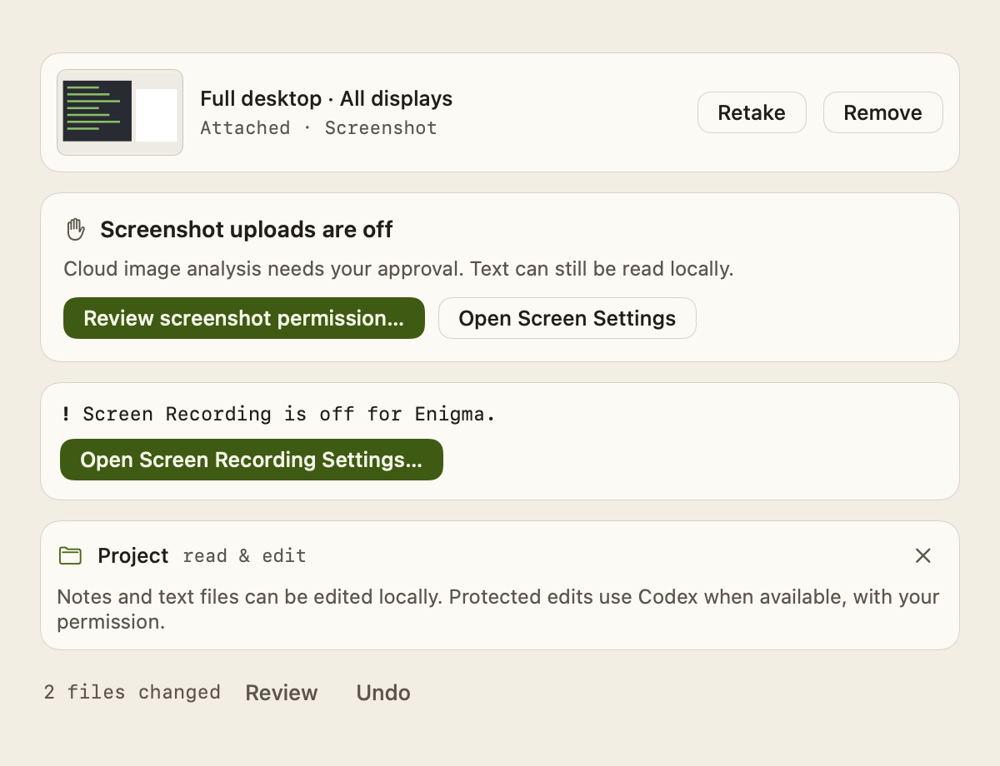

# Screen

Enigma can look at your screen when you ask it to. **/screen** captures the whole
desktop and **/snapshot** captures a region you select. Enigma reads the text in
the capture on your Mac first, and sends the image itself only when the question
needs it. A screenshot goes to a cloud model only after you allow it.

## Using it

Type a capture command in the composer, in the main window or the compact
selection panel:

- **/screen** captures every connected display, arranged as they are on your desktop.
- **/snapshot** opens the macOS region picker so you can drag out an area.

With a question, such as `/snapshot what does this error mean?`, Enigma captures
and then sends. On its own, the command attaches the capture and waits for you to
type a question. Commands can go anywhere in the message and combine with
**/think**, **/search**, **/edit** and **/translate**; for example
`/screen /translate to Spanish`. Commands inside quotes or backticks stay literal
text. See [Slash commands](Slash-Commands.md).

The attached capture appears as a card with a thumbnail, its scope (**Full desktop ·
All displays** or **Screen region**), a status line (`Attached · Reading text…`, then
`Local OCR` or `Vision`), and two buttons:

- **Retake** captures again, using the same kind of capture.
- **Remove** drops the image and its text from the next request. Your typed
  question and any selected text stay.

In the main window the card sits above the composer. In the compact selection
panel it sits under the input, and the panel grows to fit it; a capture on its own
doesn't open the conversation. If you cancel the region picker, the previous
capture (if any) and your draft are kept.



After you send, the sent message shows a small preview of the image for the rest
of the app session. A short note over the composer says how the capture was used,
for example `Local OCR · Image not sent` or `Vision · Cloud`.

A capture can't be combined with File Mode or **/messages**. Attaching files
removes the screenshot, and sending `/messages` with a capture asks you to remove one.

### Text or image

Enigma runs Apple's Vision text recognition (OCR) on every capture, on your Mac.
Then it decides what the selected model receives:

- **Text only** when the capture has enough clearly read text and the question is
  about that text, for example a word, an error code, a value, or "transcribe this".
  The model gets your question plus the extracted text.
- **The image** (plus the OCR text) when the question is visual (colors, shapes,
  layout, positions, charts, diagrams, icons, "what does this look like", "where
  is…") or when there's too little readable text.

Enigma waits at most three seconds for the text. The first recognition after
macOS starts can take much longer while Vision loads its model; if the text isn't
ready by then, the capture is treated like one with no readable text and the
model reads the image. Recognition keeps running in the background so later
captures are fast, and its late result is ignored. Captures taken while that
read still runs go straight to the image rather than starting another one.

Either way the model is told to treat everything in the screenshot as quoted data,
not instructions.

### Which model answers

The ordinary model picker decides; there is no separate screenshot model.

| Mode | Text-only request | Image request |
|---|---|---|
| **Local** | Selected local model | Selected local model, if it supports images. Pixels never leave your Mac. |
| **Cloud** | Selected cloud model | Selected cloud model, if it supports images and you've allowed uploads |
| **Auto** | Whichever model Auto picks | Auto's pick. If that's a cloud model that can't take the image, or uploads aren't allowed, the selected local model is used instead when it supports images. |

To read images on your Mac, install a recommended text-and-image package in
**Settings → Local models** and select it. Enigma never quietly switches to a
different installed image model. A text-only local model still handles text-only
requests; an image request with it stops with a message and keeps your screenshot
and draft. See [Local model selection](Local-Model-Selection.md).

Cloud image support is limited to reviewed model IDs from OpenAI, Anthropic and
Gemini. The ChatGPT and Claude Code subscriptions take text only. See
[Cloud model selection](Cloud-Model-Selection.md).

In Auto, if a cloud image request fails because the Mac is offline before any
reply arrives, Enigma retries with the selected local model when it supports images.

### Screenshots and web search

With **/search**, or automatic search when it's enabled and its chip shows, the
selected model first reads the screenshot and writes one focused search query.
A typed `/screen` or `/snapshot` shows no chip, so the request after its capture
searches only when you also typed `/search`. Without it, the question is
answered without search, except in Auto with Cloud set up, where a message that
asks for a web lookup ("latest news", "current price" and similar) asks you to
add `/search` instead of being sent; see
[How Auto decides](Cloud-Model-Selection.md#how-auto-decides). Brave Search
receives only that query, never the image, the full OCR text or your chat
history. The same model then answers from the screenshot and the evidence, and
source links appear under the answer. Without search, Brave is never contacted.
The query can include details from your screen that are relevant to the
question; the model is asked to leave out unrelated, personal or credential
details, but this isn't guaranteed.
See [Web search](Web-Search.md).

If the model can't produce a usable query, or search fails, the request stops
before anything is added to the chat, and your draft and screenshot are kept.

## Privacy and permissions

### Screen Recording

Captures need macOS **Screen Recording** permission. Enigma checks it before
hiding anything. If it's missing, macOS asks; if access is still not available, a
card explains what to do and offers **Open Screen Recording Settings…**. After
granting access you may need to quit and reopen Enigma, and the card says so.
Your draft is kept in every case.

The permission's status and an **Open Settings…** button are also in
**Settings → General → Permissions** and in the welcome setup. See
[Welcome and settings](Welcome-and-Settings.md).

Captures happen only when you run a command or press **Retake**. While one is in
progress, Enigma takes its own windows off screen so they aren't captured, and
ignores its show and selection shortcuts; everything comes back when the capture
ends or is cancelled.

### Sending screenshots to the cloud

Uploading screenshots to a cloud model is off by default. The first time a request
needs to send an image to a cloud model, Enigma shows a sheet before anything is sent:

- Its title names the scope and the provider, such as
  **Send full desktop to Anthropic?** or **Send selected region to OpenAI?**
- It previews the whole captured image.
- It explains that the choice applies to future region and full-desktop
  screenshots, to whichever cloud provider you select in Auto or Cloud, not only to
  this image or provider.
- **Allow & Send** saves that permission and sends. **Keep Screenshots Local**
  (or Escape) saves a refusal and keeps the screenshot and draft so you can use
  a local model.

If you replace the screenshot, change the cloud provider or switch to Local mode
while the sheet is open, your answer saves nothing and sends nothing.

Once you've declined, a request that needs a cloud upload shows a
**Screenshot uploads are off** card with **Review screenshot permission…** (the
sheet again) and **Open Screen Settings**. The setting itself is
**Allow screenshots to be sent to cloud models** under **Screen** in
**Settings → Cloud and search**. It's checked again before every image is sent,
including after a web search, and turning it off stops a cloud reply that is
using an image.

OCR text is separate from image uploads. In Auto or Cloud, the extracted text can
go to your cloud text model without this permission. In Local mode, text and
pixels stay on your Mac.

### What is kept

Screenshot pixels, OCR text and the sent-message preview stay in memory. Chat
history saves only your question, the answer and its source links. Temporary
capture files are deleted as soon as they're read.

### Hidden from screen sharing

The chat panel, the Settings window and the screenshot consent sheet ask macOS to
leave them out of screen sharing and recording (`NSWindow.sharingType = .none`).
They stay fully visible and usable on your own screen. This is best effort:

- Apple treats the flag as legacy, and capture apps built on ScreenCaptureKit may
  ignore it.
- Other separate windows, such as system menus, may still appear.
- Whether Zoom or another app honors it depends on that app, its version and its
  capture mode. Enigma doesn't change any other app's settings.

To check a setup, share your whole screen to a second participant, open the panel,
Settings and the consent sheet, and watch what the other side sees.

## How it works

The capture flow runs from the composer to the request:

1. `ComposerIntent` (`Enigma/App/ComposerIntent.swift`) resolves the draft's
   commands with `ComposerCommands` (`Enigma/Screen/ScreenAttachment.swift`), and
   `ComposerSubmission.plan` (`Enigma/App/ComposerSubmission.swift`) returns
   `.captureScreen` or `.screenAttachment`, or a conflict with files or Messages.
2. `ScreenComposerCoordinator` (`Enigma/Screen/ScreenComposerCoordinator.swift`)
   owns the draft and the attachment. It calls `prepareForCapture()` (permission),
   posts `.screenCaptureBegan` / `.screenCaptureEnded`, runs OCR, and returns the
   question to send automatically when there is one. It waits for OCR at most
   `ocrTimeout` (3 s), then sets the attachment to `.vision` with no text and
   leaves the detached Vision request running (only cancelling the capture
   cancels it). While such a read lingers, later captures skip OCR. A revision
   token discards late results after Remove or Retake.
3. `ScreenCaptureService` (`Enigma/Screen/ScreenCaptureService.swift`) checks
   `CGPreflightScreenCaptureAccess`/`CGRequestScreenCaptureAccess`, waits 200 ms for
   the panel to leave, then runs `/usr/sbin/screencapture` (`-i -x` for a region,
   one file per display for the desktop, composited by `NSScreen` frames). Images
   are decoded before the temporary files are removed.
4. `SpotlightPanelController` (`Enigma/App/SpotlightPanelController.swift`) orders
   the panel and Enigma's other visible windows out during capture and restores
   them afterwards; `show`, `toggle` and `summonSelectionContext` do nothing meanwhile.
5. `ScreenOCRService` (`Enigma/Screen/ScreenOCRService.swift`) uses
   `VNRecognizeTextRequest` (accurate, no language correction). `ScreenOCRResult`
   orders lines top to bottom, left to right; it's usable at 40+ non-whitespace
   characters and confidence 0.55 or higher.
6. `AppShellView.submitScreenAttachment` (`Enigma/App/AppShellView.swift`) asks
   `AutoRouter` for Auto's route, then `ScreenRoutingPolicy.decide`
   (`Enigma/Screen/ScreenRoutingPolicy.swift`) returns `.text`, `.vision`,
   `.needsCloudPermission` or `.blocked`. `requiresVision` holds the visual
   keywords; `hasConfidentTextForLookup` allows short lookups (1–40 characters,
   confidence 0.85 or higher). Cloud vision IDs are in
   `CloudModelCapabilities.visionModelIDs`.
7. `LocalChatViewModel.submitScreen` (`Enigma/LocalInference/LocalChatViewModel.swift`)
   wraps the question with `ScreenPromptContext`, resizes the image with
   `ScreenImagePreprocessor` (longest edge 1,568 px, JPEG quality 0.85), plans the
   search query with `ScreenSearchContext`, and streams from the local vision
   engine or the cloud provider. `ScreenRequestGuard`
   (`Enigma/Chat/MultimodalContent.swift`) rejects any cloud image without
   permission or a vision-capable model before anything is sent.

Consent lives in `ScreenSettings` and `ScreenUploadConsent`
(`Enigma/Screen/ScreenSettings.swift`): `allowCloudScreenshots` and
`hasExplainedCloudPermission`, stored in `UserDefaults`. The cards and sheet are in
`Enigma/Screen/ScreenCards.swift`; `ScreenConsentWindowPrivacy`
(`Enigma/Screen/ScreenControls.swift`) sets the sheet window's sharing type.
`ScreenConnectivity` reports offline state to the router. `MacPermissionRows`
(`Enigma/Screen/MacPermissionRows.swift`) shows the Accessibility and Screen
Recording rows used in Settings and the welcome setup.

## Limitations

- Interactive region selection, permission prompts, multiple physical displays and
  third-party screen-sharing behavior are not covered by automated tests; check
  them by hand with a stably signed build run from Xcode. The unsigned build from
  `scripts/verify-xcode.sh` can invalidate macOS Screen Recording consent.
- OCR quality and the text-or-image choice are heuristics. A question phrased
  unusually may send the image when text would do, or the reverse.
- Image requests need a text-and-image model; text-only models answer only from OCR.
- Search queries derived from a screenshot may contain on-screen details.
- Exclusion from screen sharing is best effort, as described above.

## Tests

Automated tests inject capture, OCR, search, provider and runtime boundaries, so
they run offline without selecting a region or downloading a model.

- `EnigmaTests/ScreenCaptureTests.swift`: command parsing, permission and restart
  paths, temporary-file cleanup, cancellation, Retake, the OCR time cap, hiding and
  restoring the panel.
- `EnigmaTests/ScreenOCRTests.swift`: OCR ordering, thresholds and image preprocessing.
- `EnigmaTests/ScreenRoutingTests.swift`: text-or-image decisions, Local/Cloud/Auto
  routing, consent defaults, offline fallback and model capabilities.
- `EnigmaTests/ScreenPipelineTests.swift`: the request pipeline, search planning,
  stopping, permission rechecks, and what is persisted.
- `EnigmaTests/ScreenProviderTests.swift`: image serialization and provider-side rejection.
- `EnigmaTests/ScreenViewTests.swift`: the real composer and compact panel in a
  hosted window: cards, Retake and Remove, the consent sheet (including its
  sharing type), denial, revocation, and Screen Recording errors.
- `EnigmaTests/AppCommandTests.swift` and `EnigmaTests/EnigmaSettingsTests.swift`
  check the panel's and Settings window's sharing type.

Run them with `scripts/verify-xcode.sh test -only-testing:EnigmaTests/ScreenViewTests`
(or another class). See [Testing](Testing.md).

### Optional real-model checks

`EnigmaTests/ScreenNativeSmokeTests.swift` has two checks that run only when their
config file exists; they're skipped otherwise, including in CI. They never download
models or change your installed library. Remove the config files afterwards.

**Local vision engine.** Create `/tmp/AI-Spotlight-Vision-Smoke.json`:

```json
{
  "model": "file:///absolute/path/model.gguf",
  "projector": "file:///absolute/path/mmproj.gguf",
  "server": "file:///absolute/path/llama-server",
  "prompts": ["Describe the shapes and colors in this image in one sentence."],
  "expectedAnswerTerms": ["red", "circle", "blue", "square"]
}
```

`model`, `projector` and `server` are required file URLs. `prompts` defaults to
the prompt above; `expectedAnswerTerms` is optional, and each term must appear in
every answer. The test installs the files into a temporary library, asks about a
synthetic image of a red circle and a blue square, checks a text-only arithmetic
answer, checks the model stays loaded between requests, and runs a short benchmark.
It writes a report to `/tmp/AI-Spotlight-Vision-Smoke-Result.txt`.

```sh
scripts/verify-xcode.sh test -only-testing:EnigmaTests/ScreenNativeSmokeTests
```

**Screenshot search.** Create `/tmp/AI-Spotlight-Screen-Search-Smoke.json`:

```json
{
  "modelsDirectory": "file:///absolute/path/to/test-library/",
  "modelID": "the-selected-text-and-image-model-id",
  "liveSearch": false
}
```

`modelID` must be the model currently selected in that library. The test runs
seven synthetic screenshots (words, memory figures, HTTP errors) through OCR,
query planning and an answer, and checks each query and answer. By default search
returns fixed public evidence; `"liveSearch": true` sends real Brave requests with
your configured key. It writes a report to
`/tmp/AI-Spotlight-Screen-Search-Smoke-Result.txt`.

```sh
scripts/verify-xcode.sh test -only-testing:EnigmaTests/ScreenSearchNativeSmokeTests
```

The same file also holds an unrelated opt-in thinking check, driven by
`/tmp/AI-Spotlight-Thinking-Smoke.json`.

Older verification reports are in `docs/history/`.
