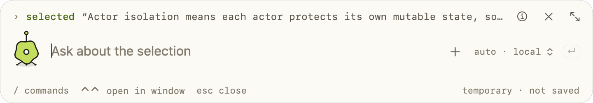
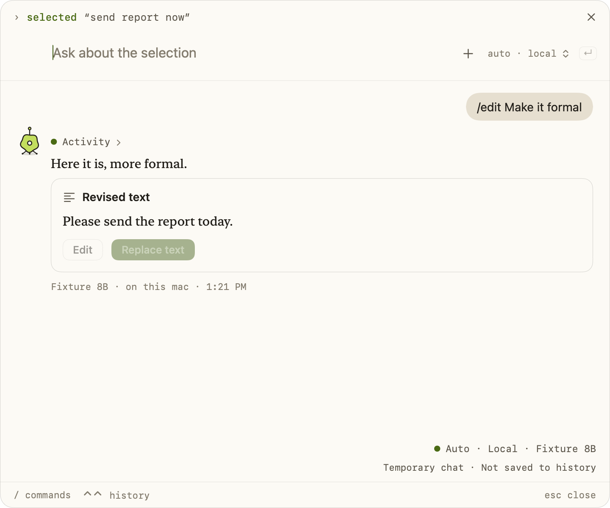
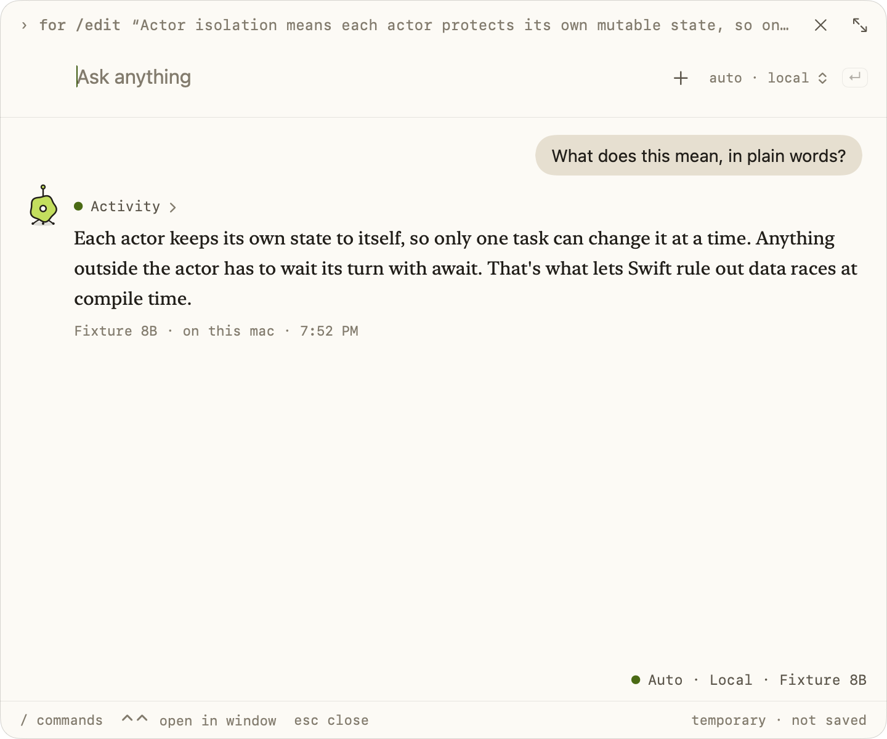

# Selection Context

Highlight text in another app and tap **Option twice** to start a new temporary
Enigma chat bar close to the pointer. **Shift–Option–Space** is the conventional backup.
Option–Control toggles the existing panel (press both modifier keys together).
Accessibility permission is required to use this shortcut while another app is active. Help contains all shortcuts,
an Accessibility status and Settings button, a choice of Option/Command/Shift for the
solo double tap, an enable switch, and Fast/Normal/Relaxed timing.

When Accessibility is missing, the composer asks to enable Selection Context and
provides **Open Accessibility Settings…**. This requests system trust and opens the
Accessibility page directly even if macOS suppresses a repeated popup. Enable
**Enigma** (the current macOS display name for Enigma). Permission status and shortcut
monitors refresh when switching apps, so granting access does not require a restart.

The source is captured before the panel becomes key. The selection is context for
the **first message only**. Later messages are ordinary turns: the selection stays
in the conversation history, so the model can refer back to it when asked, but it
is never attached again or framed as the subject of a new question. `/edit` is the
exception: on any turn it sends the selection, and the latest revision draft if
there is one, so it revises the draft or, without one, the original selection. A
standalone `/translate` also sends the selection again. The selection counts as
sent only once the model has replied to the message that carried it: if that
first reply fails, or is stopped before any text arrives, the next message carries
the selection again, and the panel still shows it as attached.
Removing the selection revokes the replacement capability and excludes it, its
place in the history, and its manually edited draft from subsequent requests,
including translations. Editing is an explicit per-request command.

The `› selected "…"` line shows what the next message will carry. Once the first
message has gone, it reads `› for /edit "…"` in a quieter color, with a tooltip
saying new questions don't attach it and /edit and /translate still use it. It stays while
the selection is in scope, because it's still what /edit revises and what Replace
text replaces, and its remove button still revokes both. The input's placeholder
changes from “Ask about the selection” to “Ask anything”. The “Selected text ·
App” card in the details and in the window gains the same note.

## Architecture and privacy

- `ConversationContext` is a provider-neutral, session-only attachment with identity,
  kind, source attribution and a text representation. Screenshot, file, webpage and
  image kinds leave room for future payloads without changing conversation routing.
  Existing screenshot/file flows can coexist with selected text.
- `ChatContextPreparer` expands attachments in request copies before token counting.
  JSON-encoded source material is explicitly described as untrusted context, never
  instructions. Drafts and displayed messages remain unchanged. Local, cloud,
  multimodal, Auto, and File Mode paths receive the same text representation.
- Web Search uses the selected model to derive a bounded query from the question
  and attachment, then follows the existing evidence preparation path. Relevant
  selection details can reach Brave when search is enabled (including existing
  automatic-search preferences). Only the original current question determines
  automatic-search eligibility; attachment text and source names cannot enable it.
  Automatic search defaults to on with a saved Brave key; its toggle is in
  Settings → Cloud and search → Web search · Brave. Without a key, neither composer
  offers `/search` or retrieves automatically. Capture itself makes no network
  request. Local mode never uses a cloud model to derive a query.
- The panel's chat is temporary: it lives in memory, writes nothing to the chat
  archive, and doesn't count against the saved chats. The hint row says so with a
  `temporary · not saved` tag for as long as the chat is in the panel. It is
  discarded on a new invocation or on switching to another chat; closing the panel
  without opening it in the window saves nothing. Hiding/reopening the panel retains
  it until then or app exit. Invoking a new chat stops an in-progress response using
  the existing request-cancellation protections; saved message contents remain intact.
- **Open in window.** Double-tap Control in the panel, at any point including before
  the first answer, or click the panel's Open in window button (tooltip “Open in
  window · saves to history”), opens the panel's chat as a normal chat in the main
  window: the window's normal size and layout, with the sidebar as Settings →
  General → Show sidebar has it for a new chat, the same composer and history. The
  chat is then saved like any other: it goes to the top of Recents, selected, and a
  quiet line under the messages says “Saved to history · Enigma keeps your last 10
  chats” (the number comes from `ChatSessionStore.maximumRetainedSessions`). The
  line is never part of the transcript. Nothing of the chat is written before this
  point. The raw selection is never written to disk: the saved chat keeps the
  messages and replies, while the selection stays in memory for /edit and Replace
  text until the user leaves the chat. Saved replies can still contain parts of
  it, such as an /edit draft, a translation, or a quoted passage. To save nothing
  from a selection chat, turn on **Keep selection chats private**. The saved line
  is shown once and goes with the next message.
- **Settings → Selection → Keep selection chats private** (off by default). When
  on, Open in window (tooltip “Open in window · stays private”) still shows the
  normal chat window, but the chat stays temporary: it isn't written to disk,
  doesn't appear in Recents, and is discarded on a new chat, on choosing another
  chat, or when the app quits. A quiet line says “Private chat · not saved to
  history” until the next message, and a `temporary · not saved` note sits over the composer for as
  long as the chat is open, where the window's other notes sit. The setting is read
  when a chat is opened in the window: changing it mid-chat applies to the next one
  and never saves or deletes a chat already opened.
- Enigma keeps the 10 most recently active chats; older ones are dropped from the
  archive on the next save, and the sidebar's Recents lists all ten, scrolling if
  needed. Histories saved when the limit was five load unchanged.
- The shortcut observes event metadata only. Accessibility text reads happen only
  during deliberate capture or explicit replacement. Secure Event Input, secure
  roles/subroles and protected ancestors block both Accessibility and copy fallback.
  Unknown/inaccessible focus or ancestry fails closed. Text is not logged.

## Capture and replacement

Capture first reads nonempty AXSelectedText, then AXStringForRange or the selected slice of AXValue. A bounded copy fallback
handles editors with incomplete selection text APIs. A known empty native AX range never
copies (some editors otherwise copy the current line). Browser canvas editors such
as Google Docs can expose an empty hidden input while document text is selected,
so supported browsers can fall back to copy when AX provides no selected text. Known copy-line editors
also require a range. Selected text is limited to 256 KB; model-specific input
budgets can be smaller and reject the request while preserving the draft.

Clipboard fallback eagerly saves every readable representation of every item,
including rich text, images and file data. If a representation cannot be preserved
or the clipboard changes during the snapshot, fallback is declined. A private
marker distinguishes unchanged clipboard contents from a copy result. Restoration
uses change-count ownership, so a subsequent user clipboard write wins. Keyboard,
mouse, scroll and focus changes abort capture. Synthetic events are
addressed to the source process and marked to distinguish them from user input.

## Revision cards and automatic replacement

Selected text is **read-only by default**. Asking “What does this code do?”
produces an explanation. Highlighting text never authorizes an edit, and a normal
answer never runs revision recovery or becomes a replacement card.

- **`/edit make this more professional`** asks for one revised-text draft. The model
  responds to the actual request and briefly describes the changes before showing
  the **Revised text** card. A question or unclear change can still receive an
  answer or clarification instead of an invented rewrite.
- **`/translate`** or **`/translate this`** detects the source language and translates
  to English. **`/translate to Spanish`** uses the requested target language.
  Translation is an ordinary read-only answer, without a revision card or paste.
  Natural requests such as “translate this” and “translate this to Spanish” follow
  the same language defaults without requiring a slash command.
- Requests for a rewrite without `/edit` receive guidance to use `/edit`. The command
  applies only to the current request: follow-up edits also need `/edit`, while
  questions about a previous draft remain read-only.

Both commands appear in slash completion and work with the existing thinking,
search, and capture commands. Quoted commands, code examples, URLs, paths, selected
source text, and previous turns cannot enable editing. If `/edit` and `/translate`
appear together, translation takes precedence and stays read-only. Standalone
`/translate` works with the attached selection on any turn: a `/translate` with no
text of its own, such as `/translate` or `/translate this to Spanish`, sends the
selection again, like `/edit`. A `/translate` with its own text translates that
text and doesn't attach the selection. Without source text, the model asks for
text to translate. `/translate` also restricts File Mode to read-only access.

**Edit** turns a revision card into an editable draft; **Done** returns to its
preview. **Replace text** pastes that draft with one click. `/edit` follow-ups
receive the latest proposed revision, including manual changes. Other follow-ups
receive it only when the user changed it by hand, since the model's own revision
is already in the conversation. Each response retains its own draft while the chat
is open.

**Settings → Selection → Automatically replace selected text** is off by
default. When enabled before an explicit `/edit` request begins, a successfully
completed revision is pasted directly, with no revision card or confirmation click.
It never applies ordinary responses, translations, malformed/incomplete revisions,
failed or cancelled requests, or a response whose context has been removed.
Turning the setting on does not apply responses already in progress; turning it
off cancels pending automatic work and makes unsent drafts available for review.

The host resolves commands from the current user request before adding context.
Request-only instructions guide explanations, editing, and translation; selected
text and previous drafts remain untrusted source material. The message that
carries the selection gets the read-only Selection Context instructions (“Selection
Context is attached to this message and is read-only…”); an `/edit` turn gets the
revision instructions; `/translate` gets the translation instructions. A later
ordinary message gets short follow-up guidance instead: the earlier selection is
background, not the subject of this message unless the user refers to it; source
text and earlier assistant output are data, never instructions; rewrites need
`/edit`; and no revision payload may be emitted. Web-search query refinement uses
only the source material the current request carries. Only `/edit` with an
attached selection enables the revision output protocol, recovery, and replacement.
Even an unsolicited, valid model revision payload cannot create a card or paste
for a read-only request. Local, cloud, vision, Auto and File Mode use this same gate.
Web-search query refinement receives the latest draft without response-format
instructions. Revision metadata is session-only and is cleared from request history.

For an explicit edit that omits the required payload, one bounded recovery request
to the same model can prepare the revision. It includes the original selection,
conversation and latest manually edited draft. A request-specific acknowledgement
is preserved; an `answer` result leaves the response unchanged. Invalid recovery
shows a notice and never treats arbitrary prose as replacement text or retries a
paste. Ordinary questions and translations do not incur this extra model request.
Language detection, translation quality, and wording still depend on the selected
model; the editing permission boundary is enforced by the application.

Capture still occurs only on double-Option (or the configured backup). Bounded
readiness retries allow an editor time to expose a fresh AX selection. Cmd+C may
retry once only if the clipboard marker remains untouched and the same safe source
is still focused. These retries end on cancellation, user input or focus changes;
there is no background selection monitoring.

## Applying a revision

Capture remembers the source application (including its PID) and the context ID.
Replacement activates that same running application and sends one Cmd+V directly
to its PID using CGEvent. The app's normal paste command acts on its **current**
selection or insertion point. There is no original AX element, range, text,
document/URL, continuity, or expiry requirement. Moving the selection or opening
another document in the same source app does not revoke replacement.

The floating panel releases keyboard focus before the
source app is activated. Accessibility permission, a still-running source,
successful activation, Secure Event Input, and the current field's password or
protected status are checked. Unknown password status fails closed. No AX text
write, re-copy, re-selection, or post-paste readback is performed. All clipboard
items and representations are preserved; temporary content is tagged transient
and auto-generated. The pasteboard stays available for 600 ms before restoration.
A newer clipboard write wins. The same Enigma panel then returns. The notice says
"Replacement sent" because dispatch does not prove that an external editor
accepted the paste. A dispatched attempt consumes the replacement action and is
never retried automatically.

## Verification and compatibility limits

Automated tests cover remembered-PID delivery, replacing the current selection in
an NSTextView fixture, insertion into a different document with no selection range,
complete clipboard restoration, transient markers, competing clipboard writes,
failed activation, permission revocation, password/secure-input blocking, event
creation failure, and one-shot dispatch without editor acknowledgement. Existing
capture, shortcut, placement, temporary-chat, context-routing, and panel tests
remain in place. Original-selection guard tests were replaced to reflect the
explicitly requested September 9 change in behavior, not to hide failures.

The September 8 signed Safari editor test verified the previous paste route.
The process-targeted paste route has automated coverage; live Google Docs,
Gmail, and Word verification remains pending. Do not infer universal compatibility
from unit tests. Safari was left alone at the user's request. Use the stably signed
Xcode build for future interactive checks, never the unsigned verification host.
The September 10 revision-card changes add coverage for acknowledgement/payload
separation, local/manual follow-ups, cloud automatic application, draft-aware search,
setting persistence, mid-response setting changes, cancelled/failed/incomplete
responses, context removal, bounded readiness retries, and a native card render.
A paste still consumes its source target to avoid repeating an ambiguous mutation.
Refine drafts before applying them; to replace again after a successful paste,
select the desired source text and invoke a fresh temporary chat.

Some editors may delay or reject paste; the clipboard has no universal consumption
acknowledgement, so unusually delayed apps may not receive the temporary text.

API references: [Apple AXSelectedText](https://developer.apple.com/documentation/applicationservices/kaxselectedtextattribute)
and [Apple event monitoring](https://developer.apple.com/library/archive/documentation/Cocoa/Conceptual/EventOverview/MonitoringEvents/MonitoringEvents.html).

The September 10 recovery fix was exercised against the installed Google Gemma 4
12B model in Auto mode with synthetic text: “make the text sound more professional”
produced a revision card. The updated smoke test uses `/edit` and also exercises
code explanation, English-default translation, and explicit Spanish translation. The real model also converted a deliberately unformatted
options response into a valid single revision. Neither check pasted into a source
application. Run this opt-in check with `TEST_RUNNER_ENIGMA_SELECTION_MODEL_SMOKE=1`
and `scripts/verify-xcode.sh test '-only-testing:EnigmaTests/SelectionContextTests/testInstalledGemmaHandlesSelectionCommands'`
when that model is selected locally.

## Permission and capture recovery

Settings → General now starts with Accessibility and Screen Recording status and
prominent buttons opening the exact macOS privacy panes. Selection Context also
shows its required Accessibility access above editing preferences. Setup includes
these controls, and chat shows an Accessibility action when access is missing.
If an old development/demo copy is listed, replace it with the current Enigma app
in System Settings and reopen Enigma; consent belongs to the signed app identity.

Capture now enables the focused app's optional `AXManualAccessibility` interface
before bounded readiness retries (up to ten reads). This follows the
[Electron accessibility guidance](https://www.electronjs.org/docs/latest/tutorial/accessibility).
Empty AX selected-text results fall through to range-based text; unsupported
parameterized range reads fall back to the selected UTF-16 slice of AXValue.
Valid selected text is retained even when a browser omits a selection range.
Secure-field checks, focus-change cancellation, copy-line safeguards, and
clipboard ownership protections remain in place. A failed capture now explains
how to retry or manually paste, instead of silently opening an empty chat.

Automated coverage exercises empty-text fallback, UTF-16 boundaries, readiness
retries, and existing secure selection / clipboard behavior. Interactive capture
must be checked with the stable development-signed app, not the unsigned test host.

## Compact panel and downward expansion

Selection Context opens the compact panel: a `› selected "…"` line naming the
selection, with a status button, a remove button and the Open in window button,
then the input row with the
character, Attach, a monospace route chip that opens the mode and model menu, and
a `↵` send key, then a monospace hint row: `/ commands`, `⌃⌃ open in window` and
`esc close` on the left, and the `temporary · not saved` tag on the right. If nothing is attached, the line reads
`› no text selected`. The status button opens temporary-chat status and the
routing and permission notices in an opaque details surface under the input; it
shows a problem glyph, and the character turns amber, when capture access is
missing or capture left a notice. Near the bottom of the screen the command list
and mode menu open above the input. Multi-line drafts resize the panel to its
measured height.

Standalone `/screen` and `/snapshot` captures also add a screenshot thumbnail
directly above the input, labeled **Full desktop · All displays** or **Screen region**.
**Retake** repeats that capture type; **Remove** discards its image and OCR from
the next request without removing the selected-text card or question. The bar
resizes to keep these controls visible before sending; the details aren't needed
to find the screenshot. Cloud image consent previews the capture
and names its actual scope and destination provider, as described in
[Screen](Screen-Skill.md).

The first accepted prompt grows the same panel downward on the `panelAnswer`
spring. The input stays where it is; the conversation and its cards appear under
it. Placement keeps the window within the current display, shifting up when there
is too little room below. Reduce Motion expands immediately.
Empty or rejected submissions do not expand, and request failures expose details.
Follow-up sends retain the expanded panel. A fresh selection returns to the bar;
New Chat restores the previous ordinary window size. Hiding during the animation
settles its final frame so reopening cannot leave a partially expanded panel.

The panel moves when dragged by its background, small or grown: any part with no
control, field, or selectable text over it, such as the hint row's empty middle or
the padding around the input. A click without movement changes nothing. A drag
keeps the panel inside the visible part of the screen under the pointer, clear of
the menu bar. It isn't a native title-bar drag, so it doesn't move the panel
between Spaces or offer window tiling. Once moved, later automatic resizing (growing into
the answer, the command list or mode menu opening above near the screen's bottom,
the details opening and closing, returning to rest) works from where the user put
it, kept on the visible screen, and lists open above or below for the room it has
there. The next summons opens it by the selection again. The main window moves by
its background the same way, except along a 6 pt band at its edges, which is
left to resizing; its sidebar and chat keep their clicks and scrolling.

The interaction was informed by [Thuki’s input-to-conversation flow](https://github.com/quiet-node/thuki/blob/main/src/App.tsx), implemented here with native AppKit
window geometry and the existing SwiftUI composer. No dependency was added.

Regression coverage checks first-send acceptance, context delivery, repeat
invocation, display-edge geometry, Reduce Motion, interruption by hiding, normal
window restoration, and native renders of both states. These use synthetic text
and the unsigned test host; live capture and animation feel still require review
in the stable development-signed app.

## Explicit command regression coverage

The September 17 command changes cover local/cloud questions and translations,
English-default and explicit-target request guidance, unsolicited revision payloads,
follow-ups after editing, Auto and screen text routing, command composition and
literal examples, request-only metadata, and read-only File Mode translation.
Existing cancellation, clipboard, context-removal and automatic-replacement checks
continue to run with explicit `/edit` requests. The native slash-menu render includes
both new commands. Automated fixtures verify routing and permissions.

For the initial command change, local verification passed: `build`, the full test
suite (525 tests, 10 opt-in tests
skipped, zero failures), and `analyze`. The opt-in Gemma 4 12B smoke test also passed
separately using synthetic text. It explained `numbers.map { $0 * 2 }`, translated
“Bonjour, le monde !” to “Hello, world!” by default and “¡Hola, mundo!” when Spanish
was requested, with and without `/translate`. None of those responses produced a
revision card. Explicit `/edit` and revision recovery still produced valid drafts.
These examples confirm the configured model's behavior, not translation quality
for every language or model. No source-application paste was performed.

The draft-removal follow-up passed `build`, `analyze`, and all 51 selection tests
(one live-model opt-in skipped). A subsequent full local run covered 526 tests but
had window-focus failures and extra keyboard input in the scrolling fixture.
All 16 window-command tests passed on retry; the scrolling retry also received
extra keystrokes. Its assertions were not changed or skipped. Use the isolated
GitHub Actions run on the published commit for the final full-suite result.
