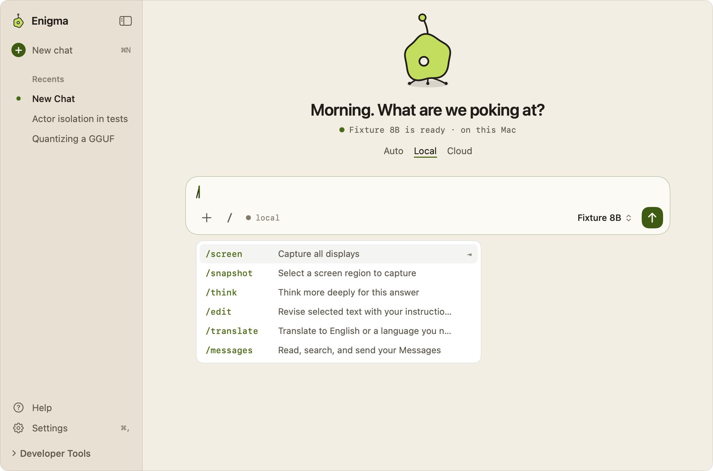
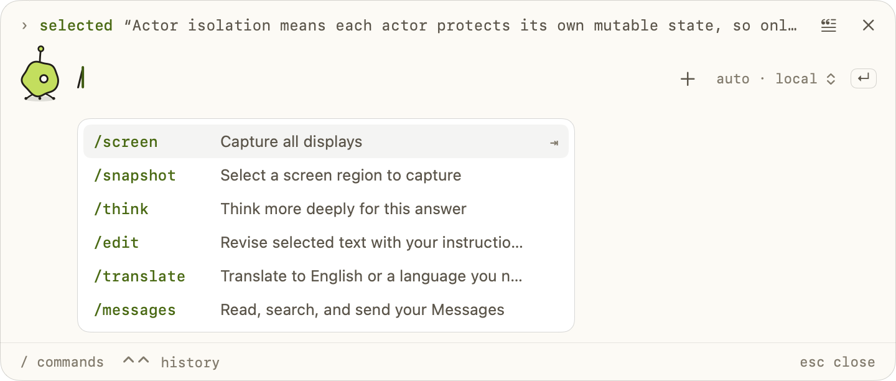

# Slash commands

Slash commands are short words starting with `/` that you type into the message
field to turn on a tool for one message: capture the screen, search the web,
think harder, revise or translate selected text, or use Apple Messages. They
work anywhere in a message and are highlighted as you type.

## Commands

| Command | Shown description | What it does |
| --- | --- | --- |
| `/search` | Search the web for this answer | Searches Brave for this message, even when automatic search wouldn't. Offered only when a Brave key is saved. See [Web Search](Web-Search.md). |
| `/screen` | Capture all displays | Captures every display, then asks about it. See [Screen](Screen-Skill.md). |
| `/snapshot` | Select a screen region to capture | Lets you drag out a region of the screen, then asks about it. |
| `/think` | Think more deeply for this answer | Asks the model to reason more carefully for this answer, with a larger answer allowance on local models and a higher reasoning effort on cloud models that support it. Works with File Mode and `/messages` too. |
| `/edit` | Revise selected text with your instructions | With Selection Context attached, returns one revised version of the selected text in a card you can edit and use to replace the selection. See [Selection Context](Selection-Context.md). |
| `/translate` | Translate to English or a language you name | Translates the text you give, or the selected text when you give none. English unless you name another language, as in `/translate this to Spanish`. Always read-only. |
| `/messages` | Read, search, and send your Messages | Gives the model the Messages tools for this message only. Sending still needs your approval. See [Messages](Messages.md). |

Every command applies to the message it's in. The next message goes back to
normal behavior, including the automatic-search setting.

You don't always have to type the command. Once you turn on **Recognize commands
from your wording**, Enigma also recognizes some commands from the wording of your
message and shows them as chips before you send. See
[Recognized commands](#recognized-commands).

## Typing and completing commands

Type `/` at the start of the message or after a space, or click the **/** button
in the composer, to open the list of commands. The list filters as you type,
ignoring case, and shows each command in monospace next to its description.

- **↑** and **↓** choose a command.
- **Tab** or **Return** completes it. Clicking a command does the same.
- **Esc** closes the list before it does anything else, such as hiding the panel.
- **Shift-Return** inserts a new line. **Return** sends when the list is closed.

Completion replaces only the command at the caret, adds a space after it when
needed, and can be undone with **⌘Z**.

In the main window the list opens below the composer while it sits in the middle
of an empty chat, and above it once the composer is docked at the bottom. In the
compact selection panel it opens below the input, or above it when the panel is
too close to the bottom of the screen.

An empty chat also shows up to four example lines under the composer, such as
`/translate "Bạn khỏe không?" → "How are you?"`. Clicking one puts the command
into the message field. The welcome tour lists the available commands, and
**Help** lists the screen, search and thinking commands.

`/search` appears in the list, the examples, Help and the welcome tour only when
a Brave Search key is saved. Saving or removing the key updates the list right
away without touching your draft.

## How commands are recognized

- A command must be its own word: at the start of the message or after
  whitespace, followed by a space, the end of the message, or punctuation
  (`. , ! ? ; :`). Case doesn't matter.
- Text in backticks or double quotes stays literal, so you can write about
  `` `/think` `` without triggering it. URLs, paths such as `/tmp/screen`,
  `\/think`, words such as `/thinker`, and unknown commands stay as typed.
- A command typed more than once counts once. Commands are removed from the
  text the model receives, except `/edit` and `/translate`, which stay at the
  start of the message so the model knows what was asked.
- If both `/screen` and `/snapshot` appear, `/snapshot` wins.
- If both `/edit` and `/translate` appear, `/translate` wins and the request
  stays read-only.

## Combining commands

Commands combine in any order, for example `/screen /search what changed in this
release?` or `/think /edit make it shorter`. Some combinations are blocked
before anything is sent:

- With files attached (File Mode), `/screen`, `/snapshot`, `/search` and
  `/messages` can't be used. Enigma shows: "Turn off Screen, Web Search, and
  Messages to work with your attached files." Attaching files also removes
  `/search` from the draft and any attached screenshot.
- `/messages` can't be combined with `/screen`, `/snapshot`, `/search` or an
  attached screenshot, so message contents never become a web search query.

## Recognized commands

With **Recognize commands from your wording** on (it's off until you turn it on,
see [The setting](#the-setting)), Enigma reads the wording of the message you're
typing and turns on the matching command for you, as if you'd typed it. It checks fixed English rules on this
Mac, with no extra model call. Rather than whole sentences, the rules look for
signals that together mark a request, so ordinary rewordings still count.

| Recognized | When your message says something like | Not recognized |
| --- | --- | --- |
| `messages` | A messaging word tied to a person or to your own messages, in a question or a read or send request: "what are the most recent messages from my dad", "has Dad replied yet", "catch me up on the group chat", "what was Alex's last text", "text Alex that I'm running late", "shoot Sam a text that I'm here", "let Mom know I landed via text" | Noun compounds ("text classification", "what does this error message mean"), other services ("send an email to Alex"), "send me a summary", how-to and advice questions ("how do I text …", "text my ex or not?"), replies in the news ("did Microsoft respond to the allegations"), pasted content ("Sam sent me this article, summarize it"), "my" things that aren't people ("read messages from my queue"), titles and slang ("the song Text Me Back"), this chat ("your last message", "summarize our conversation"), drafting and reviewing ("write a message to my landlord", "check the tone of my message to my boss"), and questions without a messaging word ("what did Sam say about dinner") |
| `messages`, as a follow-up | After a message that used Messages in this chat: "send it", "reply with sounds good", "tell her I'm on my way", "what about Alex?", "what else did she say" | A follow-up without one of these cues, such as "thanks!" |
| `search` | A question that automatic search would search for, such as "what's the latest AI news?" | Anything automatic search wouldn't search for |
| `think` | Think, reason or consider with a depth word ("think hard", "think it over", "consider this carefully before answering"), or an effort phrase: "take your time", "take a while to think", "don't rush", "be thorough", "be very careful with this one", "be meticulous", "go slow and verify each step", "step by step", "double-check your answer", "triple check the dates", "give this some serious thought", "go deep on this", "spend extra time on this", "use deep reasoning", "ultrathink", "use extended thinking"; and polite requests such as "can you think this through more carefully" | "I think …", "what do you think of this?", "do you think it will rain", "think of a name for my dog", "I'm thinking about buying …", "how to think critically", "think more positively", "what is deep thought", "it can take a while", "be thorough when cleaning a bathroom" |
| `edit` | With Selection Context attached: "rewrite this", "make it shorter", "make this more formal", "fix the grammar", "reword this", "proofread it", "tighten this up" | Anything without a selection; questions about the selection, such as "what does this mean?" |
| `translate` | With Selection Context attached: "translate this", "translate it to Spanish" | Anything without a selection |

`/screen` and `/snapshot` are never recognized, because they capture your
screen. "What's on my screen?" stays an ordinary question until you type the
command. The request a typed `/screen` or `/snapshot` sends after
its capture runs only the commands you typed: nothing else is recognized from
its wording.

### Chips

Each recognized command appears as a small chip in the composer bar, after the
`● local` or `○ cloud` indicator, in this order: `messages`, `search`, `think`,
`edit`, `translate`. In the compact selection panel the chips sit before the
route chip. The chips update as you type. Commands you type yourself get no
chip; they're highlighted in the text instead.

Click a chip to turn that command off for the message you're writing. It stays
off while you keep editing, and comes back for the next message, or when you
clear the field. VoiceOver reads each chip as "Recognized command: messages",
with the hint "Turns it off for this message".

The chips and Send use the same rules, so what the chips show is what Send does.

### Conflicts

A command you type always wins, and a recognized command never causes an error.
When a recognized command would conflict, it's dropped without a chip:

- With files attached, `messages` and `search` aren't recognized.
- With a screenshot attached, or with `/search`, `/screen` or `/snapshot` typed,
  `messages` isn't recognized.
- When Messages is on, typed or recognized, `search` isn't recognized, so
  message contents never become a web search query.
- With `/translate` typed or recognized, `edit` isn't recognized, so the request
  stays read-only. A typed `/edit` also keeps `translate` from being recognized.

The conflicts between typed commands still show the errors described in
[Combining commands](#combining-commands).

### The setting

**Settings → General → Commands → Recognize commands from your wording** controls
`messages`, `think`, `edit` and `translate`. It's off by default, so a new user's
wording never turns on a command by surprise; turn it on to get these chips. With
it off, only `search` can still be recognized, and that follows the
automatic-search setting in **Settings → Cloud and search**.

## Screen captures

`/screen` or `/snapshot` with a question captures first, then sends the question
with the capture. On its own, the command attaches the capture and waits for your
question. The attachment card offers **Retake** and **Remove**. If you change the
draft while a capture is in progress, nothing is sent automatically. See
[Screen](Screen-Skill.md) for permissions, OCR and cloud image consent.

## Privacy

Only the message you're typing can turn on a command, typed or recognized. Text
from a selection, a file, a screenshot, earlier messages or tool results can't
turn on search, editing or Messages, and quoted or backticked text stays
literal. The Messages follow-up reads only an in-memory note that the chat's
previous request used Messages, never the earlier text. Every recognized command
is shown as a chip before anything runs, and a recognized `messages` keeps every
safeguard of `/messages`: the Full Disk Access check, the one-time cloud notice,
Auto staying on this Mac, and your approval for each message sent. `/search` sends a query to Brave;
`/messages` reads your local Messages database and needs your approval to send.

## How it works

- `Enigma/App/SlashCommand.swift`: `SlashCommand` is the one catalog of commands,
  their descriptions, and the parsing used for highlighting, completion and
  execution. `available(hasSearchKey:)` hides `/search` without a key.
  `tokens(in:)` and `removing(_:from:)` find and strip commands;
  `completion(in:selection:availableCommands:)` finds the command at the caret.
- `Enigma/App/SlashCommandComposer.swift`: `SlashCommandComposer` wraps an
  AppKit `SlashCommandTextView` that colors commands with the palette's
  `accentText`, handles the keys above, and shows the list
  (`EnigmaSlashSuggestions`, an opaque `menu` surface). `CommandCompletionModel`
  tracks matches and the chosen row. `SlashCommandInsertion` lets the **/**
  button and example lines insert text at the caret.
- `Enigma/App/EnigmaComposer.swift` and `Enigma/App/EnigmaCompactPanel.swift`
  place the field in the main window and the compact panel.
- `Enigma/Screen/ScreenAttachment.swift`: `ComposerCommands` resolves the
  typed commands in a draft. `ThinkCommand` handles `/think`, and
  `ThinkCommand.isRequested(by:)` recognizes a request to think harder.
- `Enigma/App/ComposerIntent.swift`: `ComposerIntent.resolve` combines the typed
  commands with the recognized ones, applies the setting, dismissals and
  conflicts, and gives the chips (`inferred`) and the prompt to send. Matchers
  run on `WebSearchPolicy.questionText`, which drops quoted and code text.
- `Enigma/Messages/MessagesIntentPolicy.swift`: recognizes Messages requests and
  follow-up cues.
- `Enigma/App/ComposerIntentChips.swift`: the chips. `AppShellView` holds the
  dismissed chips and passes them to both composers.
- `Enigma/App/ComposerSubmission.swift`: `ComposerSubmission.plan` decides what
  Send does from the resolved draft, including the File Mode and Messages
  conflicts, which only typed commands can cause.
- `Enigma/Chat/ConversationContext.swift`: `SelectionResponseMode` turns `/edit`
  and `/translate` into the selection instructions. `SelectionIntentPolicy`
  recognizes edit and translate requests.
- `Enigma/App/EnigmaMainWindowLogic.swift`: `SlashCommandExample` (example
  lines) and `KeyboardShortcutsHelp` (Help).

## Limitations

- `/edit` only changes behavior when Selection Context is attached. Without a
  selection, the message is sent as an ordinary question.
- Commands are English words and can't be renamed.
- Recognized commands follow English phrasings only. Unusual wording gets no
  chip; typing the command still works.
- `think` reads "step by step" as a request for care even when it's part of
  the topic, as in "step by step instructions to bake bread". Click the chip to
  send without it.
- `messages` can't tell a person's name from a company's: "has Meta replied?"
  on its own is recognized, while "has Meta responded to the fine" isn't.
- A Messages follow-up needs a cue such as "send", "reply" or "what about …" in
  the new message. A chat reopened from history starts without the follow-up.
- Help doesn't list `/edit`, `/translate` or `/messages` as rows; it describes
  `/edit` and `/translate` in its selection notes.

## Tests

- `EnigmaTests/ScreenCaptureTests.swift`: parsing at every position and case,
  literals and unknown commands, `/edit` and `/translate` combinations, caret
  completion with Unicode text, and capture with and without a question.
- `EnigmaTests/ScreenPipelineTests.swift`: commands in either order, once, with
  quoted text kept.
- `EnigmaTests/ScreenViewTests.swift`: the rendered list with a highlighted draft.
- `EnigmaTests/EnigmaMainWindowTests.swift`: example lines follow the available
  commands; the **/** button types a command.
- `EnigmaTests/WebSearchTests.swift`: `/search` suggestions follow the saved key;
  removing `/search` returns to the automatic setting.
- `EnigmaTests/MessagesTests.swift` and `EnigmaTests/FileModeUITests.swift`:
  `/messages` parsing and `/translate` staying read-only in File Mode.
- `EnigmaTests/ComposerIntentTests.swift`: `MessagesIntentPolicyTests`,
  `ThinkIntentTests` and `SelectionIntentPolicyTests` cover the phrasings that
  are and aren't recognized, including quoted text and curly apostrophes;
  `ComposerIntentResolveTests` covers every conflict, dismissals, the setting,
  follow-ups and speed; `ComposerIntentChipsTests` renders the chips in both
  composers and in the shell.
- `EnigmaTests/AppShellStateTests.swift`: `ComposerSubmissionTests` plans
  recognized commands like typed ones.

Run them with `scripts/verify-xcode.sh test`. See [Testing](Testing.md).
