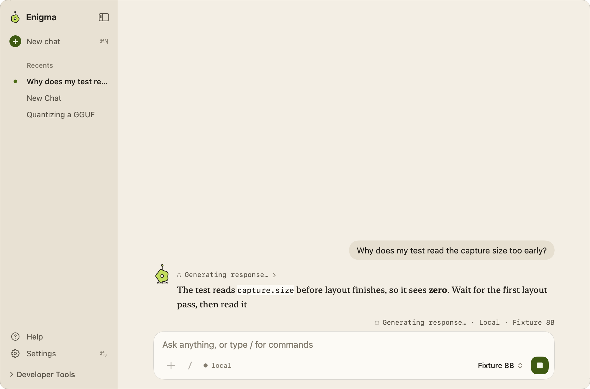

# Thinking, desktop capture, and streaming follow

Implemented against `0f66362` on the current integration branch.

- Streaming updates explicitly notify the native scroll observer. Corrections
  are throttled, so continuous layout updates cannot keep postponing scrolling.
  Scrolling away releases following, and returning to the bottom resumes it.
- `/think` applies to one request. Local and cloud request settings carry the
  intent separately from the displayed question. Local generation reserves
  2,048 tokens instead of 512 and enables the runtime's thinking template with
  a 1,024-token reasoning budget. Preparation includes the extra output space
  and concise checking guidance. File tool loops retain the same setting.
- `/screen` captures all displays and composes them in desktop arrangement.
  `/snapshot` retains the previous interactive selection. Retake preserves the
  capture type. Both use the existing permission, panel-hiding, OCR, privacy,
  cancellation, and temporary-file cleanup paths. Captures remain in memory.
- File Mode is always available; Search and Screen no longer appear as composer
  tool buttons or plus-menu options. Slash commands remain available.
- While a request is active, the character thinks beside the reply and Send
  becomes Stop. (The growing-leaf animation and green composer gradient first
  added here were later replaced; see "Waiting indicator" below.)

## Verification

The project build, complete tests, and analyzer are run with the repository's
isolated verification helper: build and analyzer passed; 388 tests completed
with eight optional skips and zero failures. Regression coverage includes command boundaries,
combined commands, desktop versus region capture and retakes, output reservations,
local/cloud thinking settings, nonsticky thinking, file-button visibility, and
scroll updates without observer frame changes. Existing live-scroll, long-chat,
request cancellation, file safety, and capture preservation tests remain intact.

The opt-in installed-model test reads `/tmp/AI-Spotlight-Thinking-Smoke.json`
as a serialized `LocalModel`, without changing the installed library. On the
owner's Google Gemma 4 12B package, `/think` correctly answered the book-and-pen
puzzle (5 kr), and the following ordinary request returned 42. No downloads or
cloud requests were needed. The fixture is removed after verification.

The stable Apple Development-signed app was built and launched from Xcode.
Native accessibility verified the waiting indicator, one visible File Mode button,
and successful Gemma responses. A live response followed at the bottom; scrolling
up during generation released it, and completion did not snap back. `/screen`
attached the desktop without region selection. `/snapshot` invoked the selector;
cancelling restored the draft and previous attachment, which were then cleared.

The existing panel privacy setting excludes it from computer screenshots.
Secondary-display arrangements and live cloud provider calls were not exercised.
GitHub CI results are recorded in the PR.

Provider controls follow the [Claude thinking documentation](https://platform.claude.com/docs/en/build-with-claude/extended-thinking)
and [Gemini thinking documentation](https://ai.google.dev/gemini-api/docs/generate-content/thinking).

The subsequent [chat presentation update](Chat-Presentation.md) adds immediate
outgoing bubbles and per-message attachments.

## Waiting indicator

While a request waits for its first words, the reply row reads "Thinking" in
monospace and the character beside it thinks: it morphs between lobe counts,
spins, and splits its hole into three. Once words arrive it ripples once per
streamed update. It is drawn natively with SwiftUI `Canvas` (see
[UI-Style.md](../UI-Style.md)); the earlier web-view SVG indicators are gone.
Under Reduce Motion the character stays still and the state reads through its
color and hole. Assistive technology receives one "Thinking" status.

