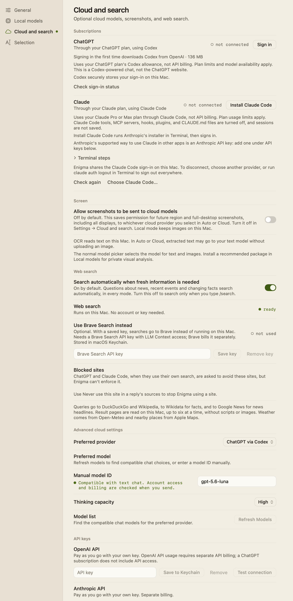
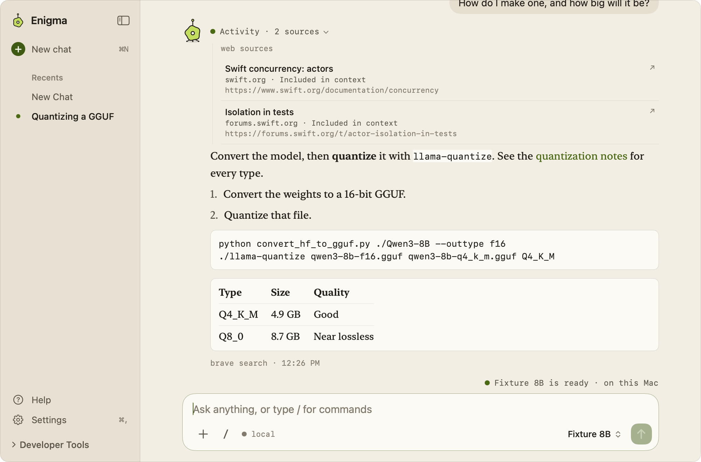

# Web Search

Enigma can ground answers in current web results from Brave Search. With your own
Brave Search API key saved, questions that need fresh information search
automatically, and **/search** forces a search for one message. Your selected
model, local or cloud, writes the answer and the reply lists the sources it was
given.

## Set up

1. Get a Brave Search API key with **LLM Context** access from the Brave Search
   API dashboard. Brave bills its usage separately from any model provider.
2. Paste it into **Settings → Cloud and search → Web search · Brave** and choose
   **Save key** (or press **Return**). The welcome setup's **Connect what you use**
   step has the same field, under **Search**.
3. The status changes from **no key** to **key saved**. **Remove key** deletes it.

## Automatic search

**Search automatically when fresh information is needed** is on by default and
takes effect once a key is saved. Turn it off for manual-only search; the choice
is remembered and applies in Local, Cloud and Auto.

Enigma decides on this Mac, from the wording of the current question alone, with
no extra model call. Questions like these search:

- News and recent developments: "latest AI news", "what's happening in …"
- Facts that change: who holds an office, weather and forecasts, stock and
  crypto prices, exchange or mortgage rates, scores, opening times and schedules
- Questions with words like "latest", "today" or "this week", and questions
  about this year's elections, releases or events
- Explicit requests such as "look up … online"

These don't search automatically:

- Text in quotes, backticks or code blocks
- Rewriting, translating, summarizing "this", writing code, and other tasks on
  text you supply
- Questions about your own work, such as "the current file" or "my latest draft"
- Historical questions, and requests such as "don't search" or "stay offline"
- File Mode and Messages requests, typed or recognized
- Questions about your own communications, such as "what are the most recent
  messages from my dad", "what's new in my texts" or "any new emails from my
  boss today", even when Messages isn't recognized. News about others, such as
  "the latest message from the White House on tariffs", still searches, and a
  typed `/search` always does.

Each message is decided on its own. Searching one question doesn't make the next
one search.

### The search chip

When a draft would search automatically, a `search` chip appears in the
composer bar while you type, so you know before sending. Click the chip to send
that message without searching; it stays off while you keep editing, on every
route (Local, Cloud and Auto), and comes back for the next message or when you
clear the field. With automatic search off, or without a key, there's no chip.
The chip follows the automatic-search setting, not **Recognize commands from
your wording**. See [Slash commands](Slash-Commands.md#recognized-commands).

## Explicit search with /search

Type **/search** anywhere in a message to search for that message only, even
for a timeless question and even when automatic search is off. It's highlighted
in the draft and stays visible until the message is accepted; delete it before
sending to cancel. `/search` combines with other commands, such as
`/screen /search what is this error?`. It can't be combined with attached files
or `/messages`. See [Slash commands](Slash-Commands.md).

Without a saved key, `/search` isn't offered in suggestions, Help or the welcome
tour. If you type it anyway, Enigma reports that a key is needed and keeps your
draft.

## Sources and citations

While a search runs, the reply's activity line moves through **Preparing search
query…** (only when the query is refined, below), **Searching…** and
**Reading sources…**. When the answer is done, the line reads **Activity · N
sources**; open it to see **web sources**, each with its title, site, URL and
**Included in context**. Clicking a source opens it in your browser. The line
under the reply includes **brave search**.

The model is told to treat the excerpts as untrusted data and to cite only the
URLs it was given. Only sources that actually fit into the prompt are shown;
other results Brave returned are dropped. A listed source means the model was
given that excerpt, not that every claim in the answer was checked against it.

If searching fails, Enigma doesn't quietly answer without evidence. It shows an
error and keeps your draft: a missing or rejected key, rate limiting, no
connection, an invalid response, no relevant sources, or not enough room in the
model's context for sources. **Stop** cancels both the search and the answer.

## Privacy

- **What goes to Brave:** a search query and your API key, over HTTPS, with
  nothing cached on disk and redirects refused.
  - Normally the query is your current question, trimmed to 50 words and 400
    characters, without slash commands.
  - With a screenshot or selected text attached, your selected model first writes
    a short query from your question and the relevant parts of that material. It
    is told to leave out unrelated, personal and credential details, but that
    isn't guaranteed. Pixels, full OCR text and the full selection are not sent.
  - For nearby questions, such as "weather today" or "cafes near me", an
    approximate area (city and coordinates rounded to about 1 km) is added. See
    Location below.
- **Never sent to Brave:** conversation history, attached files, Messages
  content, and model-provider credentials.
- **Who can trigger a search:** only your current question or `/search`.
  Attached text, OCR, files and earlier messages can refine an approved query
  but can't cause a search on their own.
- **Where the answer comes from:** search controls retrieval, not the model. In
  Local mode the answer is written on this Mac, but the query still goes to
  Brave.
- **Key storage:** the key is kept in the macOS Keychain as its own item,
  separate from model-provider keys, and never in preferences or chat history.
- **What is saved:** the chat keeps your message, the answer and the source
  titles and links. The excerpts given to the model are not saved.

### Location

**Settings → General → Location → Use location for nearby questions** is on by
default. It's used only when a search runs for a nearby question without a named
place. macOS asks for permission the first time. The area is used for that
question only, is not saved, and requests give up after 20 seconds. If location
is off, denied or unavailable, Enigma asks you to name a city and doesn't search.

## How it works

- `Enigma/Search/WebSearchSettings.swift`: `WebSearchSettings` holds the
  automatic-search preference (`webSearch.automaticallySearch` in user defaults,
  default on) and whether a key exists. `KeychainSearchCredentialStore` stores
  the key.
- `Enigma/Search/WebSearchSettingsSection.swift`: the **Web search · Brave**
  section of Settings.
- `Enigma/Search/WebSearchPolicy.swift`: `WebSearchPolicy.needsFreshInformation`
  is the deterministic automatic-search decision, using fixed English patterns
  on the question with quoted material removed.
- `Enigma/App/ComposerIntent.swift`: `ComposerIntent.resolve` runs the policy on
  the typed draft for the `search` chip, and drops it for dismissals, attached
  files and Messages requests. The composer sends its result as the final
  decision.
- `Enigma/LocalInference/LocalChatViewModel.swift`: `shouldSearch` combines
  `/search` with the policy. With `allowsAutomaticSearch: false`, as the composer
  and Auto's chosen route pass, it keeps the decision it was given, so a
  dismissed chip stays off. The Local, Cloud, Auto and Screen submission paths
  call the private `search` method, which refines the query when material is
  attached and adds location.
- `Enigma/Search/BraveSearchClient.swift`: `BraveSearchClient` sends
  `POST https://api.search.brave.com/res/v1/llm/context` with the
  `X-Subscription-Token` header, a 30-second timeout and an ephemeral session.
  It asks for up to 10 URLs and 8,192 evidence tokens, at most 2,048 per URL,
  keeps generic, point-of-interest and map results with safe HTTP(S) links, and
  never shows raw error bodies.
- `Enigma/Search/WebSearchContext.swift`: `WebSearchContext.prepare` fits
  evidence into the selected model's context. After reserving output, system
  instructions, any image and the full question, about half the remaining input
  space goes to excerpts. Each source gets at most 2,048 tokens or a third of
  that space (half with two sources, all of it with one), measured with the
  model's own token counting; space a short source doesn't use goes to the
  others. The question is never cut, and older chat history only fills what's
  left.
- `Enigma/Screen/ScreenPromptContext.swift`: `ScreenSearchContext` writes and
  validates refined queries: one line, at most 50 words and 400 characters, and
  not empty or a bare reply such as "Yes" or "UNKNOWN".
- `Enigma/Search/LocationService.swift`: `LocationIntent` decides when a question
  is about nearby places; `LocationService` makes one bounded, cancellable
  location request.
- `Enigma/Chat/AssistantActivity.swift` and `AssistantActivityView.swift`: the
  activity phases and the **web sources** list.

API reference: [Brave LLM Context](https://api-dashboard.search.brave.com/documentation/services/llm-context).

## Limitations

- Automatic search recognizes English wording and clear signals only. It can
  miss paraphrases, and can't resolve follow-ups such as "and yesterday?" from
  earlier messages; use `/search` with a complete question.
- Enigma doesn't check how recent or accurate each source is.
- Screen questions that search need one extra model call to write the query.
- Brave usage, limits and billing depend on your Brave plan.

## Tests

`EnigmaTests/WebSearchTests.swift` covers the Brave request and response format,
error handling without exposing response bodies, query limits and command
boundaries, saving and removing the key, automatic-search examples and opt-outs,
the setting and missing-key behavior in the real composers, attached text that
can't authorize a search, query refinement, location handling, evidence fitting
and source selection across Local, Cloud, Auto and Screen, failures that keep the
draft, cancellation, older chats without source data, the rendered sources
list, and a decided search staying off on every route.
`EnigmaTests/ComposerIntentTests.swift` covers the `search` chip, its dismissal
and its conflicts; `EnigmaTests/ComposerIntentPhrasingTests.swift`, the phrasing
corpus, checks which drafts get the chip and that Messages drafts never do; and `ComposerSubmissionTests` in
`EnigmaTests/AppShellStateTests.swift` covers a dismissed chip sending without
search. The tests use fixtures and need no Brave key or network.

Run them with `scripts/verify-xcode.sh test -only-testing:EnigmaTests/WebSearchTests`.
See [Testing](Testing.md).
