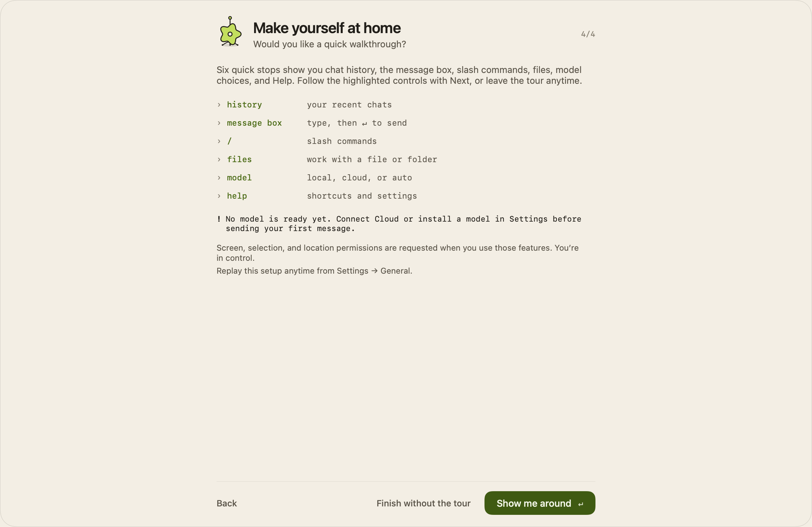

# Welcome setup and walkthrough

Welcome fills the rounded app window on the opaque `background`, in the Paper or
Ink appearance (see [UI-Style.md](../UI-Style.md)). Setup temporarily expands the
window to at least 1280 × 860, fitted to the current display. It keeps that space
through the optional tour, then restores the normal window size. Resizing during
setup does not overwrite the saved chat size. The character grows in large on
the first step, then glides into a 40 pt slot in each later step's pinned header,
beside a monospace `2/4` counter. Each step has one primary button.

First launch introduces Enigma in four steps:

1. **Welcome.** The character grows in, with a short greeting and the shortcuts
   that open Enigma. It is drawn natively with SwiftUI Canvas and stays still
   when macOS Reduce Motion is enabled. No web runtime or network is needed.
2. **Your Mac.** Existing hardware detection and the reviewed model catalog supply
   up to three compatible choices as hairline rows with a selection dot. Each row
   explains capability, download size, and estimated or measured responsiveness,
   and the character thinks while the Mac is checked or a model downloads.
   Unsupported or memory/disk-limited models never pad the list. A slower Mac
   without a responsive choice labels its best available option accordingly.
   **Skip** opts out of local models. One primary button installs, updates, uses,
   or continues, as the choice allows; Return never starts a download.
3. **Connections.** ChatGPT (through Codex) and Claude (through Claude Code) use
   the same sign-in controls as Settings, and Brave Search has a secure key field
   whose Return saves the key. **More connection settings** opens Settings →
   Cloud and search in a sheet with **Back to setup**. The page distinguishes a
   signed-in account, a saved search key, and missing connections. Every
   connection is optional, and the character shows the error state when a
   connection fails.
4. **Walkthrough invitation.** Users can finish immediately or take six short
   steps pointing at chat history, the composer, slash commands, files,
   mode/model selection, and Help. Next advances, Finish setup returns to chat, and End tour or
   Escape exits early. The command stop highlights the message box and shows
   the actual command catalog, including how to open and navigate its menu.
   Popups use the actual SwiftUI control bounds, adapt to
   the minimum panel size, and support the sidebar being shown or hidden.

## Installation and continuation

The welcome flow calls the existing model downloader, checksum verifier, atomic
installer, model selector, and performance check. Continue requires the chosen
package to be current, selected, and finished installing. Failure or cancellation
without an installed package leaves Continue unavailable; the user can retry or opt out.
Cancellation remains busy until the downloader acknowledges it. Canceling a
performance check after the verified package is installed may still leave a
usable model. If a benchmark changes the ranking, the chosen model stays visible
so the user is not asked for a second download.

Choosing **Skip** bypasses installation. Finishing setup always
selects Auto as the startup mode, whether or not a local model or Cloud account
is configured.
Without Cloud, Auto uses only the installed local model; if neither is ready,
setup still finishes in Auto and asks the user to configure a model before sending.
Existing model files, chats, and credentials are retained. No permissions are granted by setup; the
existing Screen, selection, files, and location consent flows remain in place.
The final page explains when no model route has been configured yet.

## First run, resuming, and replaying

An incomplete first run resumes its page after relaunch. Installation and account
status are read from their existing stores; an interrupted model choice must be
confirmed again on the model page. Setup completion persists independently from
whether the optional tour was taken. Existing users who have installed models or
previously dismissed model onboarding are migrated without an unsolicited wizard.

To test in the development app:

1. Run the shared **Enigma** scheme from Xcode using the usual stable
   development signing identity.
2. Open **Settings → General → Replay welcome setup**. This also brings back a
   hidden chat panel. The sidebar's Developer Tools contains the same replay
   action when the sidebar is visible.
3. Walk through the local opt-out path to test without downloading anything.
   On the connections page, open the setup links or Settings, then continue.
4. Choose the walkthrough and use Next through all six stops. Repeat and try
   End tour. Resize the panel down to 640 × 420; scroll the model and connection
   pages to reach additional content.
5. Replay again to exercise a real model install or select an already-installed
   package. Continue should appear only once the selected model is ready. Downloads
   consume the displayed disk space; account login and real searches need your
   participation and credentials.

Replay starts at the first step and does not clear application data or require an account
reset. It is disabled while the shared chat is busy. A replay of previously
completed setup does not force onboarding again on the next launch if abandoned.

## Verification

Offline regression tests in `LocalModelSelectionTests` cover first-run state,
resume, migration, completion, replay, tour progression/exit, three safe unique
choices, keeping the selected choice through reranking, continuation gates,
legacy-sheet suppression, and the character's slots and states. Native rendering tests
capture every page and tour step at default and minimum panel sizes, with the
sidebar both hidden and visible. The existing installer tests cover checksum,
truncation, HTTP, disk, cancellation, and preservation of installed models.

Use `scripts/verify-xcode.sh build`, `test`, and `analyze` as specified in AGENTS.md.
These checks do not download multi-gigabyte models, purchase subscriptions, sign
in to real accounts, or send paid search/chat requests. The checked-in screenshots
use deterministic hardware and empty-account fixtures.

Local verification after the window sizing and greeting refinements: build
and static analysis passed. The full suite ran 487 tests with 10 optional skips
and no failures. Rendering checks verify transparent outer corners on every
welcome page and the integrated app window, plus all six tour steps at both
window sizes. A native panel regression verifies temporary enlargement, size
restoration after skipping or ending the tour, replay, and saved-size preservation.
Native chat fixtures use isolated startup preferences so saved
user settings cannot change their routing. Live account authentication and
multi-gigabyte downloads remain manual checks.

Welcome exit regression tests exercise skipping, ending, and completing the tour
in a native panel, checking that the chat editor immediately regains keyboard
focus and accepts clicks and typing. Panel resizing is deferred until published
welcome state has been stored, and the tour overlay is removed when inactive.
An offline request test verifies that Auto with no Cloud configuration starts
only the local producer, including for a complex prompt.
