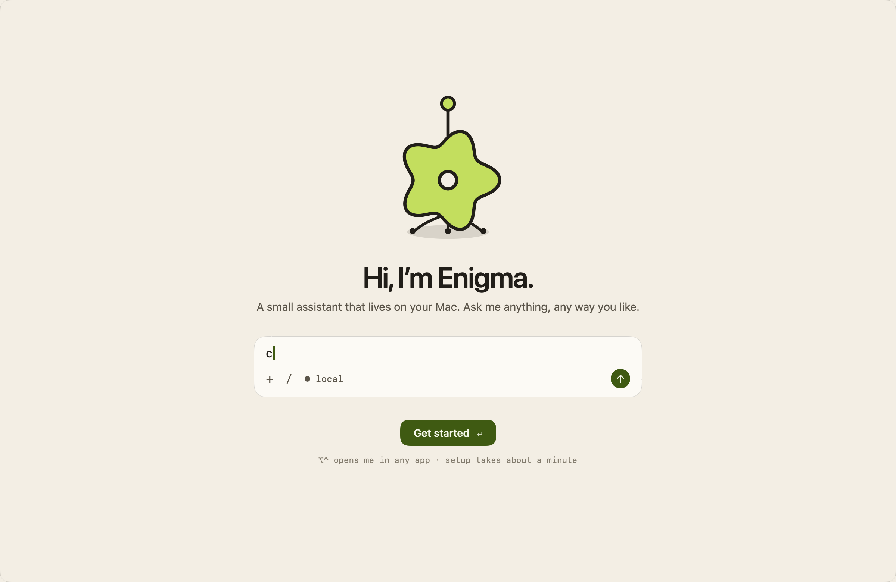
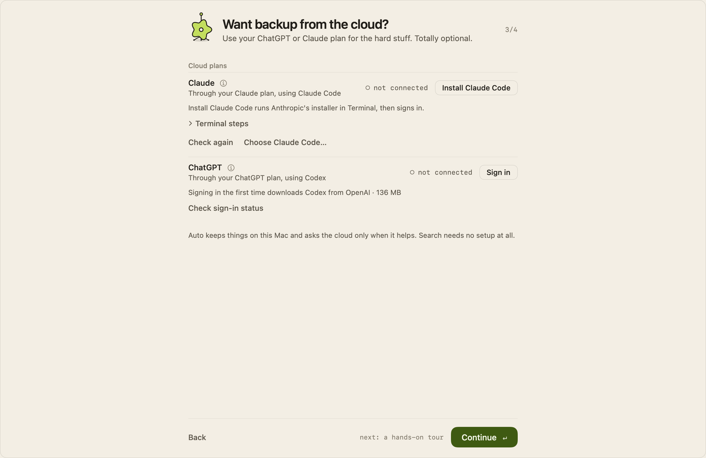
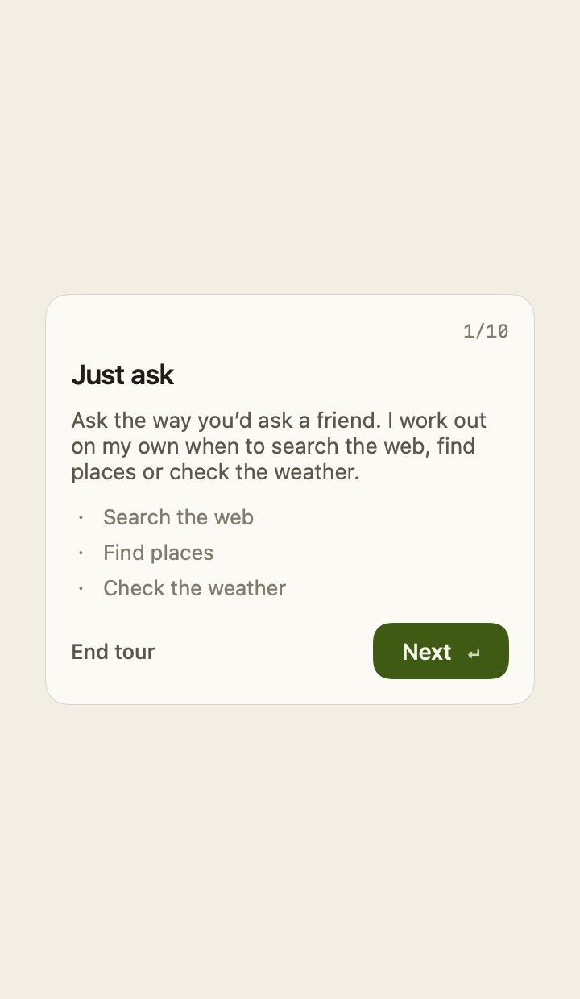
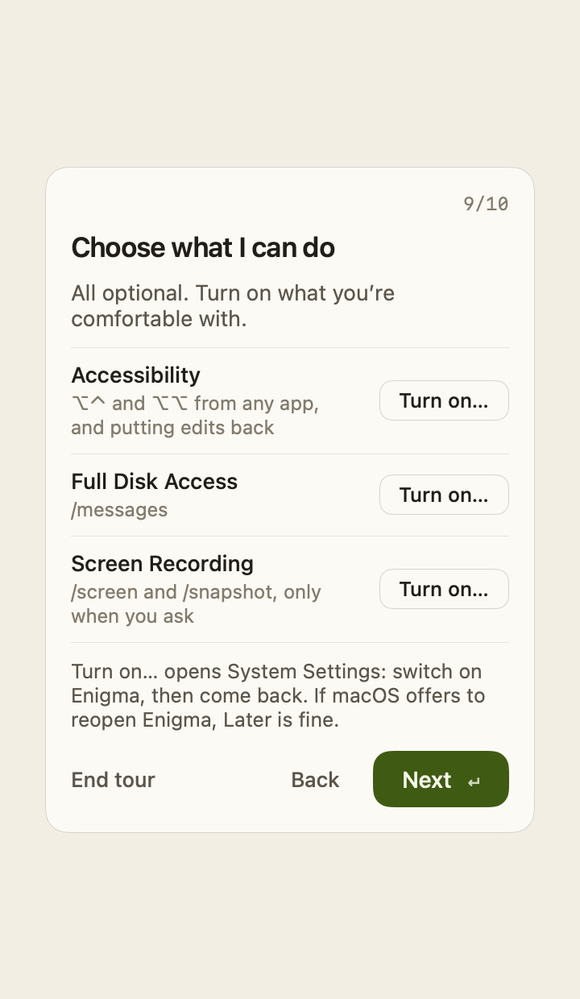
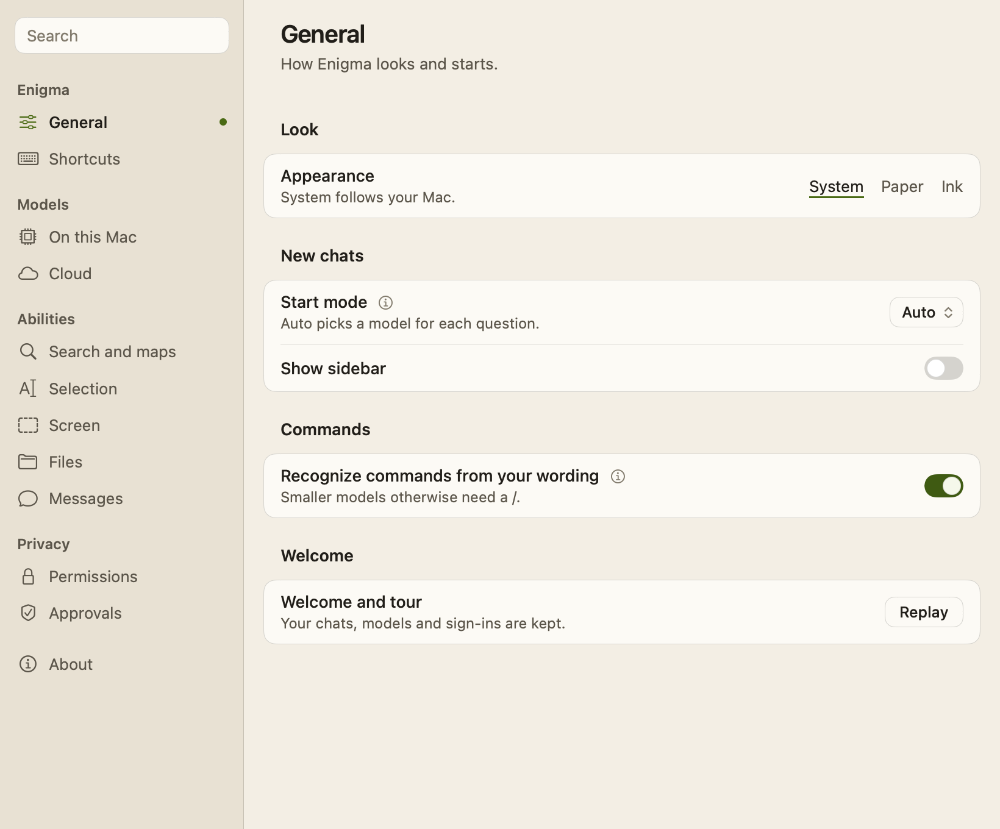
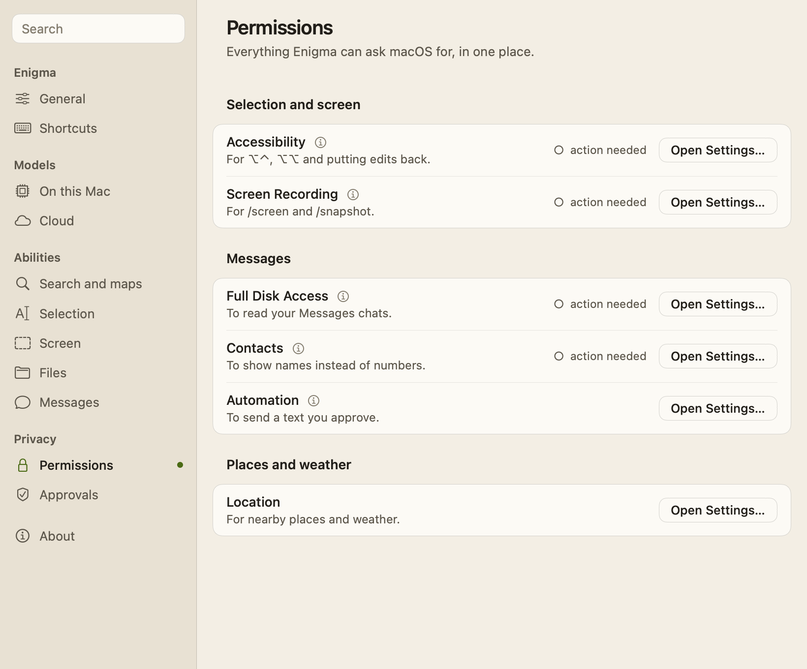
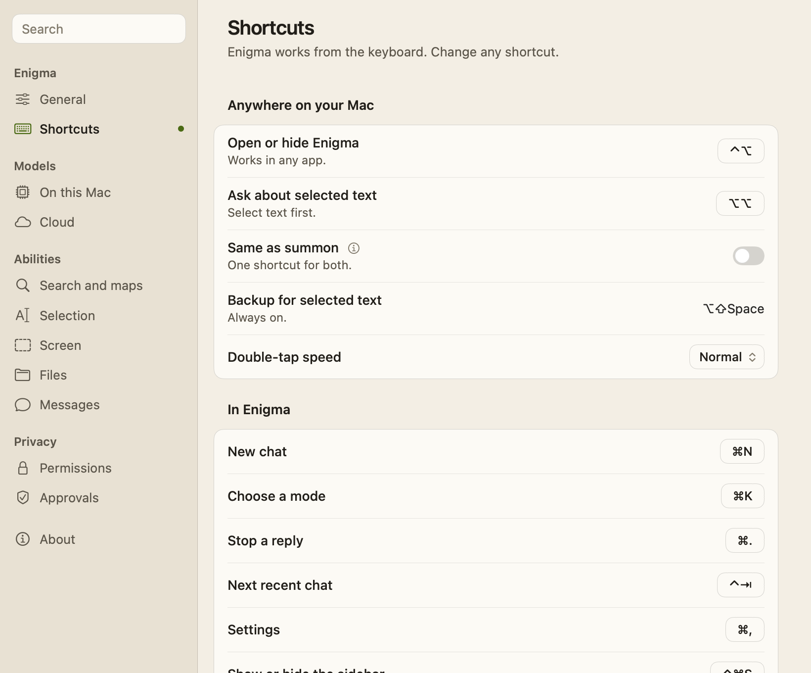

# Welcome and Settings

On first launch, Enigma walks you through a short setup (a welcome, a local
model, optional cloud plans) and then a hands-on tour of the real app. The
Settings window has a page for each part of Enigma, grouped in a sidebar with
search, and lets you change any shortcut. This page also covers how to open
Enigma and the keyboard-shortcut reference.

## Opening Enigma

Enigma lives in the menu bar and has no Dock icon. Open it with:

- **⌥⌃** (press Option and Control together, then release them, on their own) in any app. The same
  shortcut hides it again. It needs the **Accessibility** permission to work
  while another app is active. You can change it in **Settings → Shortcuts**.
- The menu bar item, which shows the Enigma character as a monochrome icon. Its
  menu has **Open**, **New Chat**, **Privacy Hide** (hides the window),
  **Check for Updates…**, **Settings**, and **Quit**. When an update is
  waiting, an item to install it appears above **Check for Updates…** (see
  [Updates.md](Updates.md)).
- Selected text in another app, then the selection shortcut (Option twice by
  default), which opens a temporary chat about the selection. See
  [Selection-Context.md](Selection-Context.md).

**Esc** hides the window.

## Welcome setup

Setup fills the Enigma window, in the current appearance. While it runs, the
window grows to at least 1280 × 860 points, centered on its display; the normal
size comes back when setup and the tour end, and the larger size is never saved
as your window size. The Enigma character flies from step to step, and to
whatever you click. Each step has one primary button, which Return presses.

1. **Hi, I'm Enigma.** A welcome sign with a message box that types example
   questions on its own, from "cafes near me" to `/think plan my week`. Choose
   **Get started**.
2. **Pick a brain for me.** Enigma shows this Mac's memory, free storage, and
   chip, then up to three models: the same roles as **Settings → On this
   Mac**, tagged **recommended** (or **best available, expect longer waits**
   on a Mac where no model is fast), **faster** and **smarter, slower
   replies**. Each row shows capability, expected speed, and download size.
   Models that don't fit the Mac's memory or storage are never listed. **Skip
   local models** uses cloud models only. The primary button changes with your
   choice: **Install model**, **Update model**, **Use this model**, or
   **Continue**. Return never starts a download; click the button instead.
   Downloads are verified before they are installed, and **Continue** appears
   only once the chosen model is installed, current, and selected. Setup's
   first performance check calibrates this Mac; installing another model in
   the same setup skips the check. See
   [Local-Model-Selection.md](Local-Model-Selection.md).

   

3. **Want backup from the cloud?** Optional: **ChatGPT** and **Claude** use
   your plan, with the same sign-in rows as **Settings → Cloud** (details
   behind each row's ⓘ). Search needs no setup at all. See
   [ChatGPT-Setup.md](ChatGPT-Setup.md) and
   [Claude-Code-Setup.md](Claude-Code-Setup.md).

   

4. **Let me show you around.** Lists the tour's stops. Choose **Show me
   around** for the tour, or **Skip the tour**. If neither a local model nor a
   cloud connection is ready, this step says so: you'll need one before
   sending a message.

Leaving setup selects **Auto** for the current chat and sets **Start mode** to
Auto, whether or not a model or cloud account is ready. Setup doesn't grant any
permissions; the tour's last stops offer them.

### The tour

The tour runs in the real main window. The window grows by a rail on its right
for the tour's card, so the card never covers the chat; the page keeps its
width while the window grows and shrinks. The card sits level with what the
stop points at, and the character perches on it.

Everything is scripted: questions type themselves into the message box, and
**Return** or the card's button takes each step. Replies are examples, played
in a temporary chat that never reaches Recents, and nothing is sent anywhere.

Ten stops, some with a checklist of steps:

1. **Just ask**: search the web, find places, check the weather, in plain words.
2. **Code, and thinking it through**: a coding question, then `/think`.
3. **Always one keystroke away**: ⌥⌃ in any app, ⌥⌥ for a selection, Esc to
   hide, menu bar only, and kept out of screenshots.
4. **Ask about anything you select**: a pretend "Shmoogle Docs" window opens
   and Enigma's window steps aside. ⌥⌥ (or Return) opens the real selection
   panel under the selected line, a question gets a revised-text card, and
   **Replace text** puts it back into the pretend document.
5. **Bring your files**: attaching with **+** or ⇧⌘A, and undo.
6. **Your Messages, in your own words**: read and search a chat, ask for a
   text, and approve it on the real approval card. Nothing is sent.
7. **Start fresh anytime**: ⌘N or **New chat**.
8. **Auto is on by default**: the mode menu (⌘K), and what to expect.
9. **Choose what I can do**: Accessibility, Full Disk Access and Screen
   Recording, each with **Turn on…**, all optional. Only Screen Recording
   needs Enigma to restart: it works the next time Enigma opens, or right away
   with **Restart now**, and a restart mid-tour picks up at the same stop.
10. **You're all set**: Help lists every shortcut, and Settings → General
    replays the tour.

**End tour** or Esc leaves at any stop: the window returns to its normal size
and the pretend document closes.

### When setup appears

- A fresh install shows setup on first launch.
- An existing install with a local model, or one that had dismissed the older
  model onboarding, is marked as set up and doesn't see it. Instead, the empty
  chat shows **See what Enigma can do** once, with **Take the tour** and
  **Not now**; either answer retires it.
- Quitting partway through resumes at the same step next time. Installation and
  account status are read from their own stores, so an interrupted model
  choice must be confirmed again.
- **Settings → General → Welcome → Replay** starts again from the first step.
  It closes Settings and shows the window. Replay keeps your chats, installed
  models, and credentials, and is unavailable while a response is running or a
  model is being installed or checked.

## Settings

Open Settings with **⌘,** while Enigma is active, the menu bar item's
**Settings**, the sidebar's **Settings** row (or the gear when the sidebar is
hidden), or the mode and model menu (**⌘K**): **Advanced settings…** opens
**Cloud** with Advanced open, and **Manage models in Settings…** opens **On
this Mac**. Connection buttons elsewhere in the app open **Cloud**.

The Settings window is 820 × 680 points. It follows the appearance setting,
floats at the same level as the chat window, and, like the chat window, asks
macOS to leave it out of screen captures and sharing (best effort).

The sidebar groups the pages: **Enigma** (General, Shortcuts), **Models** (On
this Mac, Cloud), **Abilities** (Search and maps, Selection, Screen, Files,
Messages), **Privacy** (Permissions, Approvals), and **About**. The search
field above it filters the pages by their names and what's on them, including
details and Advanced rows; Return opens the first match.

Each section's rows sit on a card under a bold heading. Rows keep to a title
and at most one short subtitle; a row's longer explanation is behind its ⓘ.
Rarely needed settings are under a page's **› Advanced**.

- **General:** **Look → Appearance** (System, Paper, or Ink; see
  [design/UI-Style.md](design/UI-Style.md)); **New chats → Start mode** (Auto,
  Local, or Cloud) and **Show sidebar**, used at launch, for each new chat, and
  for each selection chat; **Commands → Recognize commands from your wording**
  (off by default; see
  [Slash-Commands.md](Slash-Commands.md#recognized-commands)); **Welcome →
  Replay**.
- **Shortcuts:** every shortcut, changeable (see [Keyboard
  shortcuts](#keyboard-shortcuts)).
- **On this Mac:** this Mac's memory, disk, chip and memory bandwidth, with
  **Check this Mac** and **Check performance**; **For this Mac**, **On this
  Mac**, **All models**, **Files** (the **Local file tools** runtime and
  **Saved file changes**), and **Advanced: Import text GGUF…**. See
  [Local-Model-Selection.md](Local-Model-Selection.md).
- **Cloud:** one row each for **ChatGPT** and **Claude**, with their status and
  one button. **› Advanced** has the preferred provider and model, a manual
  model ID, ChatGPT's thinking capacity or Claude's effort, the model list,
  and **API keys** for OpenAI, Anthropic and Gemini. See
  [Cloud-Model-Selection.md](Cloud-Model-Selection.md).
- **Search and maps:** **Search automatically**, the web search status, and
  **Use location for nearby questions**. **› Advanced** has the optional Brave
  Search key and **Blocked sites**. See [Web-Search.md](Web-Search.md).
- **Selection:** **Automatically replace selected text** for `/edit`, **Keep
  selection chats private**, and links to Accessibility and the selection
  shortcut. See [Selection-Context.md](Selection-Context.md).
- **Screen:** sending screenshots to the cloud, and a link to Screen Recording.
  See [Screen-Skill.md](Screen-Skill.md).
- **Files:** how attaching and changes work. See [File-Mode.md](File-Mode.md).
- **Messages:** where your texts go, with links to its permissions and to
  **Approvals**. See [Messages.md](Messages.md).
- **Permissions:** every macOS permission Enigma uses, with its status and
  **Open Settings…**: Accessibility and Screen Recording; Full Disk Access,
  Contacts and Automation for Messages; and Location. If an older copy of
  Enigma is already listed in System Settings, remove it and add the app
  you're running, then quit and reopen Enigma.
- **Approvals:** everything you've answered with **Always**, each with where
  the text goes and **Remove**. See [Messages.md](Messages.md#permission-cards).
- **About:** the version, when Enigma last checked, **Check Now**, and the
  automatic update switches. See [Updates.md](Updates.md).

Old links to the former pages still work: `general`, `local`, `cloud`,
`selection`, and `discover` (which opens On this Mac).

## Location

When you ask about local weather or nearby places, and the question doesn't
name a place, Enigma can use your approximate location. This only happens as
part of a search, places lookup or weather check.

- macOS asks for location permission the first time a qualifying question is
  sent.
- Enigma requests one precise location. It rounds the coordinates to two
  decimal places, about 1 km, before looking up the area name with Apple MapKit
  or sending them to Apple Maps or Open-Meteo. Search sites get only your city.
  When Enigma searches for a nearby question, the model answering, local or
  cloud, gets the area and your exact coordinates in that request's context;
  on models that use tools, `find_places` gives distances measured from them.
- The location isn't saved with your prompt or reused for later requests, and
  there is no background tracking. The answer may name the area and is saved
  like any other chat.
- If location is off, denied, or doesn't arrive within 20 seconds, Enigma asks
  you to include a city or area instead. Stop and New chat cancel a pending
  request.

Detection is a local check of common English phrasing such as "near me",
"nearby", or "weather today". See [Web-Search.md](Web-Search.md).

## Keyboard shortcuts

**Settings → Shortcuts** lists every shortcut, and any of them can be changed:
click its button, then press the new shortcut. Esc cancels, Delete removes
it, and **Reset** or **Restore Defaults** brings back the default.

- **Anywhere on your Mac:** **Open or hide Enigma** (⌥⌃) and **Ask about
  selected text** (⌥⌥) can be keys with modifiers, modifiers pressed together,
  or a double tap of one modifier. **Same as summon** (off by default) makes
  the summon shortcut also ask about text you've just selected, and otherwise
  open Enigma as usual. **Backup for selected text** (⇧⌥ Space) is always on.
  **Double-tap speed** is Fast, Normal, or Relaxed.
- **In Enigma:** New chat (⌘N), Choose a mode (⌘K), Stop a reply (⌘.), Next
  recent chat (⌃ Tab), Settings (⌘,), Show or hide the sidebar (⌃⌘S), Open a
  selection chat in the window (⌘O), and Attach files (⇧⌘A). These need ⌘, ⌃
  or ⌥, so typing never sets them off.
- **Commands:** any slash command can have its own shortcut, which starts it
  in the message box.

A shortcut another Enigma action already has is refused. One macOS uses for
something common, like ⌘Space, is allowed with a warning. A global shortcut
that can't be registered, because another app holds it, says so on its row,
and the one before it keeps working.

The **Help** row at the bottom of the sidebar (or the **?** button when the
sidebar is hidden) lists your current shortcuts, with the Accessibility status
and **Open Accessibility Settings…**. Esc hides the window; Return sends and
⇧ Return inserts a new line; ↑ and ↓, then Tab or Return, choose a slash
command. Slash commands are listed in [Slash-Commands.md](Slash-Commands.md).

## Privacy and permissions

- Setup, the tour and Settings never grant permissions themselves. They show
  status and open the right pane of System Settings.
- Setup stores only its own progress and completion; the tour stores only the
  stop to resume at after a restart. Model files, chats, and credentials are
  untouched by setup, the tour and Replay.
- The tour never sends anything: its replies are scripted, its chats are
  temporary, and its text to "Sam" is never sent.
- API keys and the optional Brave Search key are stored in the Keychain. ChatGPT and Claude
  sign-ins are owned by Codex and Claude Code.
- Location is requested only for qualifying questions, rounded before use, and
  never stored (see above).

## How it works

| Area | Files |
| --- | --- |
| Setup state: steps, first-run detection, resume, replay, model choices, character slots | `Enigma/App/WelcomeSetup.swift` (`WelcomeSetup`) |
| Setup views; the welcome sign's typewriter and the character's perches | `Enigma/App/WelcomeSetupView.swift`, `Enigma/App/WelcomeTypewriter.swift` |
| The tour: stops, steps, scripted replies, the rail card, placement, the invite | `Enigma/App/GuidedTour.swift` (`GuidedTour`, `GuidedTourPlacement`, `TourTarget`, `TourInvite`) |
| The selection stop's pretend document | `Enigma/App/TourDocumentWindow.swift` (`TourDocumentWindow`, `TourScene`) |
| The tour's window: growing by the rail, fades, display-synced moves | `Enigma/App/SpotlightPanelController.swift`, `Enigma/App/AppShellView.swift` |
| Settings window, sidebar, search and destinations | `Enigma/App/SettingsView.swift` (`SettingsView`, `SettingsDestination`, `SettingsRequest`); window controller in `Enigma/App/AI_SpotlightApp.swift` |
| Settings pages, links and Advanced | `Enigma/App/SettingsPages.swift` |
| Settings cards | `Enigma/App/SettingsCards.swift` |
| Shortcuts you choose | `Enigma/App/ShortcutStore.swift` (`KeyBinding`, `ShortcutAction`, `ShortcutStore`), `Enigma/App/ShortcutEditor.swift` |
| Global shortcuts | `Enigma/App/GlobalHotKeyMonitor.swift` (`PanelShortcutMonitor`, `ShortcutHotKeys`), `Enigma/App/SelectionShortcut.swift`, registered in `Enigma/App/ApplicationDelegate.swift` |
| Help sheet | `Enigma/App/KeyboardShortcutsHelpView.swift`, `KeyboardShortcutsHelp` in `Enigma/App/EnigmaMainWindowLogic.swift` |
| Appearance, start mode and sidebar | `Enigma/App/EnigmaAppearancePreference.swift`, `Enigma/App/StartPreferences.swift` |
| Mac permission rows | `Enigma/Screen/MacPermissionRows.swift` |
| Location | `Enigma/Search/LocationService.swift` |
| Menu bar item | `Enigma/App/MenuBarController.swift`, `Enigma/App/AppCommand.swift` |
| Settings sections owned by features | `Enigma/Cloud/CloudSettingsPage.swift`, `Enigma/Cloud/CloudConnectionControls.swift`, `Enigma/Search/WebSearchSettingsSection.swift`, `Enigma/Screen/ScreenSettingsSection.swift`, `Enigma/LocalInference/LocalModelManagerSection.swift`, `Enigma/Messages/MessagesSettingsSection.swift` |

Preferences are stored in `UserDefaults`: `welcomeSetup.completed.v1` and
`welcomeSetup.step.v1` for setup, `guidedTour.stop.v1` (the stop to resume at)
and `guidedTour.invite.v1` for the tour, `enigma.shortcuts.overrides.v1` and
`enigma.shortcuts.selectionSameAsSummon.v1` for shortcuts, `enigma.appearance`,
`startup.preferredMode`, `startup.showSidebar`, `location.enabled`, and
`composer.inferCommands`. Invalid saved values fall back to the defaults.
Settings pages can be opened programmatically by posting `.settingsRequested`
with a `SettingsView.SettingsDestination`, or a `SettingsView.SettingsRequest`
to open the page's Advanced too.

## Limitations

- Leaving setup, including after Replay, resets **Start mode** to Auto.
- ⌥⌃ and other modifier-only shortcuts can't be registered as system hot keys,
  so they're detected by watching modifier keys and need Accessibility to work
  in other apps. They are ignored while secure text entry is active.
- The warning for macOS shortcuts covers common ones only (Quit, Close, Hide,
  Minimize, Copy, Paste, Cut, Undo, Select All, the app switcher and
  Spotlight), not every app's.
- Location detection recognizes common English phrasing only.
- The checked-in screenshots come from deterministic fixtures, not a live Mac.

## Tests

- `EnigmaTests/EnigmaWelcomeTests.swift`: the step counter and navigation, the
  character's slots, the model step's button and Return behavior, one
  performance check per setup, the tour invite for existing users only,
  rendering every step and tour stop, and focus returning to the chat after
  every way of leaving.
- `EnigmaTests/EnigmaMainWindowTests.swift`: the tour card in its rail taking
  Return and its button, placement level with its target, the selection stop
  running the real panel over the pretend document, the Messages stop's real
  approval card, tour chats kept out of Recents, first-run versus existing
  install, and the Help shortcut text.
- `EnigmaTests/AppCommandTests.swift`: the setup and tour window sizes, leaving
  the tour from every stop, resuming after a restart, saved key names, default
  and changed shortcuts, refused and warned clashes, Help listing a changed
  shortcut, and a shortcut that fails to register.
- `EnigmaTests/EnigmaSettingsTests.swift`: appearance; every page rendered in
  Paper and Ink, with Advanced open on Cloud and Search; old destination
  names; Advanced settings… opening Cloud with Advanced open; search; cards;
  no monospace; the cloud plan rows; the update switches; API and Brave keys;
  blocked sites; permission status text.
- `EnigmaTests/LocalModelSelectionTests.swift`: first-run detection, resume,
  migration of existing installs, replay, and the model step's choices.
- `EnigmaTests/AppShellStateTests.swift`: starting from saved preferences and
  resetting to Auto after setup.
- `EnigmaTests/WebSearchTests.swift`: location detection, rounding, settings,
  and failure handling.
