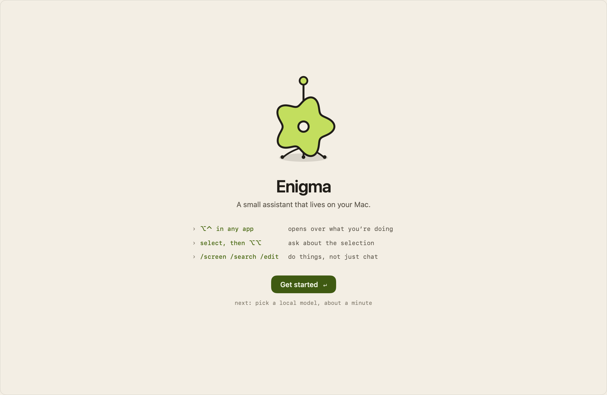
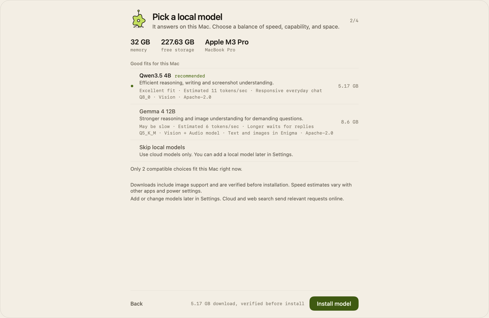
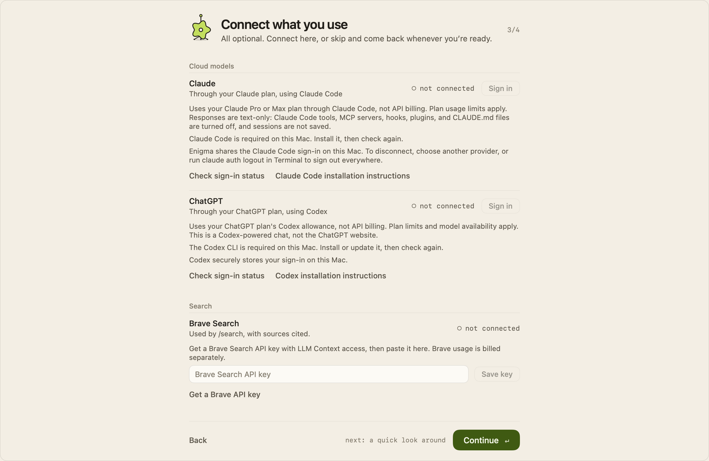
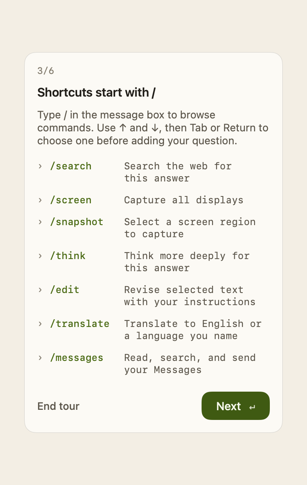
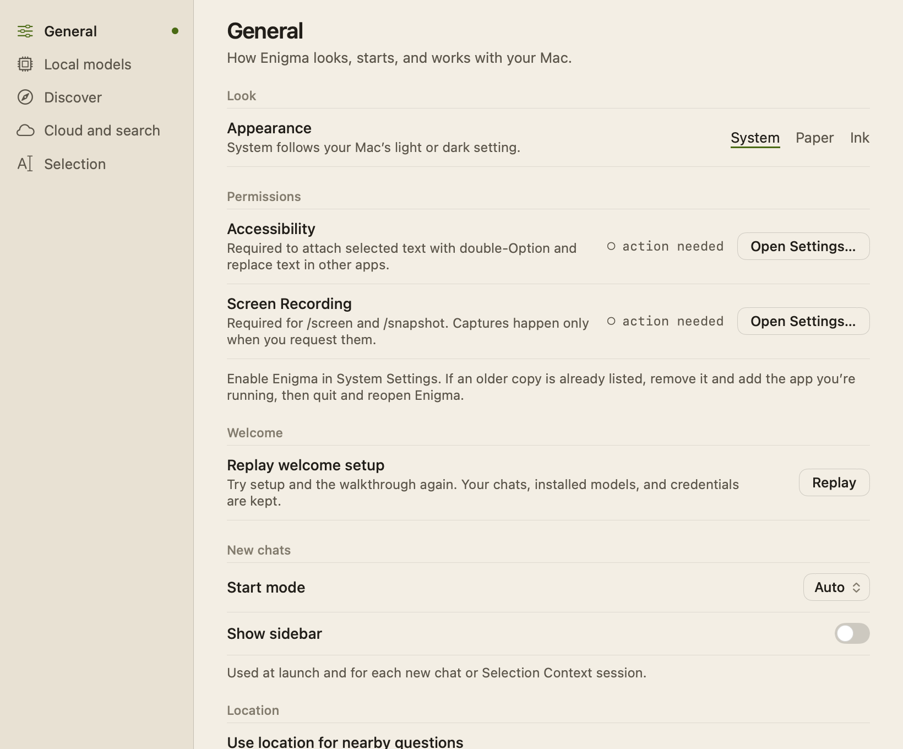

# Welcome and Settings

On first launch, Enigma walks you through a short setup: a welcome, a local model
choice, optional connections, and an optional tour of the window. Afterwards,
the Settings window holds appearance, permissions, startup preferences, models,
connections, and selection options. This page also covers how to open Enigma
and the keyboard-shortcut reference.

## Opening Enigma

Enigma lives in the menu bar and has no Dock icon. Open it with:

- **⌥⌃** (press Option and Control together, then release them, on their own) in any app. The same
  shortcut hides it again. It needs the **Accessibility** permission to work
  while another app is active.
- The menu bar item, which shows the Enigma character as a monochrome icon. Its
  menu has **Open**, **New Chat**, **Privacy Hide** (hides the window),
  **Settings**, and **Quit**.
- Selected text in another app, then the selection shortcut (Option twice by
  default), which opens a temporary chat about the selection. See
  [Selection-Context.md](Selection-Context.md).

**Esc** hides the window.

## Welcome setup

Setup fills the Enigma window, in the current appearance. While it runs, the
window grows to at least 1280 × 860 points, centered on its display; the normal
size comes back when setup and the tour end, and the larger size is never saved
as your window size. The hand-drawn Enigma character appears large on the first
step, then sits beside the title of each later step, next to a step counter such
as `2/4`. Each step has one primary button, which Return presses.

1. **Welcome.** A greeting and the three ways to use Enigma: ⌥⌃ in any app,
   the selection shortcut (shown only while the double-tap shortcut is on), and
   slash commands such as `/screen`, `/search`, and `/edit`. Choose
   **Get started**.
2. **Pick a local model.** Enigma shows this Mac's memory, free storage, and
   chip, then up to three models under **Good fits for this Mac**. The first is
   marked **recommended**, or **best available, expect longer waits** on a Mac
   where no model is responsive. Each row shows capability, expected speed, and
   download size. Models that don't fit the Mac's memory or storage are never
   listed. **Skip local models** uses cloud models only. The primary button
   changes with your choice: **Install model**, **Update model**,
   **Use this model**, or **Continue**. Return never starts a download; click
   the button instead. Downloads are verified before they are installed, and
   **Continue** appears only once the chosen model is installed, current, and
   selected. If a performance check reorders the recommendations, the model you
   chose stays in the list. See [Local-Model-Selection.md](Local-Model-Selection.md).

   

3. **Connect what you use.** Everything here is optional.
   - **Claude** and **ChatGPT** use the same sign-in controls as Settings. See
     [Claude-Code-Setup.md](Claude-Code-Setup.md) and
     [ChatGPT-Setup.md](ChatGPT-Setup.md).
   - **Brave Search** has a secure key field and **Save key** (Return in the
     field also saves). The key goes to the Keychain, and the field clears. The
     status reads **key saved · not tested here** once a key is stored. See
     [Web-Search.md](Web-Search.md).
   - **Mac permissions** shows Accessibility and Screen Recording, each with
     **Open Settings…**.
   - **More connection settings** opens Settings on **Cloud and search** in a
     sheet, with **Back to setup** at the top.

   The character listens while you type a key, and shows its error state if a
   connection or key save fails.

   

4. **Make yourself at home.** Choose **Show me around** for the tour, or
   **Finish without the tour**. If neither a local model nor a cloud
   connection is ready, this step says so: you'll need one before sending a
   message.

Leaving setup selects **Auto** for the current chat and sets **Start mode** to
Auto, whether or not a model or cloud account is ready. Setup doesn't grant any
permissions; Screen, selection, and location access are requested when you
first use those features.

### The tour

The tour has six stops, each highlighting the real control in the window with a
card beside it: chat history, the message box, slash commands (listing the
available commands), files, the mode and model menu, and Help. Choose **Next**
to move on; the last stop's button is **Finish setup**. **End tour** or Escape
leaves at any point. The card stays inside the window at any size, with the
sidebar shown or hidden.

### When setup appears

- A fresh install shows setup on first launch.
- An existing install with a local model, or one that had dismissed the older
  model onboarding, is marked as set up and doesn't see it.
- Quitting partway through resumes at the same step next time. Installation and
  account status are read from their own stores, so an interrupted model
  choice must be confirmed again.
- **Settings → General → Replay welcome setup → Replay** starts again from the
  first step. It closes Settings and shows the window. Replay keeps your chats,
  installed models, and credentials, and is unavailable while a response is
  running. The sidebar's **Developer Tools** has the same **Replay welcome
  setup** action, plus **Detect Mac capabilities**.

## Settings

Open Settings with **⌘,** while Enigma is active, the menu
bar item's **Settings**, the sidebar's **Settings** row (or the gear when the
sidebar is hidden), or **Advanced settings…** / **Manage models in Settings…**
in the mode and model menu (**⌘K**). Connection buttons elsewhere in the app
open it directly on **Cloud and search**.

The Settings window is 820 × 680 points with a list of pages on the left. It
follows the appearance setting, floats at the same level as the chat window,
and, like the chat window, asks macOS to leave it out of screen captures and
sharing (best effort).

### General

How Enigma looks, starts, and works with your Mac.

- **Look → Appearance:** **System**, **Paper**, or **Ink**. Paper is the light
  theme and Ink the dark one; System follows the Mac's light or dark setting.
  The change applies to every Enigma window at once. The default is System. See
  [design/UI-Style.md](design/UI-Style.md).
- **Permissions:** **Accessibility** (needed for the selection shortcut,
  replacing text in other apps, and ⌥⌃ while another app is active) and
  **Screen Recording** (needed for `/screen` and `/snapshot`). Each row shows
  **enabled** or **action needed** and an **Open Settings…** button. If an
  older copy of Enigma is already listed in System Settings, remove it and add
  the app you're running, then quit and reopen Enigma.
- **Welcome → Replay welcome setup:** see above.
- **New chats → Start mode** (Auto, Local, or Cloud) and **Show sidebar**. Both
  are saved and used at launch, for each new chat, and for each selection chat.
  Changing them doesn't affect the chat you're in. The defaults are Auto with
  the sidebar hidden. Modes are explained in [Chat.md](Chat.md).
- **Location → Use location for nearby questions** (on by default) and
  **Location Services → Open Settings…**. See [Location](#location) below.
- **Messages · /messages:** Full Disk Access, Contacts, and Automation for
  `/messages`. See [Messages.md](Messages.md).

### Local models

Run models on this Mac. Recommended models grouped by weight class, with
install, update, use, and delete actions; **Refresh recommendations** and
**Check performance**; imported models; **Files** (the **Local file tools**
runtime used by local File Mode and `/messages`, and **Saved file changes**);
and **Advanced: Import text GGUF…**. See
[Local-Model-Selection.md](Local-Model-Selection.md) and
[File-Mode.md](File-Mode.md).

### Discover

Find vision and audio models on Hugging Face to download. See
[Local-Model-Selection.md](Local-Model-Selection.md).

### Cloud and search

Optional cloud models, screenshots, and web search: **Subscriptions** (ChatGPT
and Claude), **Screen** options for sending screenshots to the cloud,
**Web search · Brave**, **Advanced cloud settings** (preferred provider, model,
manual model ID, ChatGPT's thinking capacity or Claude's effort, and the model
list), and **API keys** for OpenAI, Anthropic, and Gemini. See
[Cloud-Model-Selection.md](Cloud-Model-Selection.md),
[ChatGPT-Setup.md](ChatGPT-Setup.md), [Claude-Code-Setup.md](Claude-Code-Setup.md),
[Screen-Skill.md](Screen-Skill.md), and [Web-Search.md](Web-Search.md).

### Selection

The Accessibility permission, **Automatically replace selected text** for
`/edit`, and whether selection chats are kept private. See
[Selection-Context.md](Selection-Context.md).

## Location

When you ask about local weather or nearby places, and the question doesn't
name a place, Enigma can add your approximate location to the web search. This
only happens as part of a web search, so it requires Brave Search to be set up.

- macOS asks for location permission the first time a qualifying question is
  sent.
- Enigma requests one location at kilometer accuracy and rounds the
  coordinates to two decimal places before looking up the area name with Apple
  MapKit or sharing anything. The area goes to Brave Search and into that
  request's context for the model.
- The location isn't saved with your prompt or reused for later requests, and
  there is no background tracking. The answer may name the area and is saved
  like any other chat.
- If location is off, denied, or doesn't arrive within 20 seconds, Enigma asks
  you to include a city or area instead. Stop and New chat cancel a pending
  request.

Detection is a local check of common English phrasing such as "near me",
"nearby", or "weather today". See [Web-Search.md](Web-Search.md).

## Keyboard shortcuts

The **Help** row at the bottom of the sidebar (or the **?** button when the
sidebar is hidden) opens **Keyboard shortcuts**, which lists every shortcut and
holds the selection shortcut settings.

Anywhere on your Mac:

| Shortcut | Action |
| --- | --- |
| ⌥⌃ | Show or hide Enigma: press Option and Control together, then release them, with no other key, modifier or click in between |
| Option twice | New temporary chat with selection |
| ⇧⌥ Space | Selection chat backup |

The Help sheet also has **Double-tap shortcut** (on by default),
**Selection shortcut key** (Option, Command, or Shift; Option is the default,
Command can clash with a Dictation shortcut, and Shift is Search Everywhere in
JetBrains apps), and
**Double-tap interval** (Fast, Normal, or Relaxed), with the Accessibility
status and **Open Accessibility Settings…**.

In the chat window:

| Shortcut | Action |
| --- | --- |
| Esc | Hide the window, or dismiss command suggestions |
| ⌘N | New chat |
| ⌘K | Open or close the mode and model menu |
| ⌘. | Stop the response |
| ⌃ Tab | Next recent chat |
| ⌃⌘S | Show or hide chat history |
| ⌘O | Open the selection panel's chat in the window |
| ⌘, | Open Settings |
| Return / ⇧ Return | Send / insert a new line |
| ↑ / ↓, then Tab or Return | Choose and complete a slash command |
| ⇧⌘A | Attach files or a folder |

Slash commands are listed in [Slash-Commands.md](Slash-Commands.md).

## Privacy and permissions

- Setup and Settings never grant permissions themselves. They show status and
  open the right pane of System Settings.
- Setup stores only its own progress and completion. Model files, chats, and
  credentials are untouched by setup and by Replay.
- API keys and the Brave key are stored in the Keychain. ChatGPT and Claude
  sign-ins are owned by Codex and Claude Code.
- Location is requested only for qualifying questions, rounded before use, and
  never stored (see above).

## How it works

| Area | Files |
| --- | --- |
| Setup state: steps, first-run detection, resume, replay, model choices, the button's action, character slots and states, tour steps | `Enigma/App/WelcomeSetup.swift` (`WelcomeSetup`, `WelcomeTourStep`) |
| Setup views, the tour overlay and card, and the connection settings sheet | `Enigma/App/WelcomeSetupView.swift` (`WelcomeSetupView`, `WelcomeTourOverlay`, `WelcomeTourPlacement`, `ConnectionSettingsSheet`) |
| Setup presentation, mode reset, and the temporary window size | `Enigma/App/AppShellView.swift`, `Enigma/App/ShellPresentation.swift`, `Enigma/App/SpotlightPanelController.swift` |
| Settings window, pages, General and Selection pages | `Enigma/App/SettingsView.swift` (`SettingsView`, `GeneralSettingsPage`, `SelectionSettingsPage`); window controller in `Enigma/App/AI_SpotlightApp.swift` (`SettingsWindowController`) |
| Appearance preference | `Enigma/App/EnigmaAppearancePreference.swift`, `EnigmaAppearance` in `Enigma/App/EnigmaTheme.swift` |
| Start mode and sidebar | `Enigma/App/StartPreferences.swift` |
| Mac permission rows | `Enigma/Screen/MacPermissionRows.swift` |
| Location | `Enigma/Search/LocationService.swift` (`LocationIntent`, `LocationService`) |
| Help sheet and its shortcut list | `Enigma/App/KeyboardShortcutsHelpView.swift`, `KeyboardShortcutsHelp` in `Enigma/App/EnigmaMainWindowLogic.swift` |
| Menu bar item | `Enigma/App/MenuBarController.swift`, `Enigma/App/AppCommand.swift` |
| Global shortcuts: ⌥⌃ (`PanelShortcutMonitor`), ⇧⌥ Space (`GlobalHotKeyMonitor`) | `Enigma/App/GlobalHotKeyMonitor.swift`, registered in `Enigma/App/ApplicationDelegate.swift` |
| In-window shortcuts | `Enigma/App/PanelShortcut.swift` |
| Settings sections owned by features | `Enigma/Cloud/CloudSettingsPage.swift`, `Enigma/Cloud/CloudConnectionControls.swift`, `Enigma/Search/WebSearchSettingsSection.swift`, `Enigma/Screen/ScreenSettingsSection.swift`, `Enigma/LocalInference/LocalModelManagerSection.swift`, `Enigma/LocalInference/LocalModelDiscoveryView.swift`, `Enigma/Messages/MessagesSettingsSection.swift` |

Preferences are stored in `UserDefaults`: `welcomeSetup.completed.v1` and
`welcomeSetup.step.v1` for setup, `enigma.appearance`, `startup.preferredMode`,
`startup.showSidebar`, and `location.enabled`. Invalid saved values fall back
to the defaults. Settings pages can be opened programmatically by posting
`.settingsRequested` with a `SettingsView.SettingsDestination`.

## Limitations

- Leaving setup, including after Replay, resets **Start mode** to Auto.
- ⌥⌃ can't be registered as a system hot key because it uses modifiers only, so
  it's detected by watching modifier keys and needs Accessibility to work in
  other apps. It is ignored while secure text entry is active.
- Location detection recognizes common English phrasing only.
- The checked-in screenshots come from deterministic fixtures, not a live Mac.

## Tests

- `EnigmaTests/EnigmaWelcomeTests.swift`: the step counter and navigation, the
  character's slots and states, the model step's button and Return behavior,
  saving the Brave key, tour card placement, rendering every step at minimum
  and default sizes, and focus returning to the chat after every way of
  leaving.
- `EnigmaTests/LocalModelSelectionTests.swift`: first-run detection, resume,
  migration of existing installs, replay, at most three safe choices,
  keeping the chosen model through reranking, and the continue gate.
- `EnigmaTests/EnigmaSettingsTests.swift`: appearance defaults, persistence,
  and live switching of windows and the welcome; every page rendered in Paper
  and Ink; deep links to pages; Start mode and switches; API and Brave key
  saving; permission status text.
- `EnigmaTests/AppCommandTests.swift`: startup preference persistence and
  recovery, in-window and global shortcuts, and the temporary setup window
  size.
- `EnigmaTests/AppShellStateTests.swift`: starting from saved preferences and
  resetting to Auto after setup.
- `EnigmaTests/EnigmaMainWindowTests.swift`: first-run versus existing install,
  tour targets on the real controls, and the Help shortcut text.
- `EnigmaTests/EnigmaIconTests.swift`: the menu bar icon.
- `EnigmaTests/WebSearchTests.swift`: location detection, rounding, settings,
  and failure handling.
